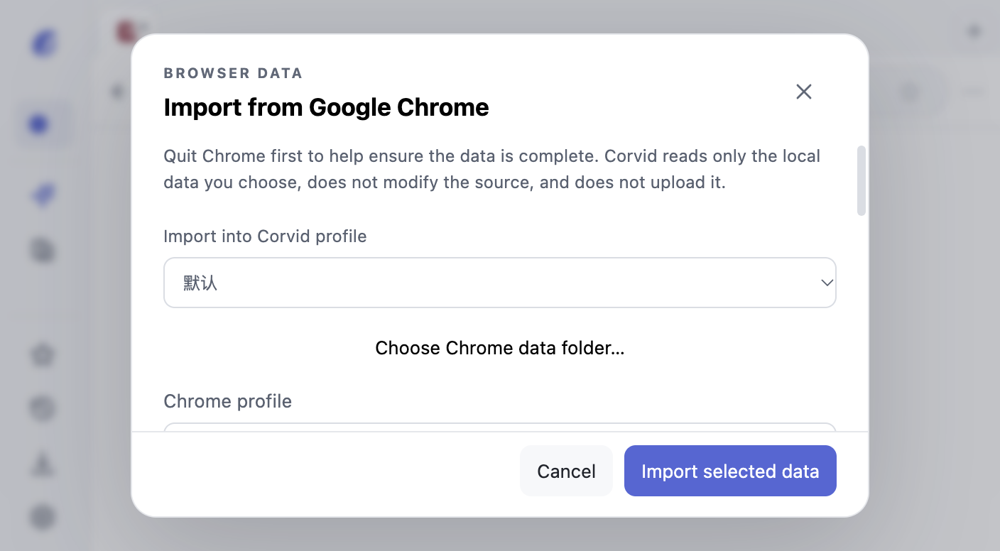

# Issue #279 Chrome 导入对话框布局验收

## 验收目标

Chrome 导入预览、分类和扩展权限较长时，标题与底部操作保持固定，预览内容在自己的滚动区内移动。用户打开对话框即可看到取消和主操作；本改动不改变来源读取、Cookie 同意、分类选择或目标浏览身份合同。

## UI 证据与判断

- **Corvid 直接观察**：隔离 Electron + 合成 Chrome Profile 运行 `tests/chrome-import-e2e.cjs`。1280×850 窗口（renderer viewport 约 1280×818）显示导入预览顶端；704×420 窗口显示较短内容视口。两种状态下取消和导入按钮都在对话框可见范围内；滚动预览后标题与底部操作的边界不移动；从最后一个扩展勾选项按 Tab 依次到达取消和导入按钮，点击底部取消后 dialog 确实关闭。截图见本记录下方。
- **Corvid 静态证据**：`desktop/index.html` 把预览内容和底部操作拆为独立容器；`desktop/styles.css` 将 dialog form 设为三行布局、仅预览行滚动，扩展权限清单不再嵌套二级滚动条；`desktop/renderer.js` 的底部取消按钮调用同一关闭路径。
- **参考细节**：Issue #18 已记录 Kobra Alert 运行态 REA Evidence `ev_7dbddd29058eef11227135f0879409777f91101dca4a0c7d543d9886057d2f61`，用于参考状态信息贴近相关内容的呈现方式；它不证明固定页脚布局，也没有把 Kobra 样式或代码移植到 Corvid。本轮对该 Evidence ID 的 REA retained-record 查询返回 0 条匹配记录，因此没有重新观察 Kobra 页面；该参考只保留为 Issue #18 中的既有上下文。
- **推断**：将浏览内容与稳定操作区分开，可以减少用户寻找提交入口的成本，并避免短窗口中按钮被长权限文案推到视口外。实际收益由本地合成 fixture 的可见边界与滚动断言验证。
- **未知**：未覆盖系统深色模式、屏幕阅读器播报、打包应用、Windows/Linux、极长扩展权限列表以及真实用户 Chrome 资料；这些不由本记录的定向 E2E 证明。

## 验证方式与结果

- 命令：`CORVID_TEST_CATEGORY_ISOLATION_ONLY=1 env -u ELECTRON_RUN_AS_NODE node tests/chrome-import-e2e.cjs` 与 `env -u ELECTRON_RUN_AS_NODE node tests/chrome-import-e2e.cjs` 均 EXIT 0。前者覆盖本次双语/尺寸矩阵；后者通过完整 Chrome 导入回归。
- 环境：2026-11-04，macOS arm64，Node.js v24.22.1，Electron 45.2.1；独立 worktree `/private/tmp/corvid-issue18-import-cta`；Electron 测试使用临时 `CORVID_DATA_DIR`，原生资料选择器由测试替身返回合成 Chrome Profile。
- 覆盖：中文/英文各在 1280×850 和 704×420 窗口运行；检查操作按钮在视口内不被水平或垂直裁切、内容区域确有独立滚动、滚动不移动标题/操作栏、从末项扩展复选框按 Tab 可依次到达底部取消和主操作、点击底部取消确实关闭 dialog、可导入类别变化时提交按钮仍正确启用/禁用。完整 E2E 另覆盖合成 Cookie 解密/写入/隔离/持久化和扩展迁移等既有路径。
- 数据边界：使用两个合成 Chrome Profile、书签/历史 fixture、合成 Cookie 密钥与本地扩展权限清单；没有读取本机 Chrome 资料、真实 Cookie 或系统钥匙串，没有访问真实网页、调用模型或执行 OAuth。定向变量在类别隔离检查后退出、不会导入写入；完整 E2E 只操作隔离目录内的合成资料。
- 辅助检查：`node --check tests/chrome-import-e2e.cjs`、`node --check desktop/renderer.js`、`git diff --check` 通过。Impeccable detector 对相关 HTML/CSS 扫描完成；结果包含本文件范围外的既有 eyebrow/警示边框/卡片阴影与对话框间距提示，未阻断本次固定操作区。检测器未提供可靠的单一组件隔离结果。

## 截图

下列截图来自本地合成 fixture，不包含账户或用户浏览数据：

| 窗口大小 | 简体中文 | English |
| --- | --- | --- |
| 1280×850 |  |  |
| 704×420 |  |  |
