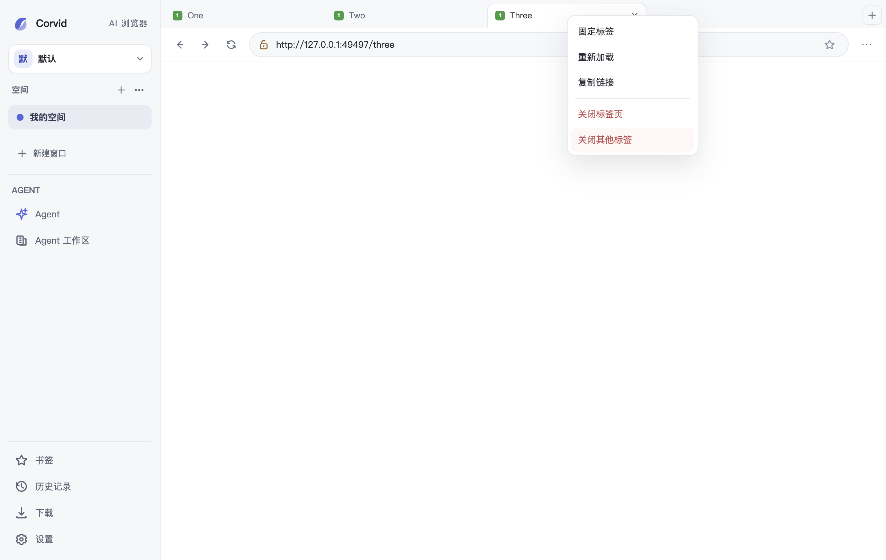
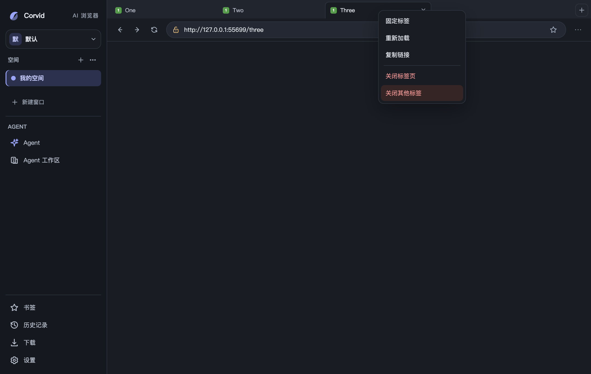
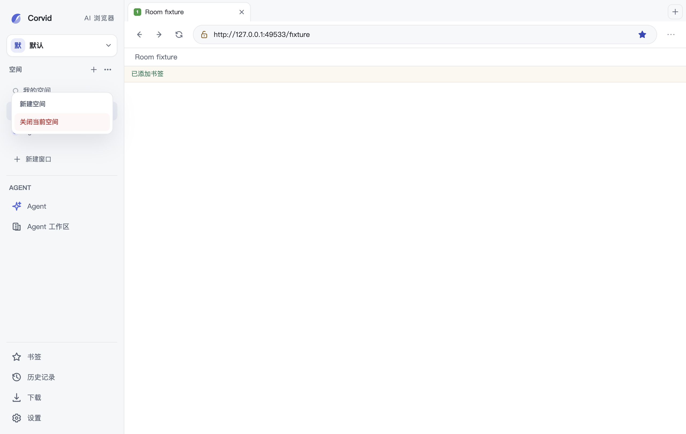
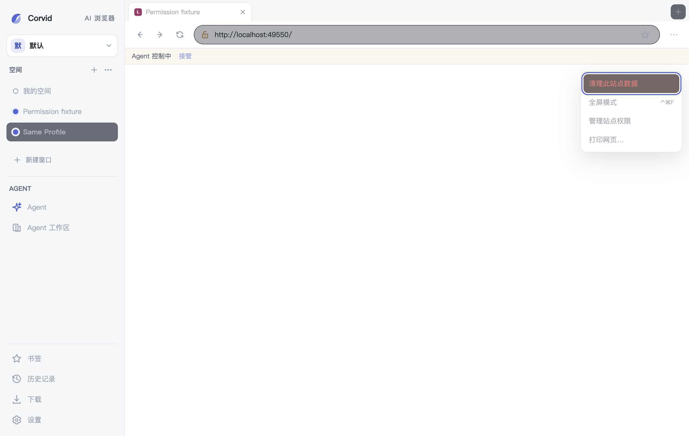

# 桌面 UI 视觉检查记录

## 2026-11-06 新标签起始页双语（Issue #130 子切片 A1）

- 环境与截图：macOS arm64、隔离真实 Electron 45.2.1、隔离 `CORVID_DATA_DIR`、BrowserWindow 1024×700，`capturePage` 渲染真实像素：[zh-CN 起始页](screenshots/issue-130/issue-130-startpage-zh-CN-1024x700.png)（SHA-256 前缀 `bbe20d67`）、[en 起始页（切换语言后新建标签）](screenshots/issue-130/issue-130-startpage-en-1024x700.png)（`3b20b659`）。页面为空白起始页无个人数据。
- 直接观察：en 模式起始页全部文案为英文（Where to next? / Search the web or enter an address / Top bookmarks / All bookmarks / Browsing history / Corvid Agent 及 aria-label），无中文残留；zh 模式文案不回归。切语言后已打开的起始页保留原语言，新建标签使用新语言（合同记录于[本地化架构](../architecture/localization.md)）。
- 断言与边界：closed shadow DOM 不可被页面侧探测，`tab-ux-e2e` 以宿主元素 `data-home-locale`/`data-home-heading` 镜像断言（zh-CN → en 切换 → 新标签 en 文案且无中文字符 → 恢复 zh-CN）；渲染像素由本截图佐证。未覆盖：VoiceOver 实播、Windows 字体回退、徽标兜底字符的逐 locale 视觉核对（en 兜底 'W' 由源码与测试路径覆盖）。

## 2026-11-06 原生控件统一自绘外观（Issue #208）

- 环境与截图：macOS arm64、隔离真实 Electron 45.2.1、隔离 `CORVID_DATA_DIR`，由 `native-controls-e2e` 在真实交互中生成（`CORVID_NATIVE_CONTROLS_QA_DIR`），BrowserWindow 1024×700：[onboarding zh-CN 浅色](screenshots/issue-208/issue-208-onboarding-zh-CN-light.png)（SHA-256 前缀 `392fec4f`）、[设置·外观 zh-CN 浅色](screenshots/issue-208/issue-208-settings-zh-CN-light.png)（`2675be46`）、[zh-CN 深色](screenshots/issue-208/issue-208-settings-zh-CN-dark.png)（`1e5fa62c`）、[en 浅色](screenshots/issue-208/issue-208-settings-en-light.png)（`4fb06e03`）、[en 深色](screenshots/issue-208/issue-208-settings-en-dark.png)（`66507788`）。
- 直接观察：设置中心全部 select（主题/语言/搜索引擎/启动/新标签页等 8 处）与侧栏身份下拉不再呈现原生控件外观，统一为 token 化边框 + 自绘 caret（浅色 `#6e7786`、深色 `#a4afbf`，10×6px 右置）；checkbox 为 14px 自绘方框、选中态 accent 底白勾（`#ask-where-to-save` 与 Chrome 导入类目等 6 处，原 accent-color 原生方框弃用）；身份下拉获得系统弹层外的自绘 affordance，且 `.profile-switcher:focus-within` 以 accent 描边 + 光晕显示键盘焦点（原先 outline:0 完全不可见，Tab 首项即此控件）；输入高度收敛三档：身份下拉 28px、面板/工具栏输入与模型选择器触发器 32px、对话框/设置输入 36px；查找条输入补齐 32px。模型搜索式 listbox 已由 PR #242 交付，本轮未重复。
- 视觉判断：caret/勾选图形均为低装饰密度线性图形，随主题换色，不与现有 1.7 描边图标体系冲突；自绘后 select 弹开选项列表仍由系统提供（跨平台弹层样式一致性留待后续切片）。
- 未覆盖：Windows/Linux 系统弹层差异、打包版、VoiceOver 实播；checkbox checked 态截图为运行态计算样式断言（accent 底 5.71:1 白勾），未逐张截取。

## 2026-11-06 低对比文字与过小字号系统清理（Issue #204）

- 环境与截图：macOS arm64、隔离真实 Electron 45.2.1、隔离 `CORVID_DATA_DIR`（首启 onboarding 弹层）、BrowserWindow 1024×700（Retina PNG 2048×1336），zh-CN/en × 浅/深主题共 8 张，均由脚本驱动真实 hover 生成，无个人资料：onboarding 主按钮 hover 态 [浅色中文](screenshots/issue-204/issue-204-onboarding-hover-zh-CN-light.png)（SHA-256 `5050961f103e5ebfca3cc97696e99eeae11c86e93c1260c08fc362feaee8bcc4`）、[深色中文](screenshots/issue-204/issue-204-onboarding-hover-zh-CN-dark.png)（`a2b9e2bcd568ae7774bb9dbad949b5abba5828b2466f4e310753d372284f4b21`）、[浅色英文](screenshots/issue-204/issue-204-onboarding-hover-en-light.png)（`7c45b05f4e12018c9622f89c6136e07f6027e5fe4c6d4cd4b2343cf79f3c92b7`）、[深色英文](screenshots/issue-204/issue-204-onboarding-hover-en-dark.png)（`681f2f8914902f09e95e30e1157e3fe1eb2f54ec74c2ae628f7e33d883c86a47`）；设置中心 [浅色中文](screenshots/issue-204/issue-204-settings-zh-CN-light.png)（`57befbf4c7bd51a2b52caf7ff029742365e7a75804cd583e6f03f1562dd1d8b2`）、[深色中文](screenshots/issue-204/issue-204-settings-zh-CN-dark.png)（`9a9fa36d5be67784b9a9484786291295225a699474a5b7fe7d93ec98102a5abf`）、[浅色英文](screenshots/issue-204/issue-204-settings-en-light.png)（`c142f391a78796b8e98262ed8567c49b3943e54cf1b4ae1bf1d33a21b8cca06c`）、[深色英文](screenshots/issue-204/issue-204-settings-en-dark.png)（`4f1c60b8709ea02e3ab694706ee5649e70cbfe41808e6d6f77db7768f6dda33d`）。
- 直接观察与测量：token 级 WCAG 计算复核（浅色）`--danger` `#b04141` 白底 5.71:1、`--surface-error` 上 5.41:1、白字在其上 5.71:1（原 `#bd4b4b` 为 4.28:1，低于正文 4.5:1）；`--text-address-icon` `#6e7786` 地址栏底 4.25:1、白底 4.52:1（原 `#8991a0` 约 2.97:1，低于非文字 3:1）；`--text-muted` 既有值在侧栏/地址栏/白底分别为 5.24/5.29/5.62:1，维持不动。深色主题 token 复核 4.5–8.0:1 全部达标，未改动。运行态 hover 计算样式：浅/深主题 onboarding 主按钮均为 `--accent-solid` 白字（4.88:1），与 `button-hover-contrast-e2e` 断言一致。
- 字号改动：en 根 token `--font-size-small` 11px→12px、`--font-size-micro` 10px→11px（zh-CN 维持 12/12），覆盖 detector 清单所列 brand-caption、侧栏段标题、panel-eyebrow、Agent 欢迎文案、页面绑定与模型状态等位置；残留字面 10/11px 文字统一归入 token（设置说明/备注/范围标签、设置导航紧凑态、模型搜索与选项行、导入错误窄窗态、全屏快捷键提示），zh-CN 全界面可见文字 ≥12px、en ≥11px 由 `typography-e2e` 断言。`brand-caption` 补溢出省略防止 11px 大写加宽裁切。顺带修正 `#fullscreen-shortcut` 引用不存在的 `--muted` token（失效回退为继承正文色）。
- 未覆盖：Windows/Linux、打包版、VoiceOver 实播；`.pi-context` 与 `#agent-client-token` 的 11px 等宽代码字为保留豁免（代码场景，符合辅助信息 11px 下限）；紧凑高度媒体查询下工作台压缩字号（en 11px/zh 12px）属密度模式豁免。

## 2026-11-05 Profile 与空间菜单键盘交互（Issue #16）

- 截图：[Profile 菜单首项聚焦，2560×1636 PNG](screenshots/issue-16-profile-room-menu-keyboard-2560x1636.png)。来自隔离 Electron、本地确定性 fixture；仅 shell UI，无个人网页、浏览身份数据或凭据。截图展示 Profile 菜单打开及首项焦点状态。
- 交互验收：真实 Electron 定向 E2E 覆盖触发按钮 Enter/Space/方向键与 Profile、空间标题、空间列表的 contextmenu 入口，确认菜单首项获得焦点、方向键可继续导航、Escape 关闭并将焦点还给对应触发器。详细基线与门禁状态见[验证记录](../reviews/verification-log.md#2026-11-05-profile-与空间菜单键盘交互-issue-16)。
- 视觉判断：沿用当前主线图标、尺寸、颜色与菜单表面；本切片只补足焦点交接和 ARIA 关联，不改变菜单视觉样式。竞品参考不作为验收依据，本轮未执行 REA；布局与样式沿用已存在的 Corvid chrome。
- 未覆盖：VoiceOver 实播、其他平台与打包版；截图是 shell renderer，不代表 macOS 原生标题栏或网页 WebContentsView 合成画面。

## 2026-11-04 地址栏占位文字对比度（Issue #192）

- 环境与截图：macOS arm64、隔离真实 Electron 45.2.1、隔离 `CORVID_DATA_DIR` 与本地 HTTP fixture。Electron 逻辑窗口 1024×700，Retina PNG 2048×1336；分别记录浅/深主题与 `zh-CN`/`en`：[浅色中文](screenshots/issue-192-address-light-zh-CN-1024x700.png)（SHA-256 `1871ec3021b548b72724a84b443db3e0d0ff85ea5258ebfdc1b700d61c88c68c`）、[浅色英文](screenshots/issue-192-address-light-en-1024x700.png)（`c3a1415ea264049f0ba31cf957af46b90ad5f1fef7282e694070746e1d8bbbbb`）、[深色中文](screenshots/issue-192-address-dark-zh-CN-1024x700.png)（`56abdcb4ccf1783c2797cf58332121a5c4f6a15433cefb4f07a794f6618656ae`）、[深色英文](screenshots/issue-192-address-dark-en-1024x700.png)（`0a71627e055c52228a781d185b902522eee1cd3a6f963042226c3b59ac254e24`）。页面为空白本地 `about:blank`，截图不含个人资料或浏览历史。
- 直接观察与测量：输入框分别在未聚焦和聚焦状态读取 Chromium 计算后的 `::placeholder` 前景色及 `#address-form` 背景色，并按 WCAG 相对亮度算法断言至少 4.5:1。原浅色 `#9aa1ad` 在 `#f7f8fa` 上为 2.45:1；改用主题 `--text-muted` 后浅色为 `#5f6878`，非聚焦 `#f7f8fa` 为 5.29:1、聚焦白底为 5.62:1。深色 `#8490a3` 在 `#222833` 上为 4.58:1；改用 `#a4afbf` 后，非聚焦为 6.67:1、聚焦 `#181c24` 为 7.69:1。四种主题/语言截图均由 E2E 生成，测试同时验证真实 placeholder 文案。
- 视觉判断与最小调整：地址栏提示是帮助开始导航的次级文本；原浅色值过淡，难以满足普通字号文字的 4.5:1 目标。沿用已有主题 `text-muted` token 只增强可读性并减少重复颜色；截图显示文字仍与地址栏图标层级相近，没有压过输入后的正文。修改影响全局输入 placeholder（`input` 与 `textarea`），保持同一语义 token；本 Issue 的真实界面验收聚焦浏览器地址栏。
- UI/UE 参考与 REA 证据：Kobra <https://kobra.systems/components/ai-editor>，2026-11-04 受控 Chromium 156 回放，视口 1280×720。REA 页面/DOM 证据 `ev_62b9ec7c1740992fded011a1063d6821c7579a6bc5a92af67edefd088939e898`，截图证据 `ev_40c0e8548f80293c2de0012fe58901d9bfecb5904009d09e0da3f9cfc45fc45a`（截图 SHA-256 `50df545ed4031cf9d7faae36c66f49959c98e666571a3e69ea4ef9ccd969750b`；采集约 04:10 UTC）。**直接观察**：该组件页的三栏文档布局、预览/代码区域和右侧组件说明。**静态页面证据**：AI Editor 输入使用 `text-foreground`，placeholder 使用 `text-muted-foreground`；本次没有激活 ask 模式，故没有声称直接验证其输入行为或颜色对比度。**推断**：语义化的 muted token 可作为 placeholder 的层级表达参考；Corvid 的 4.5:1 是本地验收合同，并非从 Kobra 推得。**未知/限制**：未分析 Kobra 源码；Rare UI、EasyUI、Pin UI、Aceternity UI 本轮未扫描；没有复制代码、样式或素材。REA 页面证据来自其可达运行页面，未覆盖屏幕阅读器及其他视口。
- 实现后视觉工具检查：Impeccable detector 对 `desktop/index.html` 的单次扫描报告既有小字号、侧边强调线、字体与层级等全页建议；这些不由本次 token 修改引入，未扩大本 Issue 范围。此次针对性自动验收覆盖地址栏两个焦点状态、双语与两种主题；不代表完整视觉审计，也未检查屏幕阅读器或其他平台。

## 2026-11-04 对话框提交按钮悬停状态（Issue #211 子项）

- 当前 Corvid 运行态：隔离 Electron 中打开“新建空间”原生 HTML dialog；鼠标悬停提交按钮时，浅色和深色主题都保留 `--accent-solid`。截图显示输入框焦点、主/次操作层级与 backdrop；没有个人网页或 Profile 数据。[实施与测试记录](issue-211-submit-hover.md)
- 最小调整：全局中性 hover 排除 `type="submit"`，不改变通用按钮、取消按钮或主按钮原有颜色。这样交互反馈不再覆盖确认操作的语义色。
- 市场参考的边界：REA 已观察的 Kobra Chat Input 直接证据仅支持输入与发送操作的清晰组合；没有观察按钮悬停。Rare UI 被安全页拦截，Aceternity Sidebar 的 hover 说明未执行，EasyUI/Pin UI 未检查。以上均不作为本次状态行为依据。
- 视觉比较：Corvid 的主次操作在正常态与 hover 态保持一致，避免确认目标在点击前失去主色提示；截图和完整限制见[Issue #211 hover 验收](issue-211-submit-hover.md)。

## 2026-11-04 交互状态与主题浏览器表面（Issue #216）

- 环境与截图：macOS arm64、Electron 45.2.1、Node.js v24.22.1；隔离临时 `CORVID_DATA_DIR`，shell 视口 1024×700 CSS px（PNG 2048×1400，Retina 2×）。页面为 `about:blank`，书签面板和空间为合成初始数据，没有个人浏览数据或网页内容。浅色主题[选中书签入口](screenshots/issue-216/issue-216-interaction-light-1024x700.png)，SHA-256 `504e97eb5d5149f136d3b0c6159b74ed116f0dd9f6225cf76d365243968b45f0`；深色主题[选中书签入口](screenshots/issue-216/issue-216-interaction-dark-1024x700.png)，SHA-256 `ec9586cee31b05edeb83c9c4bfaf50cf8f3e8273b46e189b6101cc789205c316`。
- Corvid 直接观察与视觉判断：浅色与深色截图均显示选中的“书签”入口有浅色/深色强调面、品牌色图标和 2px 内侧指示线，视觉身份稳定；侧栏其他入口保持中性色。隔离真实 Electron E2E 使用 Playwright hover、mouse down/up 及 DOM computed style 断言确认选中项 hover 不改变文字/底色，按钮按下时出现 1px 位移和轻微色调反馈。侧栏滚动区域使用主题色细滚动条；标签栏仍保留隐藏滚动条；`::selection` 使用主题强调面与强调文字。120ms 快速过渡统一服务于即时控件反馈，`prefers-reduced-motion` 将过渡压至 0.01ms 并将平滑滚动设为 auto。截图展示稳定选中态，不展示按压瞬间或系统原生滚动条像素。
- UI/UE 参考与 REA 证据：Kobra `/components` overview，2026-11-04 controlled replay Evidence `ev_9dcc8582eb2b060ca21b2bf5dfa4c9e16d1463ae74abd909134c71b67bce21d1`；REA 的 provider-owned headless Chrome 截图直接显示组件目录当前项以小型绿色标记和文字层级表达导航位置。该页是组件文档，不是浏览器；本轮没有 hover/click Kobra 导航，所以只把“当前项有明确且克制的标记”作为视觉灵感，不推断其 pressed、hover、滚动条或动效行为。捕获日期已知，精确时分未保留；本轮没有复用 Kobra 代码或素材。Rare UI、EasyUI、Pin UI、Aceternity UI 未用于该切片。
- Impeccable detector：对 `desktop/styles.css` 运行一次 `impeccable detect --json desktop/styles.css`，退出码 2；报告两个既有 `border-left` warning（`.pi-task-event` 与 `.agent-access-boundary` 的既有左边框样式）。本次新增规则未触发 detector warning；检测结果不是全站通过结论。
- 验证：`CORVID_INTERACTION_QA_DIR=docs/qa/screenshots/issue-216 env -u ELECTRON_RUN_AS_NODE node tests/interaction-states-e2e.cjs` 最终 EXIT 0，覆盖浅/深主题、selected/hover/active、细滚动条、选区与 reduced-motion。E2E 使用临时数据目录并在退出时清理；Electron 进程与临时依赖链接已退出/移除。不访问真实网站、用户资料、模型或 OAuth。
- 未覆盖：浏览器 renderer 的截图不包含上层 `WebContentsView` 合成像素；未测试原生 macOS overlay scrollbar 的实际显示、Windows/Linux、打包版、真实鼠标硬件、屏幕阅读器及用户自定义高对比度主题；Kobra 行为也只覆盖静态目录画面。

## 2026-11-04 空间与导航选中态统一（Issue #215）

- 问题与修正：最新主线已经由 PR #243 让侧栏选中项在 hover 时保持原状态，但当前空间仍使用中性文字/灰底，当前书签入口使用强调文字/强调底色/内侧指示线。隔离 Electron 基线断言在浅色主题实测 `rgb(48, 55, 80)` 与 `rgb(53, 73, 185)` 文字色不一致。修正后，当前空间沿用现有侧栏选中 token 与 2px 内侧指示线，空间圆点仍保留为空间身份标记；没有新增品牌色或改变导航行为。
- Corvid 环境与截图：macOS arm64、Electron 45.2.1、Node.js v24.22.1；临时 `CORVID_DATA_DIR`、`about:blank` 合成初始 Room/书签面板、shell viewport 1024×700 CSS px（PNG 2048×1400，Retina 2×）；未加载网页主体、用户浏览数据或账号信息。修复前浅/深主题截图重用 PR #243 的基线图，提交来源 `48cfea6`：[浅色修复前](screenshots/issue-215/issue-215-selection-light-before-1024x700.png)，SHA-256 `504e97eb5d5149f136d3b0c6159b74ed116f0dd9f6225cf76d365243968b45f0`；[深色修复前](screenshots/issue-215/issue-215-selection-dark-before-1024x700.png)，SHA-256 `ec9586cee31b05edeb83c9c4bfaf50cf8f3e8273b46e189b6101cc789205c316`。修复后浅色[当前空间与书签同时选中](screenshots/issue-215/issue-215-selection-light-after-1024x700.png)，SHA-256 `ea2a87992725bb0faeaf544abe3a8b652590835feaa224894a2c35fa0e6275b8`；深色[当前空间与书签同时选中](screenshots/issue-215/issue-215-selection-dark-after-1024x700.png)，SHA-256 `4f310051d103300a205e901aec1773a07abd46191891a8baf94d873e84ff00c0`。
- 运行态验证：`interaction-states-e2e.cjs` 在 1024×700 断言当前空间与当前侧栏入口颜色、底色和指示线相同；浅/深主题选中文字对比度分别为 6.49:1、8.04:1；当前空间和侧栏选中项在 hover 时保持已选样式。随后在 704×420 紧凑视口重做两主题样式相等断言。测试保持 `about:blank`，未调用模型、OAuth 或网络服务。截图由 Electron renderer 产生，不包含原生标题栏或网页 `WebContentsView` 合成层。
- UI/UE 参考与 REA：Kobra `https://kobra.systems/components/input-otp`，2026-11-04，1280×850，REA controlled replay Evidence `ev_f172ddf847c4c72b6741c44d18c37ef6356fdfd5b8a4be3b5c1c6a086ae0fc01`，截图 SHA-256 `0661c85e09182ee4980f9638a0c459b22aad0e7ab543dab7a1c7ff71fc0a1f30`。直接观察：当前组件目录项以绿色圆点和文字区别于中性未选项；页面属于组件文档，不是浏览器。没有点击或 hover Kobra 导航，因此不推断其 hover、pressed、键盘或滚动行为。只借鉴“当前项应有稳定且克制的状态线索”，颜色和指示线沿用 Corvid 自有 token；没有复制代码、图标或素材。Rare UI、EasyUI、Pin UI、Aceternity UI 本轮未扫描。
- Impeccable detector：对 `desktop/styles.css` 运行一次检测，退出码 2；只报告既有 `side-tab` warnings（第 442、581 行），均与本次 Room/导航选择器无关。没有把 detector 结果描述为全站通过。
- 未覆盖：没有测试用户自建长名称空间、Windows/Linux、打包版、VoiceOver/其他读屏、系统高对比度主题、原生窗口合成或网页画布截图。Issue #215 还包括标题栏、整体品牌/主题与 Agent 面板整合，本切片只统一当前空间和侧栏页面的选中语言，Issue 继续开放。

## 2026-11-04 书签即时反馈与窄窗布局（Issue #195）

- 环境与截图：macOS arm64、Electron 45.2.1；隔离 `CORVID_DATA_DIR` 和本地 HTTP fixture，页面标题为 `Fixture Page`，没有个人浏览数据、账号信息或外网请求。Playwright shell 视口为 1280×800 CSS px 与 704×420 CSS px。[中文添加状态](screenshots/issue-195-bookmark-added-zh-CN.png)，SHA-256 `d4510280f878ff11e580fd258e06ca41561461ebe54cb01df73dfe6f7cddaf22`；[英文添加状态](screenshots/issue-195-bookmark-added-en.png)，SHA-256 `71f025a9b0faaa62d6d104961f26386a96b1d0a7f7d24dfb46b562e5f0ca094a`；[英文 704×420 状态](screenshots/issue-195-bookmark-added-en-704x420.png)，SHA-256 `3f9092dc4b9b5af45b6eca2b6ff5e9ea39bdd5ea507d4b39d015e6a9f0eec8cf`。
- Corvid 直接观察与视觉判断：星标空心/填充对应 `aria-pressed=false/true`，并把辅助名称切换为“将此页加入书签 / 从书签中移除”及 “Bookmark this page / Remove bookmark”。操作完成后，地址栏下方既有状态区显示简短的成功/失败消息 2.5 秒；消息不覆盖输入控件，也不拼接网页标题，避免超长或站点提供的文字挤压工具栏。704×420 截图中地址栏和状态栏均保持单行，E2E 检查了各自没有水平溢出。静态代码显示状态区重绘时会保留提示并与现有加载、错误、控制权和站点提示并列；本轮没有在这些混合状态下逐项做 E2E。成功色与状态底色按当前 CSS token 计算的对比度为浅色 5.46:1、深色 7.88:1，深色主题仅作静态颜色核算、未截图验证。视觉继续使用 Corvid 原有 SVG 线框图标、强调色和状态区底色，不引入卡片、弹窗或外部图标素材。
- UI/UE 参考与 REA 证据：本判断使用项目已有 EGO 原生窗口观察 `ev_3a5609d1eb705ccdf3c5071061a8a6b7aafa5a604f570f210b9c81a8a5c86e5e`（2026-11-02，EGO 0.6.2.5，窗口 18761，截图 1450×833）。直接观察只支持“日常浏览 chrome 与书签入口处于常规浏览器布局”这一产品语境；当时没有操作书签按钮，因此不把它当作星标切换、反馈气泡或成功文案的证据。已安装 EGO 当前进程仍在运行，本轮未读取或操作其个人页面。Kaze 的本地工具栏快照和 Rare UI、Kobra、EasyUI、Pin UI、Aceternity UI 均未用于该交互细节；本切片按 Corvid 现有组件体系实现，不移植第三方样式或资产。REA 证据不支持对竞品书签反馈行为作本轮结论。
- 证据分类：**直接观察**为本轮隔离真实 Electron 的 zh-CN/en 添加/移除操作、可访问名称与星标状态、两种窗口视口及截图；**静态证据**为 renderer 按活动标签 URL 和 Profile 查询现有书签记录，add/remove 使用 Profile 显式参数，操作期间禁用按钮，提示文案取自双语 locale 资源；**推断/设计判断**为短消息沿用浏览器既有状态区，比 toast/modal 更少遮挡页面并适合浏览器 chrome；**未知**包括 VoiceOver 实播、其他平台、深色模式和打包版表现。
- 未覆盖：本地 fixture，不验证真实网站或实际网页画布像素；仅本机开发版 Electron，不代表全量 `npm test`；没有读取 EGO/Kaze 的个人页面，也没有验证它们的书签按钮行为、慢磁盘下的响应时间或平台差异。
## 2026-11-04 最小窗口与紧凑工具栏（Issue #219）

- 环境与截图：macOS arm64、Electron 45.2.1、隔离 `CORVID_DATA_DIR`；窗口逻辑尺寸 704×420，Retina PNG 1408×776。[中文最小窗口截图](screenshots/issue-219-window-minimum-zh-CN-704x420.png)，SHA-256 `04a78147606bb0b9a4ae8fb5d12c1af5d3324227469451cc22463e9170666487`。窗口显示合成的 `about:blank`，不含个人浏览数据或账号信息。
- Corvid 直接观察与视觉判断：真实 Electron 将 600×400 请求钳制为 704×420；工具栏中的后退/前进/刷新、地址栏、书签和更多操作在同一行完整可见，侧栏图标保持统一尺寸，地址栏吸收剩余宽度，截图状态没有横向溢出。紧凑控件沿用现有颜色、表面和图标系统，整体密度仍可辨识，符合 Corvid 克制的浏览器 chrome；此窗口的空白网页画布仅用于隔离布局检查，不代表内容页验收。
- UI/UE 参考与 REA 证据：Aceternity UI Sidebar 组件文档页 <https://ui.aceternity.com/components/sidebar>，2026-11-04 受控浏览器观察，Chromium 156.0.8078.80，704×420，浅色、英文、减少动态效果。REA Evidence `ev_162bfcf637c7995af8504348a1df4b65eb03da2bee0010a657df75c2f1662181`。**直接观察**：在 704×420 视口内，站点文档页的顶栏、标题/说明和 Preview/Code 控件可见，侧栏示例只显示上部；该文档页面视口没有可见的水平溢出。**静态证据**：没有检查站点源码或样式。**推断**：仅把这一窄视口的内容层级与留白作为参考；它不是浏览器 chrome，未观察 Sidebar 示例的响应式交互，不能据此推断 Corvid 或参考组件的完整行为。**未知与覆盖限制**：REA 捕获由 provider-owned headless Chromium 完成，宿主平台/架构未记录；未验证其他参考站点、深色主题、屏幕阅读器或 Windows/Linux。没有复制代码、图标或素材。
- 最小调整与验收：紧凑工具栏断点从不可达的 600px 并入 720px 断点，使它在 Corvid 704px 最小宽度实际触发；E2E 检查 28px 图标宽度及文档无横向溢出。没有额外增加装饰或动画。

## 2026-11-04 地址栏建议与键盘选择（Issue #191）

- 环境与截图：macOS arm64、Electron 45.2.1、Node.js v24.14.1；隔离 `CORVID_DATA_DIR`、合成历史与本地 HTTP fixture。窗口逻辑尺寸为 1024×700 与 704×420；Retina PNG 分别为 2048×1336、1408×776。常规窗口[中文截图](screenshots/issue-191-suggestions-zh-CN-1024x700.png)，SHA-256 `4fd7963e78b681ac9a744220d78874e1bbb348c359346020f50ea21ce44384ec`；窄窗[中文截图](screenshots/issue-191-suggestions-zh-CN-704x420.png)，SHA-256 `2c8ee0a48b54b07240b7fe067af20706ff201333ed966853de1875a5d44c2c21`。截图仅含本地 fixture 地址和合成页面标题，无个人浏览数据或账号信息。
- 直接观察（REA controlled replay，2026-11-04，Chromium 156.0.8078.80，隔离浏览会话）：Aceternity UI `/components` 页的 Search 控件打开对话框，输入框以 combobox 呈现并展开 Suggestions listbox；候选按 Installation、Templates、Pages、Interactions 分组。输入 `tailwind` 后按 ArrowDown、Enter 可打开匹配页面。基线 Evidence `ev_03624926237a8c15166f8a3e066fecacb0041f7d616310448135bad5d67c2c4e`；打开搜索界面 `ev_9367e9f54ba0a032a62be6dd7b34e22040be41ae2cd7cc73cfc5fa1270817677`；过滤并键盘选择 `ev_643bb90ebc8795e05341a5e84e970dcbc956fd69e74a58594539b513534f02c5`。只观察页面交互与可访问树，没有检查源代码。该站内搜索不是浏览器地址栏，因此仅把分组、可见候选和键盘反馈作为交互参考。
- Corvid 截图的视觉判断：候选面板从地址栏下沿展开，和输入框同宽、使用现有浅色表面/边框/圆角与文本层级；历史图标、标题和主机/路径分行，密度适中。短窗中侧栏已折叠，候选仍完整落在窗口内。此状态与 Corvid 简洁的日常浏览 chrome 相符；后续可在多条候选、深色主题与超长标题下复核列表密度和焦点样式。本轮 E2E 断言短窗无横向溢出。
- 设计推断与限制：仅显示历史 URL 的主机/路径，不显示查询参数或片段；普通文本给出使用已保存搜索模板的动作，只有用户确认后才导航。视觉取舍结合 Issue #191 的本地优先目标与 Corvid 现有 chrome，不复制参考站点代码、样式或素材。Rare UI、Kobra、EasyUI、Pin UI 本轮未扫描；未验证屏幕阅读器实播、其他主题/平台和真实搜索引擎。

## 2026-11-04 导航错误提示与窄窗布局（Issue #198）

- 环境与截图：macOS arm64，Electron 45.2.1，隔离 `CORVID_DATA_DIR` 与本地 HTTP fixture；页面内容是合成数据。常规窗口逻辑尺寸与 PNG 图像均为 1024×700：[中文 HTTP 500](screenshots/issue-198-http-500-zh-CN-1024x700.png)，SHA-256 `474b737a957a6ef3a420779d395ae3d8edbe2d8d6999b9910e20d7a147c049be`。窄窗逻辑尺寸与 PNG 图像均为 700×420：[英文 HTTP 500](screenshots/issue-198-http-500-en-700x420.png)，SHA-256 `9829d563fd384803488c04652e2a887085513e129ec0cbe480d8c885bfce78f2`。
- 直接观察：HTTP 500 的网页主体仍显示，Corvid 既有状态行解释服务器状态，并提供可展开的 HTTP 状态代码与重试操作；不会把 HTTP 响应误报成网页主体未加载。700×420 下侧栏折叠，提示、代码入口和重试仍可见且没有横向溢出。E2E 还覆盖连接拒绝、HTTP 408、代码展开、双语文案、原 URL 重试和恢复后状态清除。
- 视觉判断：沿用工具栏下方既有状态行，让失败说明接近导航控件并保留网页画布；错误码默认收起，避免技术细节抢占主层级，用户需要诊断时再展开。主说明和次级代码各自保持明确层级，重试仍作为直接恢复操作。参考 Kobra Alert 页的具名 alert 与简洁状态示例只支持“状态信息应明确可辨”的方向；Corvid 采用自身工具栏位置、双语词句和代码展开行为，没有复制其代码、样式、图标或素材。
- UI/UE 参考与 REA 证据：Kobra Alert，<https://kobra.systems/components/alert>，REA Evidence `ev_7dbddd29058eef11227135f0879409777f91101dca4a0c7d543d9886057d2f61`，记录的观察时间为 2026-11-03 09:20 Asia/Shanghai。本轮通过 REA evidence bundle 确认该既有记录仍保留；其覆盖是 controlled replay 的单条观察。**直接观察**：可访问树中存在命名 alert 区域，页面展示 Error/Warning/Success/Info 示例。**静态证据**：没有检查 Kobra 源码或脚本。**推断**：错误文字应能被快速识别，Corvid 将其放在用户现有浏览流程中的状态区；这是产品设计判断，不是 Kobra 的导航错误交互。**未知**：Kobra 键盘、读屏实际播报和窄窗交互不在该证据范围；本轮未扫描 Rare UI、EasyUI、Pin UI、Aceternity UI。
- 未覆盖：真实网络黑洞触发的 Chromium `ERR_TIMED_OUT` 仅有分类映射断言，未做网络层集成模拟；没有覆盖原生证书错误页、全部 Chromium 错误码、真实网站、其他平台、深色主题或 VoiceOver/Narrator/Orca 实播。HTTP 408 是本地服务器返回的 HTTP 响应，不代表浏览器网络超时。

## 2026-11-04 Corvid Agent 首任务表单与短窗层级（Issue #200）

- 环境与截图：隔离真实 Electron 45.2.1、`CORVID_DATA_DIR`、本地 HTTP 页面与确定性 Agent fixture，浅色主题。宽窗逻辑 1280×850、PNG 2560×1636：[工作台首任务表单](screenshots/issue-200-agent-first-task-1280x850.png)，SHA-256 `01425dc4aaedc5f21d83de9c6a8140c75750277d1196953c73ea86510d8e9716`。短窗 704×420、实际 shell 视口 704×388 CSS px、PNG 1408×776：[输入优先首屏](screenshots/issue-200-agent-first-task-704x420-input-first-view.png)，SHA-256 `175b82d25086ee1554a904214353d80a4e2ad53e044ba0616d4b4168af246a81`；[表单滚动查看模型/连接状态](screenshots/issue-200-agent-first-task-704x420-controls-scroll.png)，SHA-256 `1b0282d121a0b1f5cee6cf3906ae05c3597541be046dc10e8e31b9c57385539f`。页面使用本地合成 fixture；截图没有私人浏览数据或凭据。
- 直接观察与判断：宽窗中输入框先于模型选择器，管理模型是紧凑的有名称按钮，未连接状态用清晰文字与主色“连接账号”操作表示；页面绑定、提示词和页面复核保持在同一任务表单。宽窗层级简洁、留白充足，Agent 面板是浏览器中的并行工作区。704×420 下页面绑定与任务输入在首屏可见，欢迎标题与说明在中英文下完整显示且不遮挡；模型、连接和页面复核操作通过表单内滚动访问。短窗不能同时展示全部操作，截图分别记录初始输入与滚动后的控件状态。英文欢迎标题改为 “Ask Corvid Agent about this page”，说明压缩为 “Ask, summarize, or browse. Review this page before sharing.”，与中文语义一致并避免窄窗换行溢出。没有改变 Corvid 品牌、追加装饰或复制参考素材。
- 市场参考与证据边界：EGO 日常浏览壳层沿用既有 REA Evidence `ev_3a5609d1eb705ccdf3c5071061a8b6a7bafa5a604f570f210b9c81a8a5c86e5e`（2026-11-02），只证明标签/地址栏/书签/Space/网页画布的可见层级；Kaze Agent 模型入口沿用 REA Evidence `ev_ae7cc8d9bebb43705bcdbb47eb75fc571bdd0ddc99e2c1d199e2d0cb80f6dcb7`（2026-11-02），只直接显示模型选择器靠近对话输入，未验证菜单或授权。Kobra Chat Input 组件页 `https://kobra.systems/components/chat-input` 的 REA Evidence `ev_996ee85086d0d37ca6f674d30e7fe76884766d21c66af9c8f561d80dd054864d`（2026-11-04 06:45–06:51，1280×800）直接观察到模型名与输入及附件/发送操作同属 Composer 演示区域；未提交消息或展开菜单，属于组件展示而非运行态 Agent 证据。另对安装版 Kaze `ev_217ee056654245bf87cf8e7c447583335d915377b11d4d914d1e7a6ed6dd13f4` 与 EGO `ev_b0711916c0b0a9aa4d748620322a9c3e895a33630eec791a7e540a6a185f1e95` 做了 REA 只读包扫描：Kaze 的 270 项扫描显示 Electron `app.asar` 候选；EGO 扫描在 1200 项上限后为 partial。两项扫描不证明运行行为。另于 2026-11-04 通过 CUA 直接查看当前 Kaze Agent 面板，可见页面引用、@ 标签、模型选择和对话输入；没有保存截图或形成 REA Evidence，不作为可复核的行为证据。结论只吸收“模型和输入邻近、浏览器 chrome 与 Agent 分层”的结构，不把组件站的三栏目录/推广区带入日常浏览器。
- Impeccable detector：最终分支扫描 `desktop/index.html` 返回 exit 2、共 26 条：side-tab 1、11px 以下功能文字 9、tiny-text 3、重复细边框+宽阴影 11、Inter 1、字级层次 1。静态扫描仍看到源码中的 “CORVID 工作区” 文案，但 Electron 运行态断言确认 Agent 工作台中已隐藏；其余提示来自全桌面界面，作为 D21 全局视觉复核线索，不据此扩大本 Issue。
- 未覆盖：截图不含独立网页 `WebContentsView`；未检查暗色主题、屏幕阅读器实播、其他 OS、签名打包版或真实 Provider/OAuth。短窗模型设置等控件需滚动可达，不保证所有控件同时露出。

## 2026-11-04 历史面板信息层级与窄窗布局（Issue #196）

- 环境与截图：macOS arm64，隔离真实 Electron 与 `CORVID_DATA_DIR`，页面来自本地 HTTP fixture，历史记录为合成数据。常规窗口逻辑尺寸 1024×700、截图 2048×1336：[历史面板](screenshots/issue-196-history-zh-CN-1024x700.png)，SHA-256 `9a9e9a9b93b65b4a716efa5ac6d7365de8cc89fb01550667944464ad1522c427`。短高窗口逻辑尺寸 700×420、截图 1408×776：[历史面板窄窗](screenshots/issue-196-history-zh-CN-700x420.png)，SHA-256 `8c65db9b902f25c443e090e7536ae7870c1fd95dfd14b432b2d1fa5629c0573a`。
- 直接观察：面板按今天、昨天和更早日期分组；每行依次呈现页面标题、去掉查询参数与片段的主机/路径、本地化时间和删除动作。宽窗中分组、条目和次级信息层级清楚，沿用现有 Library 面板表面，没有引入卡片套卡片或额外导航。700×420 下长 URL 被省略，时间与删除动作仍可见，历史列表可独立滚动；检查未发现横向溢出。
- 视觉判断：历史列表是浏览器资料库中的次级浏览任务，应让页面标题先于来源与时间被扫读。较低对比度的 11px 元信息和简洁日期标题补足识别信息，同时保持 Corvid 现有面板密度；短窗优先保留时间和删除操作，把来源路径作为可截断字段。没有复制外部代码、图标或素材。
- REA 参考、证据类型与限制：项目研究记录中的 EGO `observe_native_ui` Evidence `ev_3a5609d1eb705ccdf3c5071061a8b6a7bafa5a604f570f210b9c81a8a5c86e5e`（2026-11-02，1450×833）直接显示常规浏览器 chrome、标签/地址栏/书签栏与 Space 入口；Kaze `observe_native_ui` Evidence `ev_3c3ee4f92ab10275d5eaae96a797c818258f403128bf9ee16d740bbdb9067`（2026-11-02，1440×851）直接显示 Browser/Skills/Scheduled/Activity 导航、Space/标签与网页画布。本轮 REA 查询这两个旧 ID 均返回 0 条保留记录，故以上是项目既有研究文档所记的观察，本轮没有重新捕获或静态分析它们。**推断：**两项参考只用于浏览器 chrome 与内容画布的层级背景，不能证明其历史面板设计。**未知：**EGO 与 Kaze 的历史列表、日期分组、时间格式及行操作均未观察。Rare UI、Kobra、EasyUI、Pin UI、Aceternity UI 的相关页面本轮未采集，未以搜索摘要或单张图片替代交互证据。
- 未覆盖：未检查深色主题、跨时区变化、Windows/Linux 布局、VoiceOver/Narrator/Orca 实播、真实用户历史内容或竞品历史交互。截图仅代表当前浅色 macOS 本地夹具状态。

## 2026-11-04 标签页加载反馈（Issue #197）

- 环境与截图：隔离真实 Electron、macOS arm64，2560×1636；页面由本地 900ms HTTP fixture 提供，无个人浏览内容。加载中：[截图](screenshots/issue-197-loading.png)（SHA-256 `b1841a3162bd0bed29627da6c960b9d495f44ae2c1fd66553a4017eb43b97317`）；加载完成：[截图](screenshots/issue-197-loaded.png)（SHA-256 `2dc6f06d071afa6a49647350975fb1060595926f2f88cf54118acbe98eb146a5`）。
- 直接观察：加载时当前标签的 favicon 槽位显示蓝色描边 spinner，地址栏下既有状态区也显示“正在加载”；完成后标签恢复站点 favicon。测试还确认导航失败后 spinner 消失。
- REA 参考：Kaze 浏览器标签/画布布局 Evidence `ev_3c3ee4f92ab10275d5eaae96a797c818258f403328128bf9ee16d740bbdb9067`（2026-11-02，1440×851）与 EGO 日常浏览 Evidence `ev_3a5609d1eb705ccdf3c5071061a8a6b7aafa5a604f570f210b9c81a8a5c86e5e`。直接观察仅限标签、地址栏/搜索和网站画布层级；**未观察**这些参考在加载中是否显示 spinner，因此不把其行为列为需求。静态代码证据本轮未扫描；竞品状态未知。
- 视觉判断：复用 favicon 的 15px 槽位，旋转强调色短弧，尺寸、位置与原 favicon 对齐；这样多标签下可快速定位加载页面，且不添加进度条或改变横向布局。加载名称提供 zh-CN/en，装饰 spinner 对辅助技术隐藏；尊重既有 `prefers-reduced-motion` 规则。没有复用外部素材。
- 未覆盖：没有在本轮重新观察 Kaze/EGO 运行时状态；截图只代表本地合成页和当前主题窗口尺寸。未检查其他平台 reduced-motion、VoiceOver/Narrator/Orca 实播，未验证远程网页的 favicon 获取时序。

## 2026-11-04 Agent 当前轮运行时长（Issue #186）

- 环境与截图：macOS、Electron 45.2.1、隔离 `CORVID_DATA_DIR`、本地 HTTP fixture；窗口逻辑尺寸 1280×850，截图图像 2560×1636。截图：[Agent 运行中当前轮时长](screenshots/issue-186-agent-task-duration-1280x850.png)，SHA-256 `a2c99218111ee072ed752c93a2eb1d2955ed867ee05e684f18224632be08dc7f`。页面主体为本地合成 fixture；GPT-6 Luna 仅显示为选择器 fixture，没有登录或真实模型调用。
- 直接观察：当前轮时长显示在 Agent 任务状态元信息中；运行期间更新，完成和停止后保持终值；模拟重启后缺少可信结束时间时显示“本轮用时未知”，不把离线时间计入。时长节点关闭 live announcement，避免逐秒读屏播报。视觉上采用低对比度次级文字与等宽数字，保留任务状态为主要层级，截图中该字段可辨且未覆盖输入区。
- REA 参考与推断：EGO Evidence `ev_3a5609d1eb705ccdf3c5071061a8a6b7aafa5a604f570f210b9c81a8a5c86e5e` 直接显示浏览器标签、地址/搜索、书签、网页画布和 Space；Kaze Evidence `ev_3c3ee4f92ab10275d5eaae96a797c818258f403328128bf9ee16d740bbdb9067` 显示 Browser/Skills/Scheduled/Activity 导航、Space/标签与网页画布，`ev_ae7cc8d9bebb43705bcdbb47eb75fc571bdd0ddc99e2c1d199e2d0cb80f6dcb7` 显示右侧 Agent 面板及靠近输入区的模型选择器。Kobra Chat History 组件页 Evidence `ev_f0bdd424946decdaac56fa07cc3d4d8b4ac6c817e744a955fea8f6f08574e882`、`ev_e5e809415d68356fb436392675b4d3034c6860e68446a5c22e0df174c3d49a22` 提供聊天与 composer 的组件层级参考。**推断：**持续状态适合放在既有任务卡内并弱化为辅助元信息，保持浏览画布和对话为主；这是 Corvid 的产品判断。**未知：**这些 REA 证据均未观察任务耗时、计时策略、读屏播报或任务重启恢复；本切片不称其为竞品能力。未采集或移植 Rare UI、EasyUI、Pin UI、Aceternity UI 的组件/素材。
- 验收与限制：隔离真实 Electron E2E 覆盖 zh-CN/en 标签、运行中更新、完成/停止冻结、重启后未知及无离线累计；工作台 E2E 通过。截图来自 Playwright shell 渲染器，不包含独立网页 `WebContentsView`。本轮原生桌面复核时 CUA 仍报告 macOS 锁屏，因此未验证 VoiceOver、原生窗口合成或真实辅助技术播报；未运行完整 `npm test`、打包版、Windows/Linux 或真实 Provider。

## 2026-11-04 Agent 运行中消息队列（Issue #180）

- 环境与截图：macOS、Electron 45.2.1、隔离 `CORVID_DATA_DIR`、本地 HTTP 页面 fixture；窗口逻辑尺寸分别为 1280×850 与 704×420，截图图像分别为 2560×1636 与 1408×776。截图：[常规窗口队列](screenshots/issue-180-agent-message-queue-1280x850.png)，SHA-256 `9dd12ce539fc6f1954b1886ae37369df8d0495d6fc9c7ff3ffbbe18464f13d87`；[短高窗口队列](screenshots/issue-180-agent-message-queue-700x420.png)，SHA-256 `a20db46a4d13e419f8786f2f0adf9ee3fd401a9481620669307d5e43ba9e828e`。页面主体为合成的本地 fixture，没有用户浏览数据、账号或凭据。
- 直接观察：常规窗口里队列顺序、消息编辑/删除/移动、添加入口和当前任务对话分区清楚；逐条发送动作要求先复核新页面并勾选同意。短高窗口队列列表可独立滚动，页面来源复核和主输入仍可通过工作台滚动到达；控件不会全部同时挤在首屏。真实 Electron E2E 通过 Tab/Enter 操作添加与修改消息，停止后队列冻结；确认页面后只发送队首，后续消息保留。
- 视觉判断与设计依据：消息队列属于已有 Agent 对话的连续交互，放在任务卡片而非网页画布或独立控制台，符合 Corvid 浏览器主画布优先的产品方向。EGO 的标签/地址/书签/网页画布运行态及 Kaze 的 Space/标签组织和 Agent 面板来自已有 REA Evidence；Kobra Chat History 仅是组件展示页，提供消息与 composer 层级参考。列表密度、双语短窗折叠和队列发送流程是 Corvid 自身设计；没有将竞品行为误写成已观察的队列方案。
- REA 覆盖与未知：EGO Evidence `ev_3a5609d1eb705ccdf3c5071061a8a6b7aafa5a604f570f210b9c81a8a5c86e5e`；Kaze Evidence `ev_3c3ee4f92ab10275d5eaae96a797c818258f403328128bf9ee16d740bbdb9067`、`ev_ae7cc8d9bebb43705bcdbb47eb75fc571bdd0ddc99e2c1d199e2d0cb80f6dcb7`；Kobra 两个视口 Evidence `ev_f0bdd424946decdaac56fa07cc3d4d8b4ac6c817e744a955fea8f6f08574e882`、`ev_e5e809415d68356fb436392675b4d3034c6860e68446a5c22e0df174c3d49a22`。本轮重新捕获 Kobra 失败于初始导航，未获得新证据；REA doctor 显示 Codex 注册与 Skill 一致，但本机分析引擎环境不完整。上述竞品 Evidence 未观察运行中消息队列、权限边界或真实模型行为。Rare UI、EasyUI、Pin UI、Aceternity UI 本轮未扫描；未移植任何素材或代码。
- 验证及限制：`node tests/agent-message-queue-contract.cjs`、`node tests/agent-task-continuation-contract.cjs`、`node tests/agent-runtime-contract-e2e.cjs`、`env -u ELECTRON_RUN_AS_NODE node tests/localization-e2e.cjs`、`env -u ELECTRON_RUN_AS_NODE node tests/pi-workbench-e2e.cjs` 和 `git diff --check` 均通过。队列合同使用确定性 Runtime；真实 Electron 使用本地 fixture，UI 中所选 GPT-6 Luna 仅为模型选择界面 fixture，没有 OAuth 或真实模型请求，也没有消耗模型额度。未运行完整 `npm test`；未覆盖打包版、Windows/Linux、VoiceOver、真实 Provider 时序或真实网页。

## 2026-11-04 Chrome 导入损坏类别状态（Issue #18）

- 环境与截图：macOS、Electron 45.2.1、隔离 `CORVID_DATA_DIR` 和合成 Chrome Profile；1280×818 CSS px 的导入对话框。截图[中文状态](screenshots/issue-18-category-isolation-zh-CN.png)，2560×1636，SHA-256 `332f1412cbd988f4d286c76964764fd29807e69e709ca3a16f77fba358028215`；[英文状态](screenshots/issue-18-category-isolation-en.png)，2560×1636，SHA-256 `e144fdf6b6a06645bd5f14edbeb68dfbb1bd4ae7cbce5855aa902842490783a0`。页面背景与书签/扩展名称来自本地 fixture；无个人网页、账号、凭据或真实浏览资料。
- 直接观察：书签保持勾选可用，合成损坏的 History 呈禁用状态并显示琥珀色说明；其他类别仍列出计数。中英文布局均未截断，错误文字靠近对应类别，层级和间距延续导入对话框现有样式。截图状态由真实 Electron 和 E2E 断言验证。
- 视觉判断：类别级就地说明让用户能判断哪些资料仍可导入；当前文字两行英文/一行中文，颜色用于提示风险而不盖过主要内容。窄窗布局与深色主题尚未验证。英文截图中 Chrome Profile 和扩展描述包含 fixture 提供的中文数据，类别标签与新增状态文案本身已本地化。
- UI/UE 参考与 REA 证据：复用 Kobra Alert `https://kobra.systems/components/alert`，REA Evidence `ev_7dbddd29058eef11227135f0879409777f91101dca4a0c7d543d9886057d2f61`（2026-11-03 09:20 Asia/Shanghai，本轮未重新采集）。**直接观察**：页面可访问树中有命名 alert 区域，并展示 Error/Warning/Success/Info 状态示例。**静态证据**：本轮未检查其源码/脚本。**推断**：类别读取失败适合使用靠近类别的简短 warning 说明；Corvid 保持自有布局、色彩和措辞。**未知/限制**：该证据不证明 Kobra 的交互行为、窄窗、键盘焦点或读屏输出；未复制代码、样式或素材。Rare UI、EasyUI、Pin UI、Aceternity UI 与 EGO 本轮未重新扫描。

## 2026-11-03 Corvid Agent 欢迎态短高窗口可读性（Issue #16）

- 环境与截图：macOS、Electron 45.2.1、隔离 `CORVID_DATA_DIR`、本地 HTTP fixture；窗口 704×420，实际 shell 视口 704×388 CSS px。截图[短高窗口欢迎态](screenshots/issue-16-agent-short-height-704x420.png)，SHA-256 `dfbd257e684cf76331e066e153aa4f7dc0c3365079d7ad93f0915cd8b5d50a4c`；页面主体是明确标注的 Corvid 本地 fixture，不含个人网页、账号或凭据。
- 直接观察：修复前截图中欢迎标题和说明被输入卡片压住；修复后 zh-CN/en 标题和经精简的完整说明都落在消息区内，且与输入卡片没有几何重叠。短窗将装饰图标收起并让文案使用整行宽度；双语说明在保留“提问/总结/协助浏览、分享前检查页面”的意思下精简，正文字号设为 10px。输入卡片独立滚动，模型选择、提示词和页面复核按钮通过自动化逐项滚动至可视区。截图展示 zh-CN 初始状态；英文说明由同一 Electron 运行中的可见边界断言验证。
- 视觉判断：在此尺寸下，欢迎文案优先于装饰，英文说明自然换行仍完整，连接当前页面等操作保留可达性。视口高度不超过 440px 时，输入卡片上限降至内容区 34%，其他不超过 480px 的短窗上限为 52%；因此 420px 高度下卡片仅露出页面来源和连接操作的一部分，模型/提示词/复核需在卡片内滚动，不能宣称所有控件同时首屏可见。没有继续缩小字号。
- 自动化：`env -u ELECTRON_RUN_AS_NODE node tests/pi-workbench-short-height-e2e.cjs` 通过；检查 zh-CN/en 的标题、完整段落、消息区边界和与输入卡片不重叠；另逐项滚动验证模型、提示词和页面复核控件可见。无真实模型、Provider 或 OAuth。先前在本分支基线上运行既有 `pi-workbench-e2e.cjs` 曾于 `#pi-task-form .pi-primary-action` 等待超时；该用例尚未由本补丁重跑通过，不能把本次定向用例当作整套工作台回归。
- REA 参考及证据边界（2026-11-03，REA 未返回精确采集时刻）：Kaze Agent 面板的模型选择器截图 Evidence `ev_ae7cc8d9bebb43705bcdbb47eb75fc571bdd0ddc99e2c1d199e2d0cb80f6dcb7`，直接观察仅限常规窗口下模型选择器位于输入区附近；未展开选择器、未测窄高窗口。Kobra Composer 页面 Evidence `ev_668bf2245d384ec9265daab73179d0986212ea9968e2b05000bd13234459f8f9`，直接可访问性树含有命名的 Subject/Message 输入框与操作按钮，加载后未操作表单。静态证据：本轮未检查两者源码或脚本。推断：短窗中紧邻输入的模型入口与明确命名控件值得参考；长说明需要更多空间是由本地双语实际渲染直接测得，并非竞品行为推断。未知：Kaze/Kobra 在短高窗口的响应式折叠、滚动、键盘顺序及读屏输出均未观察；不复制组件、样式或素材。EGO 本轮未重采集，Rare UI、EasyUI、Pin UI 与 Aceternity UI 也未扫描。

## 2026-11-03 Corvid 原生窗口菜单焦点勾选（Issue #167）

- 环境与隔离：macOS、Electron 45.2.1、`CORVID_DATA_DIR=/tmp/corvid-menu-native-ui-20261103b`；仅有新建的默认窗口与空白起始页，没有导入浏览器资料或打开私人网页。系统菜单由 macOS `System Events` 操作，窗口菜单截图只采集菜单窗口。
- 直接观察：通过原生“窗口”菜单选择“窗口 1”后，Corvid `/windows` 控制接口报告焦点窗口为 `legacy-window`；macOS 菜单的 `AXMenuItemMarkChar` 仍在“窗口 2”显示勾选。“窗口 1”未勾选。截图：[窗口菜单错误勾选（修复前）](screenshots/issue-162-window-menu-stale-check-before.png)，414×326，SHA-256 `f42a135f80c21fe3a32b08363f2cf7dcef9b02b76fd3804c665dfb90d2972dc2`。
- 静态定位：`syncApplicationMenuState` 对 radio 项逐个写入 `checked=true/false`；真实 Electron 菜单运行显示在 macOS radio 组上，随后把已选项重新写为 `false` 会把原选择恢复。已在本地修为只勾选当前焦点项，并让单元测试模拟 radio 组互斥状态。
- REA 覆盖：尝试使用 REA `observe_native_ui` 读取同一隔离窗口，但 `native-macos` provider 报 `capability_unavailable`：进程未提供可验证的启动时间，无法完成 PID 防复用校验。因此本条原生菜单行为来自 `System Events`、Corvid 隔离控制接口和单独菜单截图，不标记为 REA 观察，也不把 provider 失败当成产品行为。
- 修复后直接复核（2026-11-03 21:51 Asia/Shanghai）：隔离 Electron 45.2.1、临时 `CORVID_DATA_DIR`，macOS `System Events` 分别选择“窗口 1”和“窗口 2”；读取到窗口 1 时 `AXMenuItemMarkChar=✓` 且窗口 2 无勾选，反向切换后窗口 2 为 `✓` 且窗口 1 无勾选。Corvid `/windows` 焦点 ID 相应从 `legacy-window` 切到第二窗口 UUID，再切回 `legacy-window`。这是原生 AX 菜单状态与控制 API 的直接观察，不是 REA Evidence，也不验证像素/VoiceOver。人工诊断脚本结束时测试 helper 超时并终止了本轮自启 Electron；状态读取已在退出前完成，退出后确认无残留 Electron 进程。
- 自动化复核：`node tests/application-menu.test.mjs` 3/3；`env -u ELECTRON_RUN_AS_NODE node tests/application-menu-e2e.cjs` 通过（隔离真实 Electron）；`env -u ELECTRON_RUN_AS_NODE node tests/browser-shortcuts-e2e.cjs` 通过。菜单 E2E 的系统菜单动作以 Electron callback 驱动，不将其作为物理鼠标输入证据。全套 `npm test`、VoiceOver、Windows/Linux、打包版与原生像素对照尚未覆盖。
- 参考关系：网页菜单参考 EasyUI OriginDropdown 的可读层级与状态语义，具体页面、Evidence ID 与移植边界见[Issue #162 执行记录](https://github.com/heyallencao/corvid/issues/162)。原生菜单依平台行为实现，不复制网页皮肤。

## 2026-11-03 全屏菜单桌面状态（Issue #141）

- 环境与状态：macOS、Electron 45.2.1、隔离 `CORVID_DATA_DIR`、本地合成权限 fixture；菜单打开，键盘焦点位于原有“清理此站点数据”首项。未访问真实网站或用户资料，没有 OAuth 或模型请求。
- 截图与检查：[更多浏览工具菜单](screenshots/issue-141-site-tools-fullscreen.png)，2560×1636，SHA-256 `9c34e9e6b5e2fc7b09dd71faf47b414124a5858b2ea6ebb9571e07cada04ca7f`。人工目视确认菜单靠近触发按钮、边界与焦点状态清楚，新“全屏模式”及 `⌃⌘F` 快捷键可辨。
- 结果与限制：全屏项排在原有首项之后，不改变打开菜单时的初始焦点；菜单截图来自 Playwright shell 渲染器，不含 macOS 原生标题栏、系统合成窗口边界或独立 `WebContentsView` 页面，因此不能证明原生窗口全屏的完整视觉效果。真实全屏状态、双窗口、网页全屏及重启行为由隔离 Electron E2E 验证；其他平台和打包版未覆盖。
- UI 参照：本轮沿用 Corvid 自有“更多浏览工具”菜单与键盘焦点合同；未复制 Rare UI、Kobra、EasyUI、Pin UI 或 Aceternity UI 的组件、样式或素材。

## 2026-11-03 浅/深主题状态文字与焦点对比度（Issue #16）

- 环境与状态：macOS、Electron 45.2.1、隔离 `CORVID_DATA_DIR`；Corvid 壳显示 `about:blank`，无网页主体、个人数据、账号信息或模型调用。截图对应浅色主题、2560×1636 像素。
- 检查：真实 Electron computed CSS token。浅色与深色 `--text-muted` 在全部 `--surface*` 背景上达到至少 4.5:1；焦点指示色在这些背景上达到至少 3:1；warning/success 状态文字在一般及对应语义背景上达到至少 4.5:1。实测最弱比值分别为：浅色 muted 4.72:1、深色 muted 4.76:1、焦点指示 4.11:1、浅色状态文字 5.14:1、深色状态文字 6.86:1。
- 结果：在 [截图](screenshots/issue-16-contrast-after.png) 中，浅色浏览器壳的侧栏标签、次要操作和地址栏提示可辨；截图 SHA-256 `b9ab049878325922e8b6178ebc032e5fafd9f3c398738e5fdcd9a46e3ff125`。各主题状态阈值断言由 [Agent Room 面板 E2E](../../tests/agent-rooms-panel-e2e.cjs) 覆盖。
- 参考：色值根据 Corvid 实际 token 对比度与 [WCAG 2.2 对比度（最低）](https://www.w3.org/WAI/WCAG22/Understanding/contrast-minimum)及[非文本对比度](https://www.w3.org/WAI/WCAG22/Understanding/non-text-contrast)阈值修正；本切片未移植 UI 组件或样式，也未调用 REA 扫描 Rare UI、Kobra、EasyUI、Pin UI 或 Aceternity UI。
- 限制：截图只展示一个浅色 `about:blank` 壳状态，不能证明全部文字、图标、悬停/禁用态、组件背景或网站内容均合规。自动化计算选定 token 组合，不代表完整 WCAG 审核；未做 VoiceOver/屏幕阅读器、跨平台和打包版检查。完整自动化覆盖与边界见[验证日志](../reviews/verification-log.md#2026-11-03-主题色对比度修复-issue-16)。

## 2026-11-03 Profile 扩展权限双语分隔符

- 检查：`tests/chrome-import-e2e.cjs` 在真实 Electron 中使用合成 Chrome 扩展导入夹具，验证 Profile 扩展列表展示必需与可选权限；中文界面使用 `、` 分隔同组权限，英文界面使用 `, `。同时更新 Chrome 导入结果断言，兼容中文/ASCII 括号、英文冒号与中英文状态标点。
- 结果：定向 `node tests/chrome-import-e2e.cjs` 通过，覆盖 Cookie 解密/写入/Profile 隔离、失败回滚与重试、扩展导入及管理。未使用 ChatGPT OAuth 或模型请求；截图由测试自动刷新后已还原，未改变已有 Issue #129 证据图。
- 限制：本轮仅定向验证 Chrome 导入与 Profile 扩展路径；全量测试结果另记验证日志。

## 2026-11-03 Chrome 扩展工具栏弹窗（Issue #129）

- 环境：macOS、Electron 45.2.1、Chromium 156、真实 Corvid Electron 窗口；隔离 `CORVID_DATA_DIR`，使用合成 Chrome Profile 与本地 HTTP 页面。没有读取真实浏览器资料，没有 ChatGPT OAuth 或模型请求。
- 检查：`tests/chrome-import-e2e.cjs` 实际导入 MV3 合成扩展；打开 Corvid 工具栏中的扩展入口，检查扩展页面、320×220 内容尺寸、默认 Profile Session 路径、sandbox 与 `nodeIntegration=false`；验证 Escape、父窗口获得原生焦点后关闭弹窗、切换浏览身份关闭弹窗，及 Escape 后焦点回到原入口。此前所谓“点击更多浏览工具关闭”由 Playwright CDP 点击，未改变原生弹窗焦点，不能作为真实外点证据。现增加 macOS opt-in 原生 CoreGraphics 指针验证：按 Corvid 地址栏中心计算弹窗外坐标，弹窗在失焦后关闭。严格诊断未在父页面捕获到 DOM 鼠标事件，因此不声称事件继续传递到地址栏。工作 Profile 弹窗的 Session 路径与默认 Profile 不同。
- 截图： [Corvid 工具栏](screenshots/issue-129-extension-toolbar.png)，2560×1636，SHA-256 `43c7278beb2ed7e8a2b63a31c346c3939313200f115dfe351824de4326c56d4e`；[合成扩展弹窗](screenshots/issue-129-extension-popup.png)，640×440，SHA-256 `be434151e38545dfedb02d99b7bac189d7ee428232c8c45389c89e6774f6c2aa`。仅含本地生成的扩展名称、ID 和页面，不含用户网页或凭据；适用于 PR/Issue 布局审阅。
- 原生输入复验：`CORVID_NATIVE_POINTER_CHECK=1 node tests/chrome-import-e2e.cjs` EXIT 0；真实 Electron 父窗口先获焦点，原生指针坐标由地址栏中心计算并确认不与扩展弹窗 bounds 相交；CoreGraphics 输入后弹窗关闭。另一次严格 DOM 事件诊断没有在父页面捕获到鼠标事件，因此只验证弹窗关闭，不证明事件传递到网页。REA `observe_native_ui` 因 LaunchServices 不暴露 Electron helper PID 而返回 `pid-not-application`，未取得该次运行的 REA 截图或 AX Evidence；不把窗口清单当作 REA 观察。此验证仅限当前 macOS 开发运行（需 Swift toolchain），不证明其他平台或打包版。既有 Kobra dropdown-menu controlled replay Evidence 仅作为先前交互参考，不是本次原生输入证据。
- 双语：扩展工具栏名称、入口可访问名、不可用与打开失败状态由 `desktop/locales.js` 同时提供 `zh-CN`/`en` 资源；其余现有浏览器与 Agent UI 还未全量本地化，完整覆盖见执行板 D23。
- UI/UE 参考与 REA 证据：Kobra `https://kobra.systems/components/dropdown-menu`，REA 隔离 Chromium 156 controlled replay，Evidence `ev_3edcac9a9d467a934c1bdadc8ef6aa20155315eb1f93278088e0a98d4ac5a54c`（2026-11-03；REA inline 结果未提供精确采集时刻）。**直接观察**：REA 到达指定组件路径，并请求 DOM、可访问树与截图；本次用例未操作组件。**静态证据**：本轮没有检查其静态脚本或源码。**推断**：没有依据该参考推导 Corvid 行为；实现采用 Corvid 自己的 Profile/Session 与窗口焦点合同。**未知/限制**：由于当前 REA server 的 `inspect_analysis_view` schema 没有 browser-scenario view，未能从 retained Evidence 再提取 Kobra 控件细节；因此没有声称验证 Kobra 的开合、焦点、Escape、外点或窄窗行为，也没有复制其代码/样式/素材。Rare UI、EasyUI、Pin UI、Aceternity UI 本轮未扫描。
- 限制：MV2 实际弹窗兼容、扩展页面失败路径、屏幕阅读器播报、暗色/窄窗及 Windows/Linux 尚未覆盖；截图是合成夹具视觉证据，不证明第三方商店扩展兼容。

## 2026-11-03 下载失败记录的手动重试（Issue #126）

- 检查：真实 Electron + Playwright `_electron` 全窗口截图显示下载面板中成功记录、失败记录与“重试”操作的行内对齐；失败原因“目标文件已存在，未覆盖”可读，按钮位于对应行右侧。截图 SHA-256 `cd68e7c1dbbdf3fa66ab1eda5ee580da1e593cd9d8997be9325dc42238b93c6e`，2560×1636，仅留在本机 `/tmp/corvid-download-retry.png`。`tests/download-e2e.cjs` 还验证新尝试为独立记录、进行中按钮显示“重试中…”且禁用、取消子尝试不改变原记录。
- UI/UE 参考：复用本日 REA 直接观察的 Kobra Alert `/components/alert`，Evidence `ev_7dbddd29058eef11227135f0879409777f91101dca4a0c7d543d9886057d2f61`（2026-11-03 09:20 Asia/Shanghai）。直接观察限于 AX 树中的命名 alert 区域和四类状态预览；本次只沿用“状态文字说明清楚”的细节，不推断重试控件行为，也未移植代码、样式或素材。Rare UI（`https://rareui.com/`）同一轮仅观察到 Vercel Security Checkpoint（Evidence `ev_f2ea0fa5cdeca7d8b14710c80abd66a5e367a3cabc0eff9faa49a22dc8df806e`；2026-11-03 09:20 Asia/Shanghai），无可用交互参考；未扫描其他参考站点。
- 限制：未检查真实保存对话框的重试路径、窄窗焦点顺序、系统屏幕阅读器播报或 Windows/Linux 表现；Kobra/ Rare UI 证据不构成 Corvid 验收标准。

## 2026-11-03 Chrome 导入向导空白问题复核（Issue #124）

- 环境：macOS、隔离 worktree（主线提交 `d475c07`）、Electron 45.2.1；使用临时 `CORVID_DATA_DIR`，未读取真实 Chrome 资料。
- 操作：在实际 Corvid 窗口依次打开“设置 → 从 Google Chrome 导入”；对照 macOS 屏幕截图、Playwright `_electron` 全窗口截图、DOM 可见状态及布局尺寸。
- 结果：未复现“正文空白”。屏幕和 Playwright 截图均完整显示导入标题、说明、浏览身份选择、资料目录按钮、资料类别、限制说明和导入按钮；DOM 计算样式为可见，布局矩形非零。截图暂存 `/tmp/corvid-issue124-playwright.png`，不纳入仓库。最初报告来自不同桌面观察结果，现有证据不足以归因于产品样式缺陷。
- 处理：在 Issue #124 以中文补充复核范围与限制后关闭；没有修改 CSS 或创建产品修复 PR。若能提供特定系统显示设置、窗口尺寸或操作步骤下的复现，可重新打开。
- 限制：没有选择资料目录或导入项目；只检查当前 macOS/Electron 环境与默认窗口尺寸；未覆盖暗色主题、窄窗、其他系统和屏幕阅读器。REA 被动 DOM 证据不等同于像素呈现，本结论以同一隔离运行状态下的 CUA 屏幕截图与 Playwright Electron 截图为依据。

## 2026-11-03 浏览器标签与空间控件的辅助技术语义（Issue #16）

- Corvid 运行态：隔离 Electron 45.2.1 / Chrome 156.0.8078.75，`desktop/index.html`，REA 目标 Evidence `ev_1f81589c3247e56ea4de1db93f239a52086654699750f538b047bcb5382897ef`；被动 DOM Evidence `ev_8c9f4ce02b8bd6f50d425c60b49e3ce5a68d873048ae156cee4b4db2236b4893`（2026-11-03 01:22:13 UTC）。REA 仅观察本地 `file://` shell 的 DOM 树，脚本/资源受到策略过滤，不执行点击，也不提供可访问性树或 VoiceOver 语音。
- 参考：Kobra `/components/composer`，REA controlled replay Evidence `ev_668bf2245d384ec9265daab73179d0986212ea9968e2b05000bd13234459f8f9`（2026-11-03；REA 未返回精确观察时刻）。直接可访问性树显示两个有名称的文本框（Subject、Message）及命名操作按钮；页面加载后未操作表单。仅借鉴其控件名称清楚、语义与用途相符；该组件是邮件撰写示例，不作为 Corvid 交互需求。
- 发现与修正：Corvid 原把包含普通“新建标签”按钮的容器标成 `tablist`，标签项还有独立的切换与关闭按钮；空间栏则把空间按钮放进 `list`。现改为具名 `group`，活动标签与空间用 `aria-current="page"` 标示；扩展、模型端点与外部客户端的动态集合也统一使用具名分组，避免空态段落或非 listitem 子项落入 `list`。现有逐项 Tab、切换、关闭与快捷菜单行为保留。
- 验证：`tests/tab-ux-e2e.cjs` 通过 Chromium `Accessibility.getFullAXTree` 断言“标签页”“空间”均为具名 `group`，不存在 `tablist`/`tab` 角色，并检查活动标签/空间的 `aria-current`；另外 `navigation-error-e2e.cjs`、`agent-rooms-panel-e2e.cjs`、`pi-workbench-e2e.cjs` 定向真实 Electron 回归通过。
- 限制：REA 被动检查不证明辅助技术播报；Kobra 只观察页面加载后的静态交互树。尚未在 macOS VoiceOver、Windows Narrator 或 Linux Orca 下人工走查，也未覆盖真实屏幕阅读器里的浏览器网页画布焦点。

## 2026-11-03 系统深色主题适配

- 环境：本机 macOS、Electron 45.2.1、隔离临时 `CORVID_DATA_DIR`；真实 Electron E2E 通过 Playwright 将 `prefers-color-scheme` 分别设为 light/dark 检查。页面保持 `about:blank`，不连接 Provider，不调用模型或 OAuth。
- 检查范围：浏览器主背景、持久侧栏、标签行、Agent 工作区空态、主操作按钮、空间菜单、原生 HTML 对话框、Corvid Agent 输入区与欢迎图标；浅色偏好恢复后再次读取相同表面。截图 SHA-256 `44ef80300da82fbfa8c55f82dd0ddc3844d0a97d997556c8448026a6356c0aea`，2560×1636 Retina，文件 `/tmp/corvid-dark-theme.png`，仅保留在本机。
- 视觉结果：壳层以暗色背景、分层面板与适配后的边线呈现；正文、次级文字、占位符和状态色保持可辨；主操作按钮保留白字与深蓝底。色彩变量集中适配，页面 `WebContentsView` 内容不被强制改色。
- 自动化：`env -u ELECTRON_RUN_AS_NODE node tests/agent-rooms-panel-e2e.cjs` 通过；断言浅/深配色切换、浏览器与 Agent 表面、对话框及输入控件的实际计算颜色，恢复浅色后颜色回到原值。
- 限制：系统偏好通过 Chromium/Playwright 媒体模拟切换，未操作 macOS 系统外观设置；未覆盖 Windows/Linux、打包版、外接高对比度主题、网站自身的深色配色或真实屏幕阅读器。

## 2026-11-03 Agent 工作区任务状态播报合同

- 环境：macOS 真实 Electron、临时 Corvid 数据目录、确定性任务 fixture；未连接真实模型或 Provider。
- 检查：`tests/agent-rooms-panel-e2e.cjs` 先在旧实现上因稳定播报区不存在而失败；修复后验证 `#agent-room-announcer` 的 `role=status`、`aria-live=polite`、`aria-atomic=true`，Agent Room 列表重绘后节点身份不变，任务停止与接管状态变化写入稳定播报区。
- REA 边界：本地 `file://` shell 不在 REA 可检查的浏览器目标中，REA 页面检查拒绝该目标；本项行为由真实 Electron E2E 断言，不把 DOM 合同当成屏幕阅读器播报证据。
- 限制：未使用 VoiceOver 或其他屏幕阅读器，不证明不同辅助技术实际播报顺序、打断策略或体验；未做新的像素截图检查。

## 2026-11-03 内置 Agent 状态可访问播报（Issue #16）

- 环境：本机 macOS、Electron 45.2.1、隔离 `CORVID_DATA_DIR` 与确定性 Agent fixture；未调用真实模型、Provider 或 OAuth。
- 运行态边界：REA 对本机 CDP 的页面清单 Evidence `ev_093cc98569763990cf050b1121488623a685d612f7f9ff420a2148a047289b45` 只列出 HTTP(S) 页面，Corvid shell 的 `file://` 页面被排除；随后 REA 被动页面检查明确拒绝该目标。改用 CUA 读取原生可访问树，确认 Corvid Agent 的入口、空态标题、页面提示和任务输入框可访问；这不等于 VoiceOver 实际播报验收。
- 基线与修复：`renderPiTasks()` 每次刷新都会替换整段任务列表，原任务状态虽然临时带有 `role=status`，节点本身却随着整段列表重建。新增稳定挂载的 `#pi-task-announcer`，在所选任务状态或空间控制状态变化时以 `role=status`、`aria-live="polite"`、`aria-atomic="true"` 播报；流式回复增量不会触发播报。
- 验证：`tests/pi-workbench-e2e.cjs` 的真实 Electron 红测先因缺少稳定播报区失败；修复后 `env -u ELECTRON_RUN_AS_NODE node tests/pi-workbench-e2e.cjs` EXIT 0，断言 live region 属性、接管前后节点身份不变，以及“等待你接管/用户控制中”播报。`node --check desktop/renderer.js`、`node --check tests/pi-workbench-e2e.cjs` 与 `git diff --check` 通过。
- 限制：未在 VoiceOver 下验证实际语音/盲文输出，未完成整个浏览与 Agent 流程的键盘及辅助技术验收；REA 不支持直接检查当前 `file://` shell 页面。

## 2026-11-03 新标签起始页与后台 Agent Room 共存（Issue #98）

- 环境：本机 macOS、真实 Electron、隔离数据目录、本地 HTTP fixture；未使用真实 Profile、Cookie、网站、模型或 OAuth。
- 视觉与合成：全窗口检查确认侧栏、标签和地址栏仍由浏览器壳绘制；起始页内容位于当前空白标签 WebContentsView 中，背景页保持在活动起始页下方。起始页单页截图显示品牌、搜索、浏览身份书签、历史与 Corvid Agent 快捷入口；书签图标不发起远程 favicon 请求。内容通过闭合 Shadow DOM 绘制，不属于网页 Snapshot 内容。
- 交互：真实 Electron E2E 从起始页打开书签、历史和 Corvid Agent 面板；另一个获准 Agent Room 在前台空白起始页保持不变时完成 Snapshot、fill、click 和 SDK PNG 截图。后台页面不激活、不抢占前台。
- 验证：`env -u ELECTRON_RUN_AS_NODE node tests/tab-ux-e2e.cjs`、`env -u ELECTRON_RUN_AS_NODE node tests/mcp-e2e.cjs`、`env -u ELECTRON_RUN_AS_NODE node tests/sdk-e2e.cjs` 均通过；全量 `env -u ELECTRON_RUN_AS_NODE npm test` EXIT 0（43 条独立脚本与 3 项串行 `node:test`，共 46 项）。起始页截图 SHA-256 `2747572393f3750117f6d03e3e2c8d85e827ecd130a962e5807da060beaba588`，保存在本机临时目录，不作为仓库二进制文件。
- 限制：未验证暗色、窄窗、辅助技术、Windows/Linux、打包分发和真实网站。起始页快捷入口仍需键盘与屏幕阅读器人工复核。

## 2026-11-03 关闭最后一个用户标签后返回起始页（Issue #108）

- 环境：本机 macOS、真实 Electron、隔离测试数据与本地 HTTP fixture；关闭前最后页面为合成夹具，没有真实网页或用户数据。
- 观察：关闭最后一个用户标签后，空间栏、浏览身份和浏览器壳保持不变；新的空白标签显示 Corvid 起始页，仍可从搜索栏继续浏览。关闭按钮、中键及 Cmd/Ctrl+W 呈现相同结果。
- 验证：`tests/tab-ux-e2e.cjs` 覆盖三种关闭方式、同空间/Profile/窗口归属、起始页可见、`beforeunload` 取消时保留原页面，以及 Agent SDK 关闭不创建用户起始页。截图 SHA-256 `3c0de8a57cfb62c015af8a7251062e559d80ebcb55f96640fcb9c9d90d6d0a97`，2096×1412，仅留在本机 `/tmp/corvid-last-tab.png`。
- 限制：未验证 Windows/Linux、打包版、多个窗口同时关闭、VoiceOver 或系统原生 beforeunload 弹窗；对话框由测试替身控制。

## 2026-11-03 新标签起始页深色主题（Issue #16）

- 环境：本机 macOS、真实 Electron、隔离测试数据与本地 HTTP fixture；通过目标 `WebContentsView` CDP 媒体偏好模拟深色，再恢复浅色。没有使用真实 Profile、Cookie、网页数据、OAuth 或模型。
- 观察：起始页过渡到深石墨色背景与低饱和靛蓝光晕；标题、说明和书签文字保持清晰；搜索框、书签卡片及快捷入口改用深色表面和描边，没有残留浅色块。
- 证据：截图 SHA-256 `07d6e3ada314a66cafefbd61a1387ddb37a2a9c5c1f27ce95966603576686212`，尺寸 2096×1412；截图只保留在本机 `/tmp/corvid-newtab-dark.png`。定向 E2E 断言浅色→深色→浅色恢复，并覆盖原有导航、书签与标签流程。
- 限制：截图只包含起始页 WebContentsView，不是窗口合成截图；CDP 媒体模拟不等同于系统外观切换。未验证窄窗、VoiceOver、Windows/Linux、打包版或真实网站。

## 2026-11-03 Corvid 新标签起始页

- 环境：本机 macOS、真实 Electron、隔离测试数据与本地 HTTP fixture；测试窗口截图尺寸 2560×1636。没有使用真实 Profile、Cookie 或网页数据。
- 观察：Corvid 侧栏及浏览器 chrome 保持可见；起始内容居中，层级依次为品牌、欢迎标题、搜索/地址输入、当前浏览身份的常用书签、历史和 Corvid Agent 快捷入口。浅紫强调色与现有浏览器壳一致；书签卡片以站点域名标识，不依赖远程图标。起始页收起重复的浏览器书签栏，输入框清晰且与顶部地址栏职责相容。
- 证据：截图 SHA-256 `abd17037dde5f348c264c3515eff4931037dc83ebaab206e1d7a5e507317555d`，仅留在本机临时目录；对应自动化见[验证日志](../reviews/verification-log.md#2026-11-03-corvid-新标签起始页)。
- 限制：截图来自本地夹具与浅色主题，未验证窄窗、暗色、键盘完整路径、VoiceOver、真实网站或其他平台；截图不包含独立页面 WebContentsView 内容。

## 2026-11-03 空间术语收敛（Issue #16）

- 环境：本机 macOS、真实 Electron 开发构建、全新临时 `CORVID_DATA_DIR`；通过 CUA 读取可访问树和截图，检查首次导入提示、浏览器主界面、Agent 工作区空态；模型保持未连接，未调用 OAuth 或模型。
- 基线发现：导航区、默认空间条目、空间菜单、Agent 空态分别显示 `Spaces`、`我的 Room`、`Space 选项`、`Agent Room`；屏幕上同一概念中英混用，用户需额外理解内部 Room 词汇。关闭/授权确认框也包含 Room。
- 修复：用户可见导航、菜单、创建表单、任务恢复说明、页面上下文提示、空间关闭/授权确认框统一称“空间”；Corvid Profile 切换、管理、导入目标、设置和权限/站点数据确认统一称“浏览身份”。导入来源继续标明 Chrome Profile。内部 Room/Profile API 与持久化合同不变。
- Agent 产品语义复核：隔离 Electron 可访问树显示入口/标题为“Corvid Agent”，工作区为空时显示“Agent 工作区”，未连接 HTTP(S) 页面时明确提示连接条件；当前用户可见状态使用 Corvid 语义，Pi 保留在内部 selector/API。既有运行时错误 fixture 断言错误卡片不泄漏运行库名称。未连接模型，也未触发 OAuth。
- 定向验证：`env -u ELECTRON_RUN_AS_NODE node tests/agent-rooms-panel-e2e.cjs` 通过；该用例断言默认空间名、导航标题、创建/选项辅助名称和 Agent 空态语义。`tests/pi-workbench-e2e.cjs` 覆盖运行时错误归一化。
- 全量验证：`env -u ELECTRON_RUN_AS_NODE npm test` 最新运行 EXIT 0，43 条独立脚本与 3 项串行 `node:test` 共 46 项通过。将 Corvid Profile 文案统一为“浏览身份”后，受影响的 8 项真实 Electron E2E 串行通过（Profile 管理、快捷键设置、站点数据、权限、Chrome 导入、库搜索、Agent 空间面板与 Agent 工作台）。一次额外全量复跑在 Electron 启动阶段偶发挂起，修正测试对前台窗口的依赖后再次全量通过；启动稳定性仍由 Issue #87 跟踪。
- 限制：截图来自隔离首次启动流程，没有真实网页或用户数据；只检查 macOS 浅色主题的视觉与 AX 树，不代表 VoiceOver、Windows 或 Linux 的语言/布局验收。

## 2026-11-02 窗口空间分配边界复查（Issue #16）

- 环境：macOS、Electron 45.2.1、真实 Electron 应用、隔离 `CORVID_DATA_DIR`，Agent Room 面板打开；不调用模型或 OAuth。
- 基线复现：真实 `WebContentsView.getBounds()` 显示在 760px 内容宽度网页仅 308px；861–972px 展开侧栏后同样为 308px，973–983px 仅 309–319px，低于 Issue #16 要求的 320px。问题来自窗口宽度预算没有扣除 Agent 与网页画布间距，且 CSS/主进程断点只覆盖到 972px。
- 修复后真实 Electron 在 704、720、721、800、860、873、874、900、972、983、984、1024、1280px 共 13 个内容宽度点逐项读取所有 WebContentsView 边界：网页画布均不少于 320px，Agent Room 卡片内容均不少于 280px。最小窗口从 694×568 调整为 704×568 CSS px；874px 起展开完整侧栏，既有多任务卡片无溢出检查继续通过。
- 回归：`env -u ELECTRON_RUN_AS_NODE node tests/agent-rooms-panel-e2e.cjs` 与全量 `env -u ELECTRON_RUN_AS_NODE npm test` 通过；断言真实 Electron 主进程 WebContentsView bounds 与渲染层 Agent 面板宽度。全量包含 43 条独立脚本和 3 项 `node:test`，共 46 项检查；本次 `restore-loading-e2e` 未出现长停顿。
- 限制：仅 macOS、单窗口、浅色主题、本地 fixture；未做 Windows/Linux/缩放比例及辅助技术复验。

## 2026-11-02 Agent Room 多任务状态最小窗口（Issue #16）

- 环境：本机 macOS、Electron 45.2.1、临时 `CORVID_DATA_DIR`、本地 HTTP 页面与确定性 Agent fixture；不调用模型或 OAuth。请求窗口 640×600 后，Electron 最小尺寸约束下实际 renderer viewport 为 694×568 CSS px、`devicePixelRatio=2`。
- REA 运行态确认：隔离 Electron 页面发现 Evidence `ev_fa3c888244c221819660a2594fb5273ec56d8710f643cfc5927003ca35352719`；被动检查 Evidence `ev_e1fec2d4cb90a5398c864d87c284644508e78201d872ab3c31782bf3b452e6ee` 确认页面载入 Corvid shell、renderer 和 stylesheet。REA 本次仅提供 DOM 结构/资源元数据，不提供属性值、计算布局或截图，不把它计为视觉证据。
- 实际布局：Playwright 截图 SHA-256 `ee378bf42192236cebab759a859078ca428143777519a8b2b627dfae5e5e4c13`。两个 Agent Room 各显示多项状态及对话入口；运行/等待接管/中断/完成/失败在窄窗内仍可读，Room 控制操作可见，卡片与任务按钮没有水平溢出，网页画布仍保留在左侧。
- 自动化：`env -u ELECTRON_RUN_AS_NODE node tests/agent-rooms-panel-e2e.cjs` 通过；新增窄窗下四项并行/终态状态计数、Room/task 行 `scrollWidth` 和任务按钮视口边界断言。截图文件仅留在本机 `/tmp/corvid-agent-room-tasks-640.png`，未提交。
- 限制：只覆盖 macOS、浅色主题和本地 fixture；没有检查暗色、VoiceOver/屏幕阅读器、Windows/Linux 或更小显示器。

## 2026-11-02 Agent Room 空态进入内置 Agent（Issue #16）

- 观察依据：REA 对隔离 `CORVID_TEST_MODE=1` Electron 运行态的页面结构检查 Evidence `ev_35a2bd3b4ae11b542121538c93e8dfef506a4ad7132e9d9809ebc65ed84163c5`，以及 CUA 对最新构建的可访问树和截图观察；REA 页面检查不点击、不执行 renderer 脚本。REA 的浏览器指纹报告 Electron 45.2.1 / Chrome 156.0.8078.75，环境平台未由 REA 识别。
- 发现与修复：旧空态只写“通过 SDK/CLI 启动的工作区会显示在这里”，没有通往内置 Agent 的动作。现在说明从当前网页创建前需要检查并同意页面内容，并提供“打开 Corvid Agent”按钮；在 `about:blank` 时工作台提示先打开 HTTP(S) 页面。
- 实际界面：隔离桌面截图中，Agent 工作区空态说明与按钮完整显示；点击按钮后，Corvid Agent 工作台显示 GPT-6 Luna、账号未连接，以及“请先打开一个 HTTP(S) 页面，再连接 Corvid Agent”，预览按钮禁用。未发起授权或模型调用。
- 自动化：`env -u ELECTRON_RUN_AS_NODE node tests/agent-rooms-panel-e2e.cjs` 通过；覆盖空态 CTA、焦点进入任务输入框/关闭后回到侧栏、无效页面提示、Profile 隔离、并行 Room、窄窗、键盘交接与风险复核。焦点断言在视觉截图之后的最终交互小修中新增。
- 限制：本轮只目视检查 macOS 隔离窗口的空态和内置工作台，不覆盖暗色、VoiceOver、真实页面/模型或其他平台；REA 对 `file://` 页面只提供结构观察，截图来自 CUA。

## 2026-11-02 Corvid Agent 对话工作区与短窗复查（Issue #56）

- 环境：本机 macOS、Electron 45.2.1、隔离 `CORVID_DATA_DIR`、本地 HTTP 页面 fixture；自动化对话只使用确定性 Agent fixture，不触发真实模型。真实 GPT-6 Luna 请求另见验证日志，页面也仅为本地 fixture。
- 布局与操作：单个当前对话显示在主消息区；对话历史通过独立入口展开并可选中；底部输入区固定，模型选择和页面来源贴近输入。新对话、预览并同意页面上下文、发送、多轮续聊、恢复后的同 transcript 续聊均通过真实 Electron E2E。
- 窄短窗：在 700×420 真实 Electron 窗口断言页面来源、模型选择、连接状态/操作、输入框与页面预览按钮均完整处于可视区域且互不重叠；对话滚动区与固定输入区分开。测试截图保存在本机临时目录，不作为仓库二进制产物。
- 产品语义：可见入口、标题、状态和错误文案使用“Corvid Agent”；Pi 仅是当前可替换运行时，开发实现名仍保留在测试文件与内部代码中。
- 限制：自动化几何断言与 shell 截图不替代逐像素视觉基线、屏幕阅读器/VoiceOver、暗色主题、Windows/Linux 或真实站点检查；本地 fixture 不验证真实 provider 的故障与流式视觉表现。

## 2026-11-02 Pi Agent 窄短窗口模型与输入栏可见性

- 关联：[Issue #50](https://github.com/heyallencao/corvid/issues/50)（属于 [Issue #16](https://github.com/heyallencao/corvid/issues/16) 的 D21 打磨）。
- 环境：本机 macOS、Node.js v24.22.1、Electron 45.2.1、隔离 Corvid/Pi 临时目录和本地 HTTP 页面 fixture；不调用真实模型。通过真实 Electron `pi-workbench-e2e` 在 1280×850 与 700×420 窗口检查；截图仅捕获 shell，独立 `WebContentsView` 页面不在图内。
- 结果：窄短窗将 Pi 标题栏与表单留白压缩；模型选择、连接状态和连接按钮合为一行，表单滚动时模型栏固定在顶部；任务输入保留在首屏并与模型栏分开，页面上下文预览按钮可见。测试断言模型选择、连接状态、连接操作和输入框均完整落在表单可视区且无重叠。
- 截图 SHA-256：宽窗 `75041b643948255a58ad9975005a70bd060827e7a5289c4de313276e8107d25a`；700×420 `8e47ddd6d485379360423b1a5dced6e3403c4de75c2c0595aa3ab5da04506e4c`。文件仅留在本机临时目录。
- 限制：验证浅色主题和本地 fixture；没有验证暗色、VoiceOver、真实页面/WebContentsView 同屏效果或其他平台。

## 2026-11-02 Pi Agent 模型选择控件与短窗口复查

- 参照：REA 对运行中的 Kaze 0.26.0 截图观察到右侧 Agent 面板输入区上方的当前模型选择器（Evidence `ev_ae7cc8d9bebb43705bcdbb47eb75fc571bdd0ddc99e2c1d199e2d0cb80f6dcb7`）；未展开菜单或进入授权流程。
- 环境：真实 Electron 45.2.1、隔离 Corvid/Pi 配置目录、本地 HTTP 页面与确定性 Agent fixture；不调用模型。宽窗约 1280×850，短窗 700×420。
- 结果：模型下拉放在 Pi 输入区内、任务页面之后、上下文预览动作之前；当前 Provider 连接状态与连接/退出动作紧凑并排。宽窗截图 SHA-256 `55d70632cd8a1751916d707e4ff85cedbc07202108adb54ff062f9f44de5f21f`；短窗截图 SHA-256 `88869f059821ec4cce151b1299fb60f0dbc44badbc151a051eb27b158be56634`。截图在本机临时目录，不纳入仓库。
- 短窗中 Agent 输入表单有独立滚动；首屏优先显示任务页面与输入框，模型选择和后续动作可在表单内滚动查看。测试覆盖模型选择与未连接提示的可操作性，不代表所有最小高度下控件都同时露出。
- 限制：截图是本地 fixture 与浅色主题；未做真实模型运行时视觉检查、暗色/VoiceOver/其他平台复核。

## 2026-11-02 主框架导航失败反馈（真实 Electron E2E）

- 环境：真实 Electron、临时 `CORVID_DATA_DIR`、本地 HTTP fixture；不访问真实网站或用户 Profile。
- 操作：在用户 Room 导航到断连页面，检查状态条中的中文错误和重试按钮；恢复 fixture 后重试；期间另开一条挂起导航并由新导航替代。
- 结果：失败 URL 保留在地址栏；加载指示在导航中出现；失败状态包含简洁原因和“重试”；恢复后错误消失；被替代请求不污染新页面状态；切换到成功标签隐藏失败提示，切回失败标签后恢复提示。页面控制仍由原 WebContentsView 承载，状态提示在浏览器 chrome 区显示。
- 限制：这是交互/可见文案 E2E，不是人工截图审查；错误码映射有限，证书错误只显示通用安全连接提示；未覆盖 Windows、代理环境与所有 Chromium 网络错误。

## 2026-11-02 宽窄窗口比例与最小尺寸复查

- 环境：本机 macOS；Electron 45.2.1；隔离 `CORVID_DATA_DIR=/tmp/corvid-ui-layout-data-20261102`；本地无用户数据夹具 `127.0.0.1:38882`。
- 宽窗观察：1280px 内容宽度下侧栏 232px、网页和工作区并排；打开 Pi 工作台后网页没有被盖住，Panel 标题、表单和关闭按钮完整。
- 窄窗观察：macOS 窗口达到新设置的最小宽度约 694px 后，侧栏折叠到 64px，网页画布至少约 320px，Pi 工作区约 300px，视图间有留白；可访问树保留所有导航标签。Agent 面板仍按右侧并排布局呈现，关闭入口可见。
- 发现并修复：最初尝试在窄窗口把面板浮在网页上，但 `WebContentsView` 位于 BrowserWindow HTML 层之上，会遮住浮层；因此改为根据窗口宽度共同收窄网页与面板，并为 BrowserWindow 设置最小尺寸。对于已保存的更窄窗口，在启动时按当前显示器工作区修正初始边界，防止只设置最小尺寸却仍恢复到不可用的旧尺寸。
- 限制：仅 macOS 一种显示器/缩放设置和本地 fixture；未验证 Windows/Linux、超小显示器、手动拖到各个中间断点、菜单/站点工具、暗色、屏幕阅读器和键盘完整流程。Pi 未启动模型。自动化测试未运行。

## 2026-11-02 Corvid 浏览器壳与 Pi 工作区人工检查

- 环境：本机 macOS；Electron 45.2.1；`CORVID_DATA_DIR=/tmp/corvid-ui-redesign-20261102`；仅使用本地非敏感 HTTP 夹具页。未触碰真实浏览器 Profile、Cookie 或页面。
- 操作：实机查看新侧栏、标签/地址栏、Pi 工作台、Agent 工作区、书签、历史、下载和设置；生成 Pi Room 并检查上下文预览（未勾选发送同意、未启动 Pi/模型）；将窗口缩至约 770px 检查折叠导航与右侧 Pi 面板。
- 结果：左侧导航在窄窗收拢为图标，AX 名称仍可读；标签、地址栏、导航按钮与 Pi 工作区可用；Agent Room 状态与查看/接管操作分行显示；书签/历史/下载空态与历史列表可见；设置弹层居中且表单完整；Pi 页面预览要求显式同意，启动按钮在检查前禁用。
- 发现并修复：HTML 设置/确认弹层原先被 Electron `WebContentsView` 覆盖；新增 shell modal 状态，在对话框显示期间隐藏网页 view，并在关闭时恢复。复开设置已在屏幕截图中确认弹层、表单、按钮完整。Agent Room 行原先压缩状态文字，调整为卡片式两行布局，窄窗下复查清晰。
- 限制：仅一个宽窗口、单 Profile、本地夹具；未检查暗色主题、键盘全流程/屏幕阅读器、Windows/Linux、真实站点、原生系统对话框、真实 Pi provider 或用户同意后的模型调用。窄窗口测试只检查约 770px，未验证最小窗口阈值；未运行自动化测试。截图仅在本机交互过程查看，未作为仓库产物保留。

## 2026-11-02 Agent Room 面板

- 环境：本机 macOS；Electron 45.2.1；临时 `CORVID_DATA_DIR`；默认 Profile 与空白页面。
- 操作：打开“Agent 工作区”，观察空态；经本地控制接口创建临时 Agent Room；检查列表项、接管、交还 Agent 与查看动作。
- 观察：面板位于浏览器工具栏下方，空态与 Room 行可读；状态和标签数量清楚；接管/交还立即更新；查看切换 Room 后关闭面板。Agent Room 列表隐藏了通用搜索框。
- 限制：仅检查默认 Profile 的宽窗口与状态转换；未检查键盘、窄窗口、跨 Profile、多窗口同步、执行风险复核或模型任务；未运行自动化测试。记录见 [验证日志](../reviews/verification-log.md#2026-11-02-agent-room-面板人工检查)。
- 后续自动化：[Agent Room 面板端到端检查](../../tests/agent-rooms-panel-e2e.cjs) 覆盖窄窗口、键盘接管/交还、跨 Profile 列表过滤与风险复核状态；这些属于自动化行为验收，不替代人工检查原生对话框和视觉适配。

## 2026-11-02 Pi 任务卡状态层级检查

- 环境：本机 macOS；Node.js v24.22.1；Electron 45.2.1；`tests/pi-workbench-e2e.cjs` 创建临时数据目录与本地 HTTP fixture；隔离窗口截图暂存于 `/tmp/corvid-pi-task-card-review.png`，不纳入仓库。
- 操作：真实 Electron 中启动确定性 Pi session fixture 并在完成态检查任务卡；截图只捕获 Corvid shell，`WebContentsView` 页面不在截图画面内。
- 观察：任务目标位于卡片标题；runtime 与页面名另起一行；“已完成”以状态 pill 显示，打开 Room/继续对话/移除记录为独立操作；任务消息与事件在卡片下方分层显示。默认 Profile 的当前窗口宽度下各项均可读，没有再挤进同一条省略状态文本。
- 限制：只检查一个完成态任务、单 Profile 与默认窗口宽度；未覆盖窄窗/超长目标/多任务列表/深色/键盘与屏幕阅读器，也未把截图作为视觉基线保存。

## 2026-11-02 Pi 工作台任务历史与固定输入区

- 参照观察：REA 当前对 Kaze 窗口的截图复核显示顶端浏览器栏、紧凑纵向导航和占主体宽度的网站画布（Evidence `ev_fdb1ec28706c6b2401549b230199346e86c42a50c2e12ce04b0a06f7073563b3`，1440×851，SHA-256 `54a5bf46c65830d1e531f3fb79a7b461e004b993051a55cf51b8b32ae46009ad`）。EGO 浏览器壳参考为同日既有 REA Evidence `ev_3a5609d1eb705ccdf3c5071061a8a6b7aafa5a604f570f210b9c81a8a5c86e5e`。REA 本次无法稳定关联 EGO 窗口，因此没有把失败视作产品信息。
- 环境：真实 Electron 45.2.1、临时 `CORVID_DATA_DIR`、仅本地 HTTP fixture 与确定性 Pi stub；不调用真实模型。工作台截图存于本机临时目录，不纳入仓库。
- 操作与结果：创建 8 项任务并续聊，确认任务历史有独立滚动区；滚动回历史顶部时输入/页面上下文确认区仍在面板底部可见。再把窗口缩到 700×420，在窄短窗口完成页面上下文预览、显式同意和任务启动。Pi 状态刷新会保持阅读位置；原本位于历史末尾时继续跟随新内容。宽窗 fixture 截图 SHA-256 `2aae5a35af2d6186a3418c20ddc73cd659e6de5a9b7946c742bc66b2aab51fec`；窄短窗截图 SHA-256 `75a9ae90e00cace0110aa345a96ea11b6eebcb0e2a5dc2cc7c418004403cadd5`，均仅留在本机临时目录。
- 限制：这次是本地 fixture 的布局/交互验证，不证明真实 provider、跨平台、深色、屏幕阅读器或所有高度下的视觉质量；EGO 截图仍是同日既有快照。

## 2026-11-02 站点工具菜单键盘状态

- 环境：真实 Electron、临时 Corvid 数据目录、本地通知权限 fixture；未读取真实浏览数据。
- REA 运行时核对：在隔离启动的 Corvid Electron 45.2.1 中发现 `desktop/index.html` 页面（目标 `D6DC7DF217942879F1912FEC3D294FA0`）；只读 DOM 观察记录了 `#more-tools` 的 `aria-haspopup`、`aria-expanded`、`aria-controls` 属性名，以及 `#site-tools` 的 `role`、`aria-label`、`hidden` 属性名（Evidence `ev_39906920bf7a751852e981a5cdd90c2488b3a4c2b6a02a34d5c32a5ab43b7374`；目标发现 Evidence `ev_8c900697a3651d337e39316971b952d8742fa52b167e682c4c51bed4ecef7795`）。REA 的 Electron DOM 观察不返回属性值或焦点状态；像素截图工具拒绝 `file://` 目标，因此没有将它算作视觉证据。
- 操作与结果：从“站点工具”按钮用 ArrowDown 打开菜单；焦点环落在第一项，菜单贴近地址栏工具区。方向键、Home/End 可移动焦点；Tab 离开会关闭菜单并推进焦点；Escape 关闭并回到触发按钮；点击地址栏等外部区域关闭菜单并同步 `aria-expanded=false`。权限菜单原有确认/撤销流程继续通过。
- 截图为菜单打开时的 shell 截图，SHA-256 `770e48103db75e492f54f97061eaa0cfacaeae7bf89f1c365ed977577ba0b05a`，留在本机临时目录。
- 限制：这是键盘行为与焦点样式检查，不是 VoiceOver/屏幕阅读器验收；截图中的页面由独立 `WebContentsView` 承载，不包含页面正文；系统权限对话框仍由测试替身处理。REA 仅被动观察当前页面，没有执行键盘动作；键盘状态由真实 Electron E2E 覆盖。

## 2026-11-02 标签上下文菜单键盘闭环

- 环境：macOS、Electron 45.2.1、真实 Electron、隔离 `CORVID_DATA_DIR` 与本地 HTTP 页面 fixture；未读取真实浏览器资料或访问真实网站。
- REA 当前应用基线与复核：`desktop/index.html` 的标签按钮和菜单 DOM（Evidence `ev_935b672fa23f8053636782a670a04e23d9a1677c6f13d0d403b1ed47503d5731`；目标发现 `ev_d1ec17de5fd8928b84e6166203b5247113f8eeabc9312c67837518a7af254725`）。更新后的 Electron DOM 显示标签按钮具备 `aria-haspopup`、`aria-expanded`、`aria-controls`，菜单容器具备 `role`、`aria-label`、`hidden`。REA 被动观察不读取属性值/焦点，也不执行键盘输入；行为由 E2E 证明。
- 操作与结果：鼠标右键、`Shift+F10` 与 ContextMenu 键均可打开菜单；焦点落在首项，方向键循环，Home/End 定位首尾；Escape 关闭后返回原标签；Tab 与 Shift+Tab 关闭菜单并把焦点移至相邻 shell 控件。打开态键盘截图 SHA-256 `0002435ac8fa46a60ccd24a8d09ea7b857ba95951b911465bd1949af41fcd70c`，本机临时留存并已检查首项焦点环和菜单位置。
- 限制：仅 macOS、本地 fixture 和应用内菜单；没有 VoiceOver/屏幕阅读器验收，截图不包含独立 `WebContentsView` 的网页正文，也不代表原生系统右键菜单。

## 2026-11-03 最小高度下 Corvid Agent 工作台空间复核（Issue #16）

- 环境：本机 macOS，Electron 开发构建，独立 `CORVID_DATA_DIR=/tmp/corvid-heartbeat-20261103-1159`；首次 Chrome 资料导入提示选择“稍后”后使用 `about:blank`；没有读取或导入用户浏览器资料，也没有调用真实模型或 OAuth。通过 CUA 观察 AX 与截图，不是 REA Evidence。窗口最小边界来自 `desktop/main.cjs` 当前 `setMinimumSize(704, 420)`；截图为约 704×420 CSS px 对应的 1408×840 图像像素，CSS 尺寸未从运行时 API 单独读取。
- 操作：先在最小高度观察默认浏览壳，再打开“Agent 工作区”并进入“Corvid Agent”。随后仅拉高同一隔离窗口，检查高度增加后的对照状态；不创建任务、不提交页面上下文。
- 观察：420 CSS px 短窗下，64px 侧栏图标、标签/地址栏、关闭工作台、模型选择与“未连接/连接账号”状态仍可见；但 Agent 欢迎标题和说明被下方固定输入表单挤压，截图只露出文字局部，页面绑定提示/输入/模型区竞争同一纵向空间。`#library` 使用 `overflow:hidden`，Pi 工作台内容区为纵向 flex，任务/欢迎区与表单分别分配剩余高度；`@media (max-height:480px)` 把 `#pi-task-form` 的 `max-height` 提到 92%，而表单内部滚动，故内容未彻底丢失但首屏层级不完整。拉高窗口后，欢迎标题和说明恢复为完整可见。
- 判断：这是有限窗口高度下的具体布局优化，不是字体偏好：高频欢迎说明被遮到难以阅读，降低了 Agent 空态引导的可发现性。建议为任务/欢迎区保留最低可见高度，限制输入表单最大占用；必要时让表单自身滚动，并保证页面来源、模型/连接状态、输入和预览操作能按优先级到达，不允许欢迎正文被表单遮挡。该方向符合 Issue #16 已有“短窗可读、可滚动、无重叠”验收。
- 参考边界：本轮未补采 Rare UI、Kobra、EasyUI、Pin UI 或 Aceternity 页面；这些组件/营销页不提供与 Corvid 浏览器 Agent 工作台相同的短窗高度合同，不以其页面反推需求。已有关联的 UI 细节与字号优化见 Issue #16 及其前序 QA 记录。
- 截图限制：CUA 只在本轮交互中显示截图，没有可复用的脱敏文件产物，因此未附入 Issue/仓库。画面仅有 Corvid chrome 与 `about:blank`，无网页主体和用户数据；后续通过本地 fixture 生成可审阅文件后再作为 Issue #16 的截图补充。未运行测试。

本记录是一次人工目视检查，用于补足自动化测试无法覆盖的布局问题。它不是逐像素视觉基线，也不替代 e2e 断言。

## 环境与方法

- 时间：2026-11-01；本机 macOS；Electron 45.2.1。
- 方法：用 Playwright `_electron` 启动真实应用（隔离临时数据目录、`CORVID_TEST_MODE=1`、`CORVID_PORT=0`），在本地 HTTP 夹具页面上执行真实操作，再对 shell 渲染进程截图。
- 夹具：两个本地页面（标题"产品化演示"与"第二个标签页"，带 SVG favicon，各含两处 `needle` 文本）。
- 截图：产物保存在本机 `/tmp/corvid-chrome-*.png`，未提交进仓库（二进制证据不入库）；本记录只保留观察结论。

## 检查步骤与观察

1. 地址栏导航到第一个夹具页，再点 `+` 新建标签页并导航到第二个页面。
   - 标签栏显示两个标签，均有页面 favicon（蓝色方块），当前标签高亮，关闭按钮 `×` 在 hover/选中时出现，`+` 在最右。
   - 与 `/rooms` 状态一致：两个标签、URL 与激活状态正确；未出现空标签或标题丢失。
2. `Cmd + F` 打开页内查找并输入 `needle`。
   - 查找条显示输入框、`1/2` 计数、向上/向下按钮与关闭按钮；计数与夹具中两处匹配一致。
3. 打开"下载"面板。
   - 面板显示标题、搜索框与空状态文案，工具栏按钮全部可点击。

## 发现并修复的问题

- **查找条遮挡工具栏**：初版查找条定位在 `top:82px`，正好压住书签、历史、下载、设置、站点数据、站点权限按钮；点击"下载"时被遮挡（自动化步骤超时暴露，截图确认）。修复：定位到 `top:118px`（工具栏下方，浮在页面区之上）。修复后重新截图确认工具栏完整可见、各按钮可点击。
- **夹具编码假象**：首次夹具响应未声明 `charset=utf-8`，标签标题显示乱码；这是夹具问题而非应用缺陷，夹具补上 `charset=utf-8` 后标题正常。应用侧 `page-title-updated` 传递的标题字符串本身正确。

## 未覆盖与限制

- 截图只覆盖 shell 渲染进程（工具栏、标签栏、查找条、库面板）；页面内容由独立 `WebContentsView` 承载，不在截图内，页面渲染需要另做检查。
- 未验证：真实站点 favicon 形态、查找高亮样式、超长标签标题截断、窗口最小尺寸下的布局、浅色/深色主题、Windows 与 Linux 外观。
- 未建立逐像素视觉基线；本记录只证明上述步骤中的布局问题已修复。

## 后续

- 若建立视觉回归，建议用同样的 Playwright 启动方式 + 截图哈希，并明确阈值与允许的字体/抗锯齿差异。

## 2026-11-03 Agent 空态至工作台键盘焦点核验（Issue #16）

- 本次改动没有调整视觉样式；真实 Electron 定向 E2E 使用 Enter 从 Agent 工作区侧栏打开空态及 Corvid Agent 工作台，核对焦点进入任务输入框并在关闭后恢复到入口。全量回归结果和 REA 参考证据见[验证记录](../reviews/verification-log.md#2026-11-03-agent-空态到工作台的键盘路径-issue-16)。
- REA 直接观察 Kobra Chat Input 文档页的可访问树：消息框及附加按钮均有独立名称；这是公开组件页的 DOM/AX 观察，只作交互命名参考。没有在本轮对 Corvid 工作台截图作人工目视复核，也没有验证实际读屏播报、完整 Tab 顺序或 Kobra 控件行为；相关未覆盖项仍保持开放。
# 2026-11-04 浏览身份删除确认与窄窗布局（Issue #174）

- Corvid 运行态：macOS、Electron 45.2.1、隔离 `CORVID_DATA_DIR`、本地 HTTP fixture。真实 Electron UI 中打开浏览身份菜单与删除确认框；窗口/空间仍引用目标身份时显示阻断项并禁用删除；取消不产生数据变更。另在 700×420 视口检查英文文案、保留数据说明和底部操作区完整可见。截图仅包含本地合成身份/网页：[`profile-deletion-blocked-zh-CN-2560x1636.png`](screenshots/profile-deletion-blocked-zh-CN-2560x1636.png)，SHA-256 `17147d7a743f3d473ff85706fc28a4819899585c8e54a66be6c19782ac407243`；[`profile-deletion-blocked-en-700x420.png`](screenshots/profile-deletion-blocked-en-700x420.png)，SHA-256 `dd4bd38fcfbea9dc5737cd47af40d1e1bac81c55270454d651edb9546a66805b`。
- 视觉判断：确认框沿用 Corvid 现有表面、圆角、边框和阴影；标题与影响说明先于身份选择；阻断原因和下载文件保留说明分区呈现；窄窗将操作区固定在滚动视口底部。首次 700×420 截图显示保留说明被操作区遮住，已调小垂直间距并加上动作/说明矩形断言，复验截图现可完整看到两者。禁用操作采用中性背景与可读文字，并与可操作的危险按钮区分。
- UI 参考及 REA：Chrome 官方“管理 Chrome 个人资料”帮助页 `https://support.google.com/chrome/answer/2364824?hl=en`，Evidence `ev_030a3fa846bf1e55eb2d59ebda668384a07c40fac4ae003df523927da1747a99`，直接证据限官方帮助页 DOM/AX 描述：从身份管理选择删除并给出删除后果，未观察原生 Chrome 确认框。Safari 官方用户指南 `https://support.apple.com/guide/safari/ibrwf3a9e7d6/mac`，Evidence `ev_97475b45ef50f6216275a5e422ca3577d94f6bc9c09ffe0158cb93f185022e73`，静态说明其保留默认身份并列出清理/保留数据边界，未观察原生 Safari 删除交互。Kobra Alert `https://kobra.systems/components/alert`，REA controlled replay Evidence `ev_7dbddd29058eef11227135f0879409777f91101dca4a0c7d543d9886057d2f61`；直接观察到具名 alert 区域和多种状态预览，页面没有执行组件交互。本实现只采用清楚标明阻断状态的可访问 `status` 区域这一点；浏览身份/数据范围以 Corvid 自身合同为准。以上参考不作为产品验收标准，也未复制代码、样式或素材。
- 证据分层：截图、Playwright DOM 矩形和 E2E 操作是 Corvid 本机真实 Electron 运行观察；语言键、`aria-live`、阻断映射与响应式 CSS 是仓库静态证据；将影响范围先于破坏性操作呈现、并在短窗保持主操作可见，是结合 Corvid 安全合同与上述有限参考作出的设计推断。
- 未知与限制：REA 没有观察 Chrome/Safari 原生窗口、删除失败恢复或窄窗行为；本次产品运行未测试 VoiceOver、Windows/Linux、打包版、暗色模式或扩展专属外部数据；没有将截图解释为 Chromium 所有磁盘残留均已抹除的证明。

## 2026-11-03 设置、资料库与 Agent 工作区完成度复核

- **运行态环境：** macOS 隔离 Corvid Electron，`CORVID_DATA_DIR=/tmp/corvid-style-audit-20261103-1300`，仅 `about:blank`；首次资料导入提示选择“稍后”。没有读取/导入用户浏览器资料、连接模型或执行 OAuth。CUA 截图为 2560×1700 图像像素；视口 CSS 尺寸和设备像素比未通过运行时 API 测量。本地运行窗口属于旧提交 `771c9bb6c1a9dc208a468c034b89ac3436b19542`，因此不能当作 GitHub 当前主分支的完整运行态基线。
- **当前主分支交叉核对：** GitHub `main` 为 `56adc9ceb977933f03885e674a9650f669f75ae8`。只读源码确认工作区卡片仍使用 `#library` 固定右侧 420px 宽度、`top:126px`、`right:12px`、16px 圆角和阴影；面板头包含 9px 字距眉题、标题、搜索和关闭按钮。`desktop/index.html` 当前主分支的设置表单含应用语言、搜索引擎、搜索模板、Chrome 导入、Profile 扩展和外部 Agent 访问；未发现常规分组导航、显式主题选择、启动/新标签偏好或下载保存偏好入口。这里是代码静态观察，未执行主分支窗口。
- **直接观察（CUA，旧提交）：** 分别打开书签、历史、下载、Agent 空间和 Corvid Agent。前三个列表空态都在右侧大卡片中只显示“暂无书签 / 暂无浏览历史 / 暂无下载”，并始终显示搜索框；空态没有对应的下一步操作。Agent 空态有说明和“打开 Corvid Agent”按钮；对话工作台显示“历史对话 · 0”，欢迎说明居中，Composer 固定在底部。由于当前页是 `about:blank` 且模型未连接，不能据此检查发送任务、页面上下文同意、真实连接错误或任务状态。
- **设置直接观察（CUA，旧提交）：** 从已有“浏览历史”面板打开设置后，设置以居中对话框叠在已打开的工作区卡片上，后方卡片仍保留并被模糊/变暗；对话框内容为搜索引擎、搜索模板、浏览器资料导入、当前 Profile 扩展和保存/取消。本地旧版本的设置字段比 GitHub `main` 少应用语言与外部 Agent 访问，因此本截图仅作历史形态参考；主分支静态结构已另外确认。
- **视觉判断：** 低装饰、中性色与靛蓝强调保持克制，但当前列表面板的重复眉题、单句空态和大块空白更像未完成的通用管理卡片，未充分表达书签、历史、下载各自的用途；设置把若干不同作用范围塞进对话框，也没有专业浏览器设置中心的分类层级。此判断针对信息层级和任务语义，不要求增加装饰图或动效。主分支深色配色存在，但是否有显式主题选择已由静态设置表单核查为无入口；本轮没有切换主题。
- **参考：** Kobra `/components/input-otp` 的既有 REA Evidence `ev_d9031d59f216f90410942ff24402a14620cac83262016208561bff9f0c3788c9` 显示导航、预览、上下文属性的职责分区；它是组件工作台，不是浏览器设置。Aceternity 分组侧栏公开说明可作为导航分组的补充灵感，未在本轮用 REA 观察其运行态。Chrome 与 Firefox 官方帮助文档描述了个性化/语言/无障碍、外观、下载、标签/浏览、权限/数据等设置类别；这是帮助文档信息架构，不是运行态 UI 证据。
- **Issue 与排期：** 浏览器设置中心已创建 [Issue #165](https://github.com/heyallencao/corvid/issues/165)，并同步为 D24；日常面板视觉细节归入既有 [Issue #16](https://github.com/heyallencao/corvid/issues/16)，避免重复开单。UI 截图只在 CUA 对话中显示，没有可安全引用的文件产物，本轮未附图。没有运行测试。
# 2026-11-04 桌面主界面 Impeccable 评审

- 目标：`desktop/index.html`，Impeccable slug `desktop-index-html`；使用隔离 macOS Electron（本地提交 `771c9bb6c1a9dc208a468c034b89ac3436b19542`，落后缓存 `origin/main` 82 个提交）。
- 方法：双代理先设计评审、后独立检测。CUA 直接观察默认壳层、Agent 空态和设置；REA DOM 记录 3717 nodes。Detector 报 6 warnings、0 errors：低对比度 2、10px 功能文字 3、Inter 过度使用 1。完整评分、问题、参考 Evidence ID 和边界见 [Impeccable snapshot](../../.impeccable/critique/2026-11-03T23-31-28Z__desktop-index-html.md)。
- 运行态截图：2560×1636，SHA-256 `60e0910b0de5464196cd111d3378909ed163ddd5e4b55dea0800f0c4ede3ae93`，仅本机 `/tmp/corvid-impeccable-default.png`；无个人资料/网页主体。临时应用及数据已关闭清理。
- Issue 去重：未新建 Issue；中英支持 #130、设置分组 #165、地址栏对比度 #192、整体品牌/空态 #16 与 D24 已有跟踪。旧工作副本显示的空白新标签已由上游 #93 / PR #94 处理，不重复开单。
- 未运行测试。未覆盖英文、窄短窗、暗色、真实网页、Agent 运行/失败、键盘与辅助技术；灵感站点只引用项目内 2026-11-03 历史 REA 记录，本轮未取得新鲜站点证据。

## 2026-11-04 标签页身份与溢出（Issue #201）

- 环境与截图：macOS arm64、Electron 45.2.1、隔离临时 `CORVID_DATA_DIR`、本地 HTTP 合成标题页面；窗口逻辑尺寸 1280×850 与最小 704×420，Retina 截图分别为 2560×1636 和 1408×776：[14 标签常规窗口](screenshots/issue-201-tabs-14-zh-CN-1280x850.png)，SHA-256 `2c78d2beede906fc8d18abd2c9ff83313e5c89db0cfd73224d4f3eda2a5a602b`；[14 标签英文窄窗](screenshots/issue-201-tabs-14-en-704x420.png)，SHA-256 `710f262e53e1bb1d44f0d330218ae4f63aa8d9c19c028bb326d72efe23c8de9a`。仅使用本地合成页面标题/URL；没有个人浏览数据、账号、真实网页或凭据。截图来自 Playwright shell renderer，能检查 Corvid 标签与 chrome，但不包含由 Electron `WebContentsView` 单独绘制的网页画布，因此不把空白区域当作网页显示结果。
- 运行观察：`tests/tab-overflow-e2e.cjs` 使用 1、5、14 个本地标签；常规窗口检查宽度、标题与滚动边界，14 标签溢出时左右箭头可用、到边界禁用，新标签按钮保持可达，Tab 主按钮可用 Enter 切换。窄窗依次检查 1/5/14 个标签：单个与 5 个标签不显示无用滚动箭头，14 个标签切换 44px 图标模式并显示滚动控件；检查完整可访问名称、方向键按钮滚动和页面本身不横向溢出。缺少 favicon 的页面使用离线生成的域名首字母图标；测试验证渲染 fallback 为 data URI，但没有监测 Chromium 自动请求网页默认 `/favicon.ico` 的网络行为。滚动按钮的 zh-CN/en 可访问名称均通过真实 Electron UI 验证。测试 EXIT 0；未运行全量 `npm test`。
- 视觉判断：Corvid 仍把普通网页浏览画布和横向标签栏放在主浏览路径。常规标签以 170px 为优先宽度并可在拥挤时缩到 120px 最小身份区；窄窗压缩到 44px 图标，标题由 tooltip/辅助名称保留；独立两侧按钮比隐藏滚动条更容易发现如何查看隐藏标签，固定的新建按钮在滚动后仍可见。截图显示常规状态下标题、活动态、favicon、关闭与新增按钮层级清楚；窄窗中侧栏折叠，标签图标连续排列，地址栏保持完整。
- 市场参照与 REA：EGO 0.6.2.5 REA 原生窗口 Evidence `ev_3a5609d1eb705ccdf3c5071061a8b6a7bafa5a604f570f210b9c81a8a5c86e5e`（2026-11-02）直接显示常规顶部标签/地址栏/书签栏、网页主画布和 Space/Profile 入口；Kaze 0.26.0 Evidence `ev_3c3ee4f92ab10275d5eaae96a797c818258f403328128bf9ee16d740bbdb9067` 与截图复核 `ev_fdb1ec28706c6b2401549b230199346e86c42a50c2e12ce04b0a06f7073563b3`（2026-11-02）直接显示 Space 侧栏、Space 标签列表与网站主画布。两者 REA 观察都只有一个窗口/有限标签状态，不证明大量标签、窄窗、滚动箭头或键盘行为。Kobra `/components/tabs` REA controlled capture Evidence `ev_5bfa402d0b342d261c1ba965d9e3b08f147da89405763883a07af7984b7a46a5`（2026-11-04；REA 未回传精确采集时刻，Chromium 156.0.8078.80、1280×800、en-US、浅色、reduced motion、隔离空白 Profile）记录指定页面可达，且请求截图、DOM 与 AX 快照；未触发组件交互。后续 REA `inspect_analysis_view` 因当前服务器不接受 `browser-scenario` view 而失败，无法读取更多保留的页面交互细节。
- 设计取舍与证据等级：**直接观察**限于上述竞品当时的页面布局与 Kobra 静态组件页捕获；**静态证据**为 Corvid 原 CSS 已有 `overflow:auto`，但旧 `.tab` 可被 flex 压缩至仅剩图标/单字母且无显式滚动提示，通用地球 favicon 无法区分站点；**推断/产品判断**是优先保留 EGO 式日常横向浏览主路径，同时吸收 Kaze 的空间侧栏做任务边界，不能把 Kaze 的 Space 导航列表直接当作普通网页标签替代。Issue #201“没有横向滚动”说法不完全准确，代码原本可滚动；本次修复的实际问题是拥挤时身份退化与滚动可发现性。Rare UI、EasyUI、Pin UI 与 Aceternity UI 本轮未扫描；没有移植参考代码/图标/素材。
- 未覆盖：未对 EGO/Kaze 执行多标签运行态压力场景，未验证 VoiceOver/Narrator/Orca 实际播报、鼠标滚轮/触控板完整操作、Windows/Linux、暗色主题和打包应用。回退首字母按 hostname 生成，因此同一域名的多个标签会共享站点图标，完整页标题仍由标准窗口文字、tooltip 与可访问名称区分。

## 2026-11-04 书签与历史列表行（Issue #220）

- 产品目标与基线：书签和历史是日常浏览资料列表，首要扫描顺序为页面标题、来源路径、行操作；历史保留既有日期分组和本地时间。两类列表使用相同的本地站点首字母标识、次级主机/路径和图标式删除按钮；行之间用留白分隔，悬停时出现轻微表面反馈。query/hash 不进入可见地址或 tooltip，不加载远程 favicon。无记录空态说明下一步；已有空间时提供打开新标签页，没有活动空间时提供新建空间；搜索无匹配时提供清除搜索。Profile 改变时清空上一身份的搜索词。
- 市场参考与 REA 证据：Kobra `https://kobra.systems/components/empty` controlled replay Evidence `ev_48460ab71e977a33244aefb14848d7eaa9d83f2abfa2753ff4e887d1e1b60f5a`（2026-11-04，Chromium 156.0.8078.80、1280×800、en-US、UTC、浅色、减少动态效果、隔离浏览器）直接观察到安静的细边界空态、简短说明和单一主操作；Kobra `https://kobra.systems/components/item` Evidence `ev_321077654f899ddbc47b6b4feeb4c3acda79d474fc09092023f0183cb54d1343`（相同受控环境）直接观察到小型项目标识、主标题、次级更新时间和独立收藏动作。两页都是组件展示，无列表数据行为或点击交互验收；本实现只借鉴信息层级，不复用其素材或样式。Rare UI、EasyUI、Pin UI、Aceternity UI 本轮未采集相关组件。
- 证据分类：**直接观察**包括上述 REA capture 及 Corvid 本机 E2E 截图/DOM 状态；**静态证据**是 `renderer.js` 对域名标识、脱敏地址、Profile 状态和中英文资源的实现，以及 `styles.css` 的列表/窄窗规则；**推断**是对浏览器资料列表采用标题、来源、操作层级并把“新建空间”作为无活动空间的唯一空态动作；**未知**包括 Kobra 展示组件之外的产品行为、竞品浏览器历史/书签列表样式、其他操作系统与暗色主题。
- 竞品边界：项目既有 EGO 日常浏览 Evidence `ev_3a5609d1eb705ccdf3c5071061a8b6a7bafa5a604f570f210b9c81a8a5c86e5e` 与 Kaze 浏览器 Evidence `ev_3c3ee4f92ab10275d5eaae96a797c818258f403128bf9ee16d740bbdb9067`（均记录于 2026-11-02）仅涉及浏览器 chrome、标签/空间入口和页面画布；未覆盖书签/历史列表，因此不用于声称竞品有同类样式或行为。本轮设计依据 Corvid 自身列表任务、隐私边界和现有 #196 历史日期/时间合同。
- Corvid 截图与视觉判断：真实 Electron、1024×700 及 700×420 逻辑窗口；PNG 分辨率分别为 2048×1336、1408×776。书签行 [截图](screenshots/issue-220-bookmarks-zh-CN-1024x700.png)，SHA-256 `1357d6d7ce3f3595b7e24509660cee04f93a2e9fffa70baaaa1a26ae7f0cc5e6`；书签空态 [截图](screenshots/issue-220-bookmarks-empty-zh-CN-1024x700.png)，SHA-256 `7865f0488110264ed76b91dbf99c9d686e8d9910afdf18628d64f31677afcc8e`；历史空态 [截图](screenshots/issue-220-history-empty-zh-CN-1024x700.png)，SHA-256 `114548cee1e56648377643e7aad88c9fa5f943315bcf0b85a331f280b59be694`；历史常规窗 [截图](screenshots/issue-220-history-zh-CN-1024x700.png)，SHA-256 `df638f893b4d1f018dada7c34a9330e5008d905a10b4af2b86336962c9605c81`；历史窄窗 [截图](screenshots/issue-220-history-zh-CN-700x420.png)，SHA-256 `037507755007724f15fecb5f2dafc75086cdfa22d142a9ebcc29c813f7f8c57a`。人工目视确认站点标识保持紧凑、标题与来源分层清楚，删除操作在常规与窄窗均可见；两类空态内容位于列表可用区域中央。截图只含合成资料与 `127.0.0.1` fixture，无账号或私人浏览数据。
- 验收方式：真实 Electron + 隔离 `CORVID_DATA_DIR` + 本地 HTTP fixture；书签/历史行 query/hash 隐藏、空态中英文、清除搜索、新建空间/打开标签动作、Profile 隔离与搜索重置、重启保持、历史日期分组及 700×420 操作不溢出由 [E2E 索引](e2e-suites.md)记录。未附真实浏览数据。
- 未覆盖：暗色主题的人工目视、屏幕阅读器实播、Windows/Linux、macOS 签名打包版本和大规模列表性能。REA 只观察参考站点展示组件，不能证明其生产产品行为。

## 2026-11-04 相似 Agent 对话识别（Issue #193）

- 环境与截图：macOS arm64、Electron 45.2.1、Node.js v24.22.1、隔离临时 `CORVID_DATA_DIR`、本地 HTTP 页面夹具；窗口逻辑尺寸 1280×850 与 704×420，Retina shell 截图分别为 2560×1636 和 1408×776：[历史与侧栏摘要（1280×850）](screenshots/issue-193-conversation-summary-1280x850.png)，SHA-256 `47a38a0be3add60465736846c255059a4c9bc948a4323a71a6929bdc115274a6`；[英文窄窗与紧凑标记（704×420）](screenshots/issue-193-conversation-summary-704x420-en.png)，SHA-256 `365c7523a606d032556ba53dbf4c284a2e782cb8f0e1b74208729eacb072de4a`。夹具构造两条同页、同状态、不同请求的历史任务；图中凭据样式文本、邮箱、电话号码和 URL 均已裁剪，截图没有真实网站、账号或用户浏览数据。窗口中显示的地址来自本地 `127.0.0.1` fixture。
- 运行观察：默认名“Corvid Agent 对话”的活动 Room 以用户首条请求的 72 字符摘要作为主标签，副行显示页面标题与本地化到秒的最近活动；自定义 Room 名称保留原文，摘要仍作为次级信息。Agent 历史条目与 Agent 工作区任务操作呈现请求摘要、页面、状态和最近活动；视觉标题最多 72 字符，经过同样脱敏的辅助名称最多保留 240 字符，悬停提示可查看最多 8000 字符的完整安全标题，历史按钮按 Tab 顺序可达，两个任务的可访问操作名称不同。窄窗侧栏把摘要文字折叠为首字方形标记，并把安全摘要、页面和时间保留在可访问名称中；鼠标提示保留脱敏后的完整请求。英文模式将安全占位词显示为英文。E2E 还检查长标识、链接、邮箱及电话号码的常见格式会被隐藏。
- 视觉判断：常规窗保持原有浏览器侧栏和右侧工作区比例；摘要紧贴 Room 名称，页面和时间作为次级线索，使用已有中性文本与活动态颜色，不新增装饰层。窄窗把长文字折叠成小标记，避免压窄页面画布；完整上下文仍由辅助名称提供。实际截图可见历史项按请求内容分层，`Corvid Fixture Page` 与时间放在状态行；窄窗小标记与原有 Room 点位、侧栏间距一致。建议后续在 #16 的整体 UI review 中继续观察高密度 Room 列表下的滚动定位和截断。
- REA 参照与证据范围：2026-11-02 已安装 EGO 0.6.2.5 REA Evidence `ev_3a5609d1eb705ccdf3c5071061a8a6b7aafa5a604f570f210b9c81a8a5c86e5e` 直接显示常规浏览 chrome 与 Space/Profile 入口，支持保留浏览侧栏的产品语境，但没有任务摘要证据；Kaze 0.26.0 REA Evidence `ev_ae7cc8d9bebb43705bcdbb47eb75fc571bdd0ddc99e2c1d199e2d0cb80f6dcb7` 直接显示 Agent 面板和紧邻输入区的模型选择，没有打开对话历史，因此不据此推断 Kaze 的历史命名行为。Kobra `/components/item` 2026-11-04 controlled REA Evidence `ev_321077654f899ddbc47b6b4feeb4c3acda79d474fc09092023f0183cb54d1343` 显示项目项主标题与次级更新时间的静态层级；没有触发交互，捕获时刻未留精确时间。此实现吸收的只是可扫读的标题/次级信息层级，摘要规则、Room 语义与 Corvid 安全模型来自自身产品合同；没有复用其源码或素材。Rare UI、EasyUI、Pin UI、Aceternity UI 本轮未扫描。
- 证据分类：**直接观察**为本轮隔离 Electron 截图、真实 DOM、键盘焦点与中英文本地化状态；**静态证据**为摘要投影只包含 Room ID、72 字符可见请求摘要、最多 240 字符脱敏辅助摘要、最多 8000 字符的脱敏完整提示、脱敏页面标题、状态和更新时间，按 Profile 过滤后才投递 Renderer；**推断/产品判断**为用请求意图替代默认 Agent Room 名称能减少同名扫描成本，同时保留用户自定义 Room 名称；**未知**包括全部自然语言个人信息检测、屏幕阅读器实际播报、不同平台与打包版表现。
- 未覆盖：本轮最终隔离 Electron E2E 已覆盖完整脱敏 tooltip、超过 240 字符的末尾标题断言和英文占位词本地化。没有登录模型或调用真实 Provider；没有测试真实用户对话、真实网页内容、VoiceOver 实播、深色主题、Windows/Linux 和签名应用；常见模式脱敏不等于完整 PII 检测。`pi-workbench-e2e.cjs` 为组合流程定向回归，并非全量 `npm test`。

## 2026-11-04 Agent 消息队列主次操作与窄窗（Issue #194）

- 目标与改动：让队首“检查页面并发送下一条”作为明确主操作单独呈现；上移、编辑、移除收进默认折叠的“更多操作”，保留键盘可达性和清楚的逐项名称。队列正文移除嵌套卡片质感、用细分隔线分开消息；主操作使用现有品牌强调色。页面检查与再次明确同意的发送合同不变。
- Corvid 运行证据：macOS 开发版 Electron 45.2.1、隔离临时数据、本地 HTTP 页面 fixture、窗口测试调用 `setSize(1280,850)` 与 `setSize(700,420)`；renderer PNG 栅格分别为 2560×1622 与 1408×776（DPR 2）。截图未另行记录最终原生窗口 bounds，文件名 704×420 是测试标注，PNG 尺寸不证明窗口外框大小；截图无真实网页、账号或浏览数据。zh-CN 1280×850 [截图](screenshots/issue-194-message-queue-zh-CN-1280x850.png)，SHA-256 `c187e6948d28da7abe648e5eaa139bee9d4c79ca0d8ac05e04af59ef8dcfedf1`；en 1280×850 [截图](screenshots/issue-194-message-queue-en-1280x850.png)，SHA-256 `ce3d3b5833d6edb7da3beca81309bff7593410d962fd6fe2f330ba93707588e1`；zh-CN 704×420 [截图](screenshots/issue-194-message-queue-zh-CN-704x420.png)，SHA-256 `ab0aad69d7a61308e4b9dc656ba905cf387c1e3103ec92b4486fd734d4de0ebb`；en 704×420 [截图](screenshots/issue-194-message-queue-en-704x420.png)，SHA-256 `49f30e16f597de96e4cb92bcdb74d2643fbb99c94dd9a0321ad6aae67d3b1429`。
- 视觉判断：主按钮与次级管理入口的字重、对比度、垂直顺序形成可扫读层级；消息内容以正文和轻分隔线呈现，避免每条再包一层浮卡。窄窗中队列与固定输入区争用垂直空间，消息列表仍可在任务历史滚动区访问；截图将主操作滚至任务滚动视口内，测试断言其完整边界可见。后续若任务头部内容增长，需继续验证窄窗内主操作定位。
- UI/UE 参考与 REA 证据：Kobra Chat Input `https://kobra.systems/components/chat-input`，REA Evidence `ev_5bd9271a5d3e641358f71ca5308cfb038e6cbcd917b2dfdbfee52aaf090293c8`，2026-11-04 受控浏览器观察，Chromium 156.0.8078.80、1280×720、en-US、浅色、减少动态效果。**直接观察**：组件文档的输入框旁有清楚突出的发送图标及较弱的附属输入动作；该页面是三栏组件文档展示。**静态证据**：未检查该站代码或样式。**推断**：仅借用“发送主操作与低频动作可有明确层级”这一交互提示；不移植组件或素材，也不把它作为消息队列行为证据。**未知与限制**：未操作该组件的键盘/窄窗状态；该输入框不是任务队列，REA 捕获时间没有在本记录保留精确到分钟的值。Rare UI、EasyUI、Pin UI 与 Aceternity UI 本轮未用于此细节。
- 覆盖限制：定向真实 Electron E2E 使用确定性本地 Agent fixture，没有调用真实模型或 OAuth；没有验证 VoiceOver 实播、Windows/Linux、签名打包版、真实网页或完整 `npm test`。
- 接管后视觉复查（2026-11-04 15:42 UTC）：复用 PR 内隔离 Electron 与本地 fixture 截图；没有改动产品布局。1280×850 逻辑窗口截图可读到“后续消息 · 2”、队首内容、主按钮与折叠的“更多操作”；704×420 逻辑窗口截图只呈现队列的一部分，主按钮可见，队列标题和多条消息并非同时完整呈现。测试在窄窗中滚动任务历史区域，使主按钮完全进入视口后再截图，因此截图不证明所有队列项可同时看到，也不证明滚动/焦点的完整键盘体验。截图 PNG 栅格为 1280×850 状态下 2560×1622、704×420 状态下 1408×776；PNG 是 renderer 视口，不包含原生窗口标题区。仓库内既有截图保持原样。
- 直接观察与静态证据：所选截图直接显示首要发送动作位于次级操作之前；简中窄窗还显示折叠的“更多操作”摘要。`desktop/styles.css` 仍让外层任务历史和队列列表分别滚动，队列列表 `max-height:132px`；原生 `details/summary` 提供键盘展开语义和 `:focus-visible` 样式。推断：嵌套滚动会增加窄窗及键盘操作时辨识滚动容器的成本。未知：屏幕阅读器实际播报、键盘滚动焦点变化、多队列项的完整滚动体验尚未由本轮视觉截图验证。
- Impeccable detector：Assessment B 对 `desktop/renderer.js` 与 `desktop/locales.js` 的输出为 `[]`（退出码 0）；扫描范围不含 CSS-only 文件，不代表完整 UI 无问题。Assessment A 独立检查源码与截图，指出窄窗全队列可见性、嵌套滚动成本、重绘后的焦点恢复仍需运行态验证。本轮保留“队首主操作 + 折叠低频操作”的最小方案，未据此扩大功能范围。
- 参照证据沿用本节前述 Kobra Chat Input `ev_5bd9271a5d3e641358f71ca5308cfb038e6cbcd917b2dfdbfee52aaf090293c8`；它仅支持发送主次层级的交互提示，不含队列行为。本轮未重新捕获 Rare UI、Kobra、EasyUI、Pin UI 或 Aceternity UI 页面，也未移植素材/代码。

## 2026-11-04 地址栏连接状态与 SVG 图标（Issue #209）

- **范围与设计判断：** 将侧栏 6 个 Unicode 图形、空间标题操作、Profile 下拉、地址栏安全标记、查找按钮、关闭按钮、标签/窗口新建按钮与固定标签 pin 统一为 currentColor SVG，复用 16px/20px 图标尺寸及 1.7px 笔画 token。连接状态按当前已提交 URL 区分 HTTPS 加密、HTTP 未加密、本地页和无法确认；失败的当前导航显示未知，HTTP 4xx/5xx 响应仍按未加密连接显示。这里仅说明传输加密状态，不表示网站身份可信。Pin 图标改为跟随主题颜色的内联 SVG；当前 fallback favicon 已改为 DOM 内联 SVG；hostname 色相由 CSS 自定义属性提供，字形颜色使用 `--favicon-fallback-foreground` 主题 token。此分支原先没有 Issue 所述 `FALLBACK_FAVICON` 固定描边常量。
- **截图：** macOS arm64、Electron 45.2.1、Node.js v24.22.1，临时 `CORVID_DATA_DIR` 与本地 HTTP fixture，无网页账号或个人数据。[英文窄窗 700×420](screenshots/issue-209/issue-209-http-500-connection-state-en-700x420.png) SHA-256 `784222a20d9e8da0dc95ab1e1da7edcd37d274c825325ac58fd81f430f094d2c`；[简体中文 1024×700](screenshots/issue-209/issue-209-http-500-connection-state-zh-CN-1024x700.png) SHA-256 `6d99c79ee99e4c663888e0ede33ec08b7b019cbac73d332c85f12fc497ca4a66`。截图展示本地 HTTP 500 页面、打开状态锁图形与对应语言错误文案；截图只证明这些可见状态。
- **视觉检查：** 窄窗中锁形处于地址输入前端、书签操作之后；HTTP 使用开锁轮廓与警示色，HTTPS 使用闭锁轮廓，未知使用开锁轮廓和“无法确认”辅助名称。侧栏 Agent/工作区、书签、历史、下载和设置共用相同光学尺寸与中性笔画；Agent 仍由既有品牌强调色区分。实际截图显示工具栏基线、书签和状态区未被图标替换挤压。英语窄窗与简中常规窗均完成双语人工检查；深色主题和屏幕阅读器实播未覆盖。
- **REA 参考及证据边界：** 参考 EGO `0.6.2.5` 原生浏览器 chrome/地址栏/书签栏/Space 入口观察，REA Evidence `ev_3a5609d1eb705ccdf3c5071061a8a6b7aafa5a604f570f210b9c81a8a5c86e5e`；参考 Kaze `0.26.0` 的浏览器工具栏与左侧导航，REA Evidence `ev_fdb1ec28706c6b2401549b230199346e86c42a50c2e12ce04b0a06f7073563b3`。**直接观察**只支持浏览器 chrome 保持熟悉且网页主画布不变；两条 Evidence 都没有验证竞品 HTTP/HTTPS 锁态、具体 SVG 笔画或交互，因此未用来推断这些行为。Issue #209 的原始运行截图据 issue 描述显示 `.address-lock` 放大镜与字形混用，属于报告者现场截图，不是本轮新 REA 证据。Rare UI、Kobra、EasyUI、Pin UI、Aceternity UI 本轮未扫描；未复制参考代码/图标/素材。**产品推断**是统一描边、明确开/闭锁形状和双语状态名称能让连接传输状态更可辨认；**未知**包括目标平台上的对比度差异、真实 TLS 证书失败详情、VoiceOver 实播和竞品锁态行为。
- **验证：** `env -u ELECTRON_RUN_AS_NODE node tests/navigation-error-e2e.cjs`、`node tests/tab-overflow-e2e.cjs`、`node tests/tab-pin-menu-e2e.cjs` 最终均退出码 0：分别覆盖 HTTP 未加密/失败未知与双语名称、六个导航 SVG、HTTP 500 状态、标签溢出下的内联 fallback SVG 与 CSS token、固定标签 pin SVG 的 currentColor，以及既有重试/菜单/重启流程。首次试跑曾因默认语言假设、异步 favicon 替换和既有测试仍要求 img 而失败；明确语言、等待 fallback 结构、更新为 SVG 合同后完整重跑通过。依赖仅通过根目录 `node_modules` 临时软链接提供，E2E 退出后已移除；测试不登录 OAuth、不调用模型。HTTPS 使用本机受信任证书的运行态正向场景尚未验证。
- **Impeccable detector：** 对 `desktop/index.html`、`desktop/renderer.js`、`desktop/styles.css`、`desktop/locales.js` 执行一次 `impeccable detect --json`，退出码 2；报告既有站点中的窄边强调、低字号、Inter 字体、层级与阴影等规则项，没有报告本切片新增的图标或连接状态问题。此结果不代表全站 detector 通过；本轮没有扩修无关视图。

## 2026-11-04 浏览器 chrome 与网页画布边界（Issue #213）

- 目标与实现：原生 `WebContentsView` 的 y 坐标原先固定为 112px，而浏览器 chrome 高度随书签栏和状态区变化；Library 与站点工具浮层也分别使用固定 top 值。现在 shell renderer 报告每个窗口的 `#browser-shell` 实测高度，主进程据此布局原生网页视图；两个浮层共享 `--browser-chrome-height + 12px`。首次测量前以 90px 作为标签行和工具栏的临时基准，后续由 DOM 测量更新。
- 直接观察：隔离真实 Electron E2E 的 DOM 读数和主进程 `WebContentsView` bounds 一致；覆盖无书签/状态、书签与瞬时状态、Library、站点菜单、704×420 窄窗及新标签。夹具页面是本地合成蓝色画布。测试实测书签与状态同时显示时总 chrome 高度超过 90px；不把 Issue 中估算的 151px 当成固定预期，因为 CSS 最小高度和内容行高会影响实际尺寸。浮层顶边与实测高度加 12px 间隔相符。
- 视觉判断与验收：浏览器 chrome 继续占据网页画布上方的独立区域，浮层与完整工具栏留出一致间距；窄窗只改变可用宽度，网页视图仍从实际 chrome 下沿开始并铺满剩余区域。最小改动复用现有表面、间距和组件样式，不新增装饰或动效。验收以实际 DOM 高度和原生 bounds 为主；本轮尚无包含独立原生网页视图的最终桌面截图，因此不声称已完成人眼像素级合成检查。
- UI/UE 参考与 REA 证据：项目既有 EGO `observe_native_ui` 记录 `ev_3a5609d1eb705ccdf3c5071061a8b6a7bafa5a604f570f210b9c81a8a5c86e5e`（2026-11-02，1450×833）与 Kaze `observe_native_ui` 记录 `ev_fdb1ec28706c6b2401549b230199346e86c42a50c2e12ce04b0a06f7073563b3`（2026-11-02，1440×851）仅作为“日常浏览 chrome 与网页画布分层”的直接观察背景。本轮没有重新打开竞品运行态；REA 当前未返回这些历史 Evidence 的保留记录，几何数值不由竞品截图推断。**静态证据**是上述 Corvid 几何 E2E 对 DOM 与主进程原生 bounds 的断言。**推断/设计判断**是让网页画布从实际 chrome 下沿起始，并让浮层共享同一高度来源，可避免状态行变化时遮挡或留出不一致空隙。**未知**包括竞品相同状态下的精确布局、其他平台原生合成和真实站点内容。Rare UI、Kobra、EasyUI、Pin UI、Aceternity UI 未用于该几何修复；未移植代码、图标或素材。
- 未覆盖：没有生成桌面原生合成截图；未验证暗色主题、打包版、Windows/Linux、屏幕阅读器实播、多窗口同时改变 chrome 高度或恶意 renderer IPC 输入的端到端场景。主进程仍对 IPC 来源窗口及 1–600px 范围作校验。

## 2026-11-04 字体与中文排版（Issue #212）

- 环境与截图：macOS arm64、Electron 45.2.1、Node.js v24.22.1；独立 worktree `/private/tmp/corvid-issue212-typography`，使用隔离临时 `CORVID_DATA_DIR`、应用内 `about:blank` 和本地静态壳层。窗口为 1024×700 CSS px（Retina PNG 2048×1336）及 704×420 CSS px（Retina PNG 1408×776）。截图均为合成空态，不含真实浏览数据、账号或网页主体。中文书签面板 [宽窗](screenshots/issue-212/issue-212-zh-CN-library-1024x700.png)，SHA-256 `db51a99395e42e569a44777ba879760d7925f6958472ac3abbaea5bf50f0e3c3`；英文书签面板 [宽窗](screenshots/issue-212/issue-212-en-library-1024x700.png)，SHA-256 `9266e4b76b654a159a2171ece9105d2812fe8a23f3d73ef2d2381207708b0bbc`；中文 Agent 工作区 [窄窗](screenshots/issue-212/issue-212-zh-CN-agent-704x420.png)，SHA-256 `fac86ebe658ff646702f9126174347f5389be8be07f2819b08cc45f450423668`；英文 Agent 工作区 [窄窗](screenshots/issue-212/issue-212-en-agent-704x420.png)，SHA-256 `7289ffac06a54b62627b2f6b00b0d3e9709f622d5454110026f7eee1ec01256e`。
- 直接观察与视觉判断：中文界面使用平台系统 UI 字体和 PingFang SC、Microsoft YaHei UI、Noto Sans CJK SC 等明确回退；可见中文正文、辅助文字和控件不低于 12px，panel eyebrow 在中文下移除拉大字距；英文继续使用 system-ui 并保留 10/11px 紧凑文字。两种语言的空态标题、说明与操作层级在截图中清晰，去掉与书签/历史无关的品牌眉题后标题更直接。704×420 窄窗 Agent 面板没有水平溢出；截图只记录 viewport 当前可见区域，不单独证明面板所有纵向内容都无需滚动。
- UI/UE 参考与 REA 证据：项目既有 EGO `observe_native_ui` Evidence `ev_3a5609d1eb705ccdf3c5071061a8a6b7aafa5a604f570f210b9c81a8a5c86e5e`（2026-11-02）及 Kaze `observe_native_ui` Evidence `ev_3c3ee4f92ab10275d5eaae96a797c818258f403128bf9ee16d740bbdb9067`（2026-11-02）仅用于日常浏览 chrome、侧栏和网页画布的产品语境；没有观察它们的字体 fallback、CJK 小字或字体缩放行为。2026-11-04 的 REA 安装包目录扫描：Kaze `ev_f808570849e34f1db2fcb56e240957549376e9e88214ed49284d618d14c171ed` 与 EGO `ev_741c3981ef91b99a5db222b3b13011e1e87a2fb93ebf8907ab96762986c0c380` 均受 80 项目录上限约束；Kaze 的定向 ASAR inventory `ev_bccb58150737314758d343ca2f305f11a12f9498a499298ded9298d5bcb7cdc0` 报告 unpacked native helper 完整性矛盾，且本轮没有分析其字体源码或运行时。它们都不构成竞品字体行为证据。Rare UI、Kobra、EasyUI、Pin UI、Aceternity UI 本轮未作为字体依据；本切片选择系统原生字体与 locale-aware CJK fallback 是 Corvid 的可维护性与可读性判断，不移植外部 CSS、图标或素材。
- 验收与限制：`CORVID_TYPOGRAPHY_QA_DIR=docs/qa/screenshots/issue-212 node tests/typography-e2e.cjs` 最终 EXIT 0，验证中英文字体栈、locale 字号 token、中文可见文本 12px 下限、书签标题无错误眉题和 704×420 无水平溢出。初次断言把字号为 0 的图标按钮隐藏文字计入“可见文本”，据实际 DOM 将检查器改为跳过零字号文本后重跑通过。四张图来自 Playwright renderer 截图，不是原生桌面合成或 WebContentsView 网页像素验收。Impeccable detector 对既有侧边强调线、重复描边/阴影与字号层级给出 warning/advisory；这些跨页面结果需结合人工审阅，未作为本切片的字体需求。未知项包括 Windows/Linux 本地 CJK 字体回退、打包版、深色主题、屏幕阅读器与真实用户字号偏好；没有登录 OAuth、调用模型或消耗模型额度。

## 2026-11-04 accent 对比色 token 化渲染一致性（Issue #210 子切片 D2）

- 注入 `.pi-primary-action` 元素截图（Playwright renderer 截图，1024×700、隔离 `CORVID_DATA_DIR`）。
- 分支与 origin/main 对照逐字节相同——`color: #fff` → `color: var(--accent-contrast)` 纯重构，渲染不变。
- 边界：注入节点证据，非真实会话全页面截图；相关规则在真实工作台的呈现由 interaction-states/dialogs-ui E2E 覆盖。

## 2026-11-04 CSS 级联收敛子切片 A 前后一致性（Issue #211）

- 环境：macOS arm64、Electron 45.2.1、1024×700 CSS px、隔离 `CORVID_DATA_DIR`；浅色 Agent 授权对话框与深色 Chrome 导入对话框各一张，来自 Playwright renderer 截图。

- [浅色 Agent 授权（分支）](screenshots/issue-211-a-branch-agent-access-light-1024x700.png) SHA-256 `c08969d5fd9c94fc…`、[深色 Chrome 导入（分支）](screenshots/issue-211-a-branch-chrome-import-dark-1024x700.png) SHA-256 `716bfa0525686f7a…` 与 origin/main 同法截取的对照图逐字节相同；计算样式矩阵（含 renderer 动态注入的 `.pi-consent`、`.extension-load-error` 与窄窗 `.pi-create-room`）亦逐字节一致。

- 边界：截图只证明本切片改动前后渲染不变，不证明级联债务全部收敛；后续子切片见 issue #211 拆解方案评论。

## 2026-11-04 按钮 type 显式化 hover 终态一致性（Issue #211 子切片 C）

- 环境：macOS arm64、Electron 45.2.1、1024×700 CSS px、隔离 `CORVID_DATA_DIR`；hover 状态下 `#chrome-tools` 工具栏截图（Playwright renderer 截图）。

- [分支工具栏 hover 截图](screenshots/issue-211-c-branch-toolbar-hover.png) SHA-256 `e619b94ef61ff1e4…` 与 origin/main 对照逐字节相同——type 显式化前后 hover 终态渲染不变（`:not([type="submit"])` 为属性字面匹配的实证）。

- 边界：只覆盖工具栏代表组件；侧栏/空间条以计算样式探针（终态等待 400ms）证实一致。
## 2026-11-03 设置中心首个切片（Issue #165）

- 环境与状态：macOS 本机真实 Electron，窗口分别为 1024×700 与 700×420 CSS 像素，使用隔离 `CORVID_DATA_DIR` 和 `about:blank`，没有个人网页、账号或凭据。前后截图：旧长表单[中文 1024×700](screenshots/corvid-localization-zh-CN-settings-1024x700.png)，新设置中心[中文 1024×700](screenshots/issue-165-settings-zh-CN-1024x700.png)、[中文 700×420](screenshots/issue-165-settings-zh-CN-700x420.png)、[英文 1024×700](screenshots/issue-165-settings-en-1024x700.png)、[英文 700×420](screenshots/issue-165-settings-en-700x420.png)。新图由本轮隔离 E2E 生成，供 PR 审阅。
- 视觉判断：常规窗口采用窄分类导航加单一内容区，标题、作用范围标签与说明形成层级，底部操作固定；主题沿用 Corvid 既有表面与文字 token，未增加装饰动画。窄窗将分类导航移到内容上方，并仅滚动设置内容，保留保存/取消操作可见。验收重点为 700×420 下导航不挤压表单、较长的 Profile/站点内容可滚动且操作区不被遮挡；英文长文案与当前网站无可用来源状态也需检查。
- UI/UE 参考与 REA 证据：EasyUI `https://easyui.site/` 首页，Chromium 156.0.8078.79，1280×900，`en-US`、浅色、减少动态效果；REA Evidence `ev_d2996c2ec957254fbbdaf189ae26cd41f3bf738048af3abad217259da86f4755`，观察日期 2026-11-03（采集时刻未保留）。**直接观察**：AX 树显示独立命名的主导航、Home/Components/Sponsors 导航项、独立组件搜索与主题切换按钮，以及组件预览加载中的 `status`。**静态证据**：本轮未检查其站点源码或脚本。**推断**：将导航、搜索和内容状态明确命名有助于设置页定位；这不证明该页面具备设置交互，也不构成三栏布局要求。**未知与限制**：没有操作控件，未检查键盘路径、窄窗、焦点、错误/空态或过渡行为；页面预览状态为加载中，不能据此评价完整组件行为。Corvid 保持自己的双栏结构、状态文案和视觉 token，未复制组件、样式或素材。
- 补充参考：Aceternity UI Grouped Sidebar（`https://ui.aceternity.com/blocks/sidebars/grouped-sidebar`），REA controlled replay，Evidence `ev_ebf975bd570dbe44f649677ff4df073cb74ff0afc275ae21c1e699336ecbb7bb`，观察日期 2026-11-04；Chromium 156.0.8078.79、临时 profile、1280×900、浅色、`en-US`、减少动态效果。**直接观察**：可访问性树列出主导航及 Content/Team/Settings 分组，Settings 下显示 General/Security/API Keys 子项；页面组件说明描述展开状态、持久化和宽/窄侧栏尺寸。**静态证据**：未检查源码。**推断**：稳定的分区命名与明确选中状态适用于设置分类定位，因此 Corvid 保留单层分类导航和选中反馈；不采用可折叠分组或尺寸。**未知与限制**：没有点击或键盘操作该组件；REA 未验证持久化声明、动画、焦点、窄窗或错误态。参考站点只提供交互灵感，未复制代码、样式或素材。
- 范围与限制：本切片只重组已经存在的语言、搜索、Profile 导入/扩展、Agent 连接及站点权限/数据入口，并新增应用级主题选择；启动/新标签和下载偏好仍未实现。截图只证明上述隔离数据与两个窗口尺寸下的视觉状态，不证明站点操作完整往返、全产品键盘流程、屏幕阅读器或 Windows/Linux/打包版表现。

### Issue #165 启动与下载偏好增量

- 直接观察：macOS 本机 Electron 45.2.1，隔离 `CORVID_DATA_DIR` 与本地 HTTP fixture；截图在 2026-11-03 由 `tests/settings-preferences-e2e.cjs` 生成，窗口为 1024×700 与 700×420 CSS px，界面分别为 zh-CN/en，无个人网页、账号或凭据。常规窗截图展示常规设置；窄窗截图展示下载分类。[中文 1024×700](screenshots/issue-165-settings-preferences-zh-CN-1024x700.png)、[中文 700×420](screenshots/issue-165-settings-preferences-zh-CN-700x420.png)、[英文 1024×700](screenshots/issue-165-settings-preferences-en-1024x700.png)、[英文 700×420](screenshots/issue-165-settings-preferences-en-700x420.png)。截图采集时刻未留存。
- 视觉调整：窄窗分类从横向滚动改为三列两行网格，让“Agent 与连接 / Agent and connections”等六个入口完整可见；E2E 直接检查 700px 窄窗下无横向溢出、所有按钮边界均在导航区域内。类别选择只显示当前设置分区，滚动回到该分区顶部，避免其他类别末尾内容混入当前视图。主题色、圆角、表面与固定保存操作沿用 Corvid 现有样式，不增加装饰动画。
- UI/UE 参考与 REA：仍使用 EasyUI 首页信息分区参考，REA Evidence `ev_d2996c2ec957254fbbdaf189ae26cd41f3bf738048af3abad217259da86f4755`；站点、直接观察、静态证据、推断与未知边界已详述在本节上方“设置中心首个切片”。新增窄窗导航判断来自 Corvid 自身双语截图与 DOM 几何断言，不把 EasyUI 首页推断为设置页或三列导航设计规范；没有复制代码、样式或素材。
- 未知与限制：局部 Electron fixture 证明设置分类和表单当前截图状态，不代表屏幕阅读器播报、完整键盘操作、真实系统文件夹/保存对话框或 Windows/Linux/打包版表现。后续窄窗首屏与滚动边界在下方 2026-11-04 复核中补充。

### Issue #285 离开设置时的草稿与窄窗首屏（2026-11-04）

- 直接观察：解锁后的本机 Corvid 原生 Electron 窗口中，通过 CUA 查看设置中心截图及可访问性树，确认六个分类、表单与固定保存/取消操作均可访问；截图未作为可分发证据保留。另一次 REA `observe_native_ui` 对隔离 Electron 窗口返回 `capability_unavailable`，原因是 provider 无法提供可验证的进程启动时间，故不把该尝试标为 REA 原生观察。运行态 E2E 截图来自隔离临时 `CORVID_DATA_DIR`、本地 HTTP fixture 与 `about:blank`，没有用户网页或 Profile 数据。
- 直接观察与修复：旧 700×420 截图的下载文件夹输入框下方操作被固定保存区遮住。缩短低高度设置留白并提高可用对话框高度后，下载路径与“更改文件夹/恢复系统默认”操作均在首屏完整可见；路径使用单行省略规则，保存/取消继续固定在底部。新中文[下载首屏](screenshots/issue-165-settings-preferences-zh-CN-700x420.png)，英文[下载首屏](screenshots/issue-165-settings-preferences-en-700x420.png)，窗口逻辑尺寸 700×420 CSS px、PNG 1408×776；SHA-256 分别为 `9c33d3fa475e7de7ade3747874fa48fa96daf1485dcbc4d6a2ff2cdb8c729f4d`、`5dcabb2ee047554517004a1dc2c59644a9c9bc86938b9a66b673f8fd0455d9cf`。下载前询问与提示需在内容区滚动后查看。
- 未保存决策：从有草稿的设置跳转模型管理或 Agent 授权时显示三种明确操作。中文[窄窗决策框](screenshots/issue-165-settings-unsaved-zh-CN-700x420.png)，SHA-256 `a24be4d6e170ff62905f455995d90315d6a2d0f0da4f37e17121e8ca2415cfc8`。E2E 直接验证各按钮留在视口内、继续编辑恢复草稿/分类/焦点、保存后再进入模型管理、放弃后进入 Agent 授权且不提交草稿；必填搜索模板为空时保存会回到设置提示校验错误，放弃仍可离开。语言和主题即时生效并保存的边界由双语文案说明。
- 键盘：真实 Electron E2E 以 Tab 从首分类移至下一分类，并断言 `:focus-visible` 与实线轮廓；设置离开决策的 Escape 不会丢弃操作，而是返回当前设置。没有完成全产品键盘审计或屏幕阅读器实播。
- 视觉判断与参考：保持 Corvid 既有边框、强调色、固定动作区和克制表面；窄窗压缩优先让文件夹路径与常用按钮同屏，而把次级询问选项留在滚动区。分类层级参考沿用 EasyUI 首页 REA Evidence `ev_d2996c2ec957254fbbdaf189ae26cd41f3bf738048af3abad217259da86f4755` 与 Aceternity Grouped Sidebar `ev_ebf975bd570dbe44f649677ff4df073cb74ff0afc275ae21c1e699336ecbb7bb` 的有限直接观察；未重新扫描市场站点，也不将其当作设置页验收要求。没有复制代码、样式或素材。
- 未覆盖：REA 原生窗口观察不可用；CUA 原生截图未保存。已保存截图为隔离 Electron/Playwright 运行态的 renderer 截图，不证明 macOS 原生文件夹选择器、Windows/Linux、签名包、VoiceOver 或网页 WebContentsView 合成像素。

### Issue #165 当前网站分类入口增量

- 直接观察：2026-11-04（Asia/Shanghai，本轮 Electron E2E 生成截图，脚本未保留精确采集时刻），Corvid macOS Electron 45.2.1，隔离 `CORVID_DATA_DIR` 与本地 `127.0.0.1` fixture；当前网站设置分类显示合成来源及“管理站点权限 / 清理此站点数据”按钮。常规窗 1024×700 可同时显示来源和操作；700×420 下需滚动设置内容区，截图刻意滚到来源与操作可见的位置。中文[1024×700](screenshots/issue-165-settings-site-zh-CN-1024x700.png)、[700×420](screenshots/issue-165-settings-site-zh-CN-700x420.png)，英文[1024×700](screenshots/issue-165-settings-site-en-1024x700.png)、[700×420](screenshots/issue-165-settings-site-en-700x420.png)。页面仅显示本地合成内容，没有个人浏览数据。
- 视觉判断：当前网站级标签与明确来源行让清理范围可辨；两个站点操作平级放置，取消和保存仍固定在对话框底部。700×420 需要滚动才能读到来源并操作；当前内容区保留独立滚动，自动化验证并截图确认范围说明、当前来源和两个操作按钮可同时完整显示，保存/取消仍固定可见。
- UI/UE 参考与 REA：延用 EasyUI 首页有限的分区/命名状态参考，REA Evidence `ev_d2996c2ec957254fbbdaf189ae26cd41f3bf738048af3abad217259da86f4755`（站点 `https://easyui.site/`、首页；2026-11-03；具体观察限制见本节上方“设置中心首个切片”）。本轮没有重新访问参考页或创建新 REA Evidence；站点分类、焦点、滚动与状态只依据 Corvid 隔离运行态直接观察。EasyUI 没有被当作浏览器权限或清理流程证据，也未复制其代码/素材。
- 未知与限制：通知权限请求与站点清理确认由 Electron `dialog.showMessageBox` 替身驱动；本地 fixture 已通过设置分类完成授权后保留/撤销检查，不证明原生系统权限/确认对话框的焦点与像素表现，也未覆盖屏幕阅读器、真实鼠标、Windows/Linux、打包版或全产品键盘顺序。

## 2026-11-04 菜单破坏性动作语义（Issue #203）

- 局部调整：`#tab-menu` 的关闭标签/关闭其他标签、`#room-menu` 的关闭当前空间、`#site-tools` 的清理此站点数据使用 `--danger`，hover 使用 `--surface-error`。历史/书签行删除按钮已使用同一语义色，Profile 删除确认继续使用现有 `.danger-button`；普通菜单动作保持中性。语义提示不替代既有确认、站点/Room 控制权检查。
- 运行态证据：隔离 Electron、临时 Corvid 数据目录、本地 HTTP fixture；默认窗口 1280×850 CSS px，Playwright renderer 截图栅格 2560×1622。`tab-pin-menu-e2e.cjs` 对浅/深主题分别核对实际文字色与 hover 背景和 CSS tokens；`room-close-e2e.cjs` 验证空间关闭菜单危险态及取消/页面变化/关闭恢复回归；`permissions-e2e.cjs` 验证清理站点数据菜单危险态并保留焦点/键盘菜单回归。三项 EXIT 0。截图：、、、。均来自本地 fixture，不含用户浏览内容。
- 设计参照：REA 在 Kobra `https://kobra.systems/components/command-menu` 读取页面可见的命令菜单源码面板，其中展示 `role=dialog`、`aria-modal=true`、Escape 关闭与减少动态效果；这是静态源码展示，不是该菜单完整运行行为。REA Evidence `ev_d72a8b14c30d4f87fbad13f3247133180bbadd80fb2c160e7ecc4fc386a4efe6`。该命令菜单是模态搜索；Corvid 此处是轻量上下文菜单，因此仅用于区分覆盖层类别，不移植模态语义。另一次开启参考菜单的运行态尝试未成功，不作为行为证据。
- 验证环境：Node.js v24.22.1、Electron 45.2.1、Playwright Core 1.64.1；通过共享只读依赖目录 `NODE_PATH` 启动隔离 worktree。未启动签名包或触发钥匙串流程；未访问用户资料、真实站点、OAuth 或模型。
- 剩余范围：此 Issue 还有覆盖体系一致性等更大议题，本子项只交付明确的破坏性菜单动作样式。截图来自 shell renderer，不覆盖上层 WebContentsView 的网页合成像素，也不代表 macOS 原生窗口/Windows/Linux验收。对 `desktop/index.html`、`desktop/renderer.js`、`desktop/styles.css` 的最终 Impeccable detector 扫描退出码为 2：报告 3 条侧边强调线 warning（其中 1 条来自既有 inline CSS，另 2 条指向其他组件的既有 CSS）、1 条层级 warning 和 11 条细描边/宽阴影 advisory；这些是跨页面启发式结果，均未指向本子项新增的菜单规则，因此不能表述为全站通过。

## 2026-11-04 导航状态区与恢复（Issue #202）

- 环境与截图：macOS arm64、Node.js v24.22.1、Electron 45.2.1；隔离 `CORVID_DATA_DIR`、合成空间与本地 HTTP fixture。HTTP 错误行分别覆盖 1024×700 / 1280×850 和 700×420 逻辑视口；慢加载时工具栏底边细进度线和标签 spinner 截图为 1280×850。截图仅显示本地 `127.0.0.1` fixture，无个人浏览数据、账号、凭据或外网内容：中文常规[截图](screenshots/issue-202/issue-202-http-500-zh-CN-1024x700.png)，SHA-256 `62ccd77eb4545eafd78264d23e112fcde004329993aff8e0d91fde46a157a823`；中文窄窗[截图](screenshots/issue-202/issue-202-http-500-zh-CN-700x420.png)，SHA-256 `84ebd193a8df92dd9ab026fbf4104ebc96e3dce808490101a6d2a4c21e903a89`；英文常规[截图](screenshots/issue-202/issue-202-http-500-en-1280x850.png)，SHA-256 `f7ee988b95313f482cbaa10f390b530f8168da09ee451a895a34b19ad895e751`；英文窄窗[截图](screenshots/issue-202/issue-202-http-500-en-700x420.png)，SHA-256 `0c5525e15b469ea1a407a4a8c8657718b9480025af5fd5bf825847ec8a62266d`；英文慢加载[截图](screenshots/issue-202/issue-202-loading-tab-spinner-en-1280x850.png)，SHA-256 `aa8294513a59278e30fefc9e241ada7c0f268596f15cf1a78c54a9bfb7f76bda`。
- Corvid 直接观察与视觉判断：真实 Electron 中，慢加载同时显示在工具栏底边的 2px 进度线与标签 spinner，前者不改变 50px 工具栏高度，状态条保持隐藏，避免每次导航插入/移除整行提示；减少动态效果时进度线和 spinner 保持静态可辨；失败态保留清楚的 HTTP/连接原因、可展开技术代码、“重试”和“复制链接”，标签以 `127.0.0.1:<port>` host 识别，地址栏保留完整 URL 供编辑。窄窗状态行没有水平溢出，两个恢复动作及技术细节入口均可见。info/warning/danger/success 分别使用既有 `surface-running`、`surface-warning`、`surface-error`、`surface-success` 和线条 token；错误文本仍使用既有 `danger` 色，未引入新的色彩体系。截图显示错误横幅仍占据一行，减少布局扰动的本轮变化针对高频加载态；错误恢复行的进一步非侵入布局需要单独评审，不能声称所有状态变化均零位移。
- UI/UE 参考及 REA：Kobra Alert `https://kobra.systems/components/alert`，采用项目已有 REA controlled replay Evidence `ev_7dbddd29058eef11227135f0879409777f91101dca4a0c7d543d9886057d2f61`（已记录的观察时间 2026-11-03 09:20 Asia/Shanghai；本轮未重新采集）。**直接观察**限于公开组件页可访问树中的具名 alert 区域及 Error/Warning/Success/Info 展示预览，没有触发交互。**静态证据**为 Corvid 现有状态 token、`#status` 渲染和真实 Electron 截图。**推断/设计判断**是保留浏览器标签 spinner 作为高频过程反馈，并用低高度语义状态面表达罕见错误和可恢复动作；Kobra 只支持状态命名/区分的参考，不证明浏览器导航行为或 toast 布局。Rare UI、EasyUI、Pin UI 与 Aceternity UI 本轮未扫描；没有复制代码、样式或素材。
- 未知与限制：未做深色主题截图、VoiceOver 实播、Windows/Linux、签名打包运行、真实网站、真实网络超时或 HTTP 代理环境验收；HTTP 408 是 fixture 返回码，连接拒绝使用本地关闭端口。没有成对修改前截图，以上为隔离 fixture 的修改后证据。Impeccable 机械 detector 仅报告未改动的既有 `styles.css:426`/`:565` 两处 side-tab 警告。

## 2026-11-05 Agent 工作台窄窗工具栏滚动验收（Issue #217）

- 环境与截图：macOS arm64、Node.js v24.22.1、Electron 45.2.1；临时 Corvid 数据目录与 18 条长合成任务记录，BrowserWindow 外框 704×568、Electron shell viewport 719×428 CSS px。截图裁切为 658×440 PNG，仅含 Corvid Agent 面板：[中文](../../tests/fixtures/issue-217/issue-217-workbench-zh-CN-704x568.png)，SHA-256 `ef4d525fef82e1797b18a99c16e7840d47da16838fb5572a8585d0c8cf5d80ad`；[英文](../../tests/fixtures/issue-217/issue-217-workbench-en-704x568.png)，SHA-256 `809fc7e2e0105cd98a8570911c71f3876f74460f36e8da9f2d499bf089bfdd4e`。页面内容、真实浏览数据、Provider、OAuth 和模型均未使用。
- 直接观察：`pi-workbench-header-e2e.cjs` 在 zh-CN/en 分别把真实任务列表滚到底部；scrollHeight/clientHeight 为 350/99 与 376/99，实际 scrollTop 为 250 与 276.5。工具栏在两种语言滚动前后的 y 坐标均为 171px，且是工作台的子节点、不是任务列表的子节点。两个按钮均完整落在工作区右边界 x=700 内；中英文新建按钮宽 84/131.6px，历史按钮宽 92/148px。截图显示工具栏位于独立滚动列表上方，右侧动作无遮挡。
- 视觉判断：只调整工具栏与列表的滚动归属，保留 Corvid 的按钮层级、间距、颜色和双语标签；窄窗下固定动作仍可见，长任务内容在下方区域滚动。当前截图已检查，未发现文字、边框或布局裁切。
- UI/UE 参考与 REA：沿用 Kobra AI Editor 文档页既有 Evidence `ev_eed2234f92bb4dee43563c6d18dc2209dafec1dd7f373f3782c554a9c2299afb`（2026-11-04，REA Chromium 156.0.8078.80，1280×720）。直接观察仅限三列文档导航/示例/属性区；把固定操作与滚动内容分开是结合 Corvid 工作流作出的推断，不代表 Kobra 的窄窗/键盘行为。本轮未重新访问参考页，也未复制代码或素材。
- 未覆盖：仅验证 macOS 开发版、浅色主题、704×568 这一窗口尺寸；未覆盖 Windows/Linux、打包版、暗色主题、VoiceOver/读屏实播或其他短窗。截图不含独立 `WebContentsView` 页面画布。命令与全量结果见[验证记录](../reviews/verification-log.md#2026-11-05-agent-工作台窄窗工具栏滚动验收issue-217)。

## 2026-11-05 键盘链接焦点与原生控件指针反馈 Issue #218

- 环境与截图：macOS arm64、Node.js v24.22.1、Electron 45.2.1；隔离临时 Corvid 数据目录、合成历史记录与本地 HTTP fixture。BrowserWindow 外框 1024×700，renderer viewport 1024×668 CSS px，DPR 2；PNG 为 2048×1336。zh-CN 历史面板中，Tab 将焦点移至“Beta Today”链接：[键盘焦点截图](screenshots/issue-218-history-link-keyboard-focus-zh-CN-1024x700.png)，SHA-256 `90bf1b272eb35fdd38521f57a931ac30ba4f201b35bdd98cd99b963276063ce5`。页面仅含本地 fixture 和合成历史，不含真实浏览记录、账号或凭据。
- 直接观察：真实 Electron E2E 从关闭历史面板按钮继续按 Tab，直到历史链接取得焦点；链接 computed style 为 `outlineStyle: solid`、`outlineWidth: 2px`。截图中链接周围可见共享焦点环。启用态原生 select 与 checkbox 的 computed cursor 为 `pointer`；disabled select 与 checkbox 不会被新规则设为 `pointer`。
- 视觉判断与参考：复用 Corvid 已有 `--focus-ring` 颜色和 2px 焦点环，不引入新的控件色彩；截图中焦点边界清楚，历史行文字和操作仍可见。本轮未重新检查外部 UI/UE 参考或采集 REA 证据；验收依据为 Corvid 的真实 Electron 渲染与 computed style。
- 未覆盖：只覆盖 macOS 开发版、浅色主题、zh-CN 和 1024×700 外框；未验证 Windows/Linux、打包版、暗色主题、英文焦点环、VoiceOver/其他读屏实播或辅助技术完整流程。Issue #218 的 dialog/tooltip 等其余范围保持开放。命令与全量结果见[验证记录](../reviews/verification-log.md#2026-11-05-键盘链接焦点与原生控件指针反馈-issue-218)。
