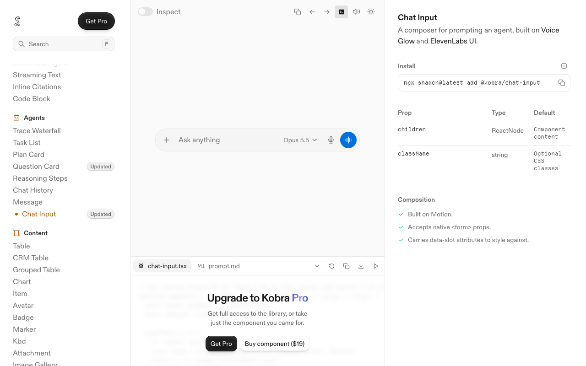
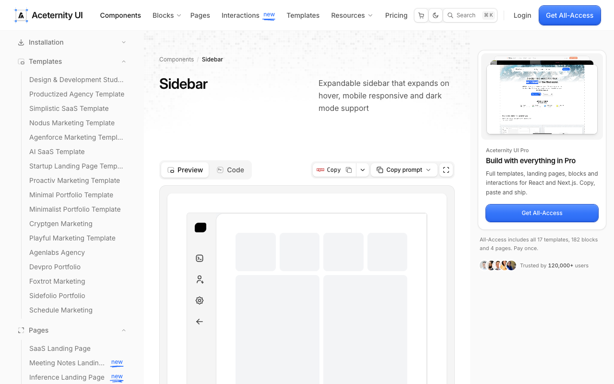

# EGO 与 Kaze 浏览器参照分析

观察日期：2026-11-02
用途：指导 Corvid 的日常浏览器、内置 Agent 与外部 BrowserMCP 组合路线。
对应战略：[统一桌面体验设计](../architecture/ui-experience.md)；对应执行板：[D21 统一浏览器与 Agent 桌面体验](../execution/feature-board.md#d21-部分)。

## 产品结论

Corvid 以 EGO 的人用日常浏览器为主产品模式：用户拥有正常的浏览器窗口、标签和 Spaces，Agent 在隔离工作区并行协作。Kaze 参照补足内置 Pi Agent 的可见任务流程、持续任务状态、Browser/Agent 工作区，以及面向外部 Agent 的 BrowserMCP 操作入口。Corvid 需要将这些能力放进统一 Profile、Room、Page、页面上下文同意和用户控制权合同；品牌和界面由 Corvid 自己设计。

这个方向不等于 EGO 与 Kaze 的功能已被逐项验证，也不把各自的浏览器实现视为可复用源码。闭源应用的未观察行为保持未知。

## 证据及范围

| 来源 | 观察到的事实 | 证据类型与范围 | 限制 |
| --- | --- | --- | --- |
| 已安装 EGO：`/Applications/ego lite.app`，版本 `0.6.2.5` / build `6.2.5` | REA 原生窗口截图显示标准浏览器布局：顶部标签、地址/搜索栏、书签栏、Google 新标签页；无障碍树中可见创建/打开 Space 的入口。 | 2026-11-02 REA `observe_native_ui` Evidence `ev_3a5609d1eb705ccdf3c5071061a8a6b7aafa5a604f570f210b9c81a8a5c86e5e`，窗口 18761、截图 1450×833、SHA-256 `f00222e8f5d4d97b6c77538ed42ba551794231557039d2d41cad56c8543c6a9e`；对照 EGO skill 的页面/Space API 说明。 | 仅观察一个已打开窗口；AX 快照含网站区域但研究记录不保留个人页面内容。可见入口不证明后台 Agent 隔离、权限和故障恢复。 |
| EGO REA：Evidence `ev_2427a886de292400f519650617741446c0908b99f864b8d8fb04dcb679b1336b` | 已检查应用目录 2,574 个条目；探测 70 个文件、读取 5,076 字节；扫描中未识别出 Electron/runtime candidate。 | `inspect_desktop_application`；目录摘要身份 SHA-256 `422aa7e21004305c40278981ea4c2f909b4297d03b20e7df418bde07cafdcefd`。 | 该摘要只覆盖所检查的路径、元数据和读取范围；REA 明确指出运行时行为、未读字节和构建对应关系未知。此扫描不能解释完整浏览器实现。 |
| EGO 开源仓库 [`citrolabs/ego-lite`](https://github.com/citrolabs/ego-lite/tree/12407167f84a58af24044f072868051952131491)，commit `12407167f84a58af24044f072868051952131491` | 仓库说明其交付物是 `ego-browser` Agent harness/技能接口；可见接口围绕共享浏览器会话、Space、页面句柄与 Agent 操作。 | 仓库 README 与 `AGENTS.md`；源码仓库状态为 `main...origin/main`。 | 该仓库不是 EGO 完整桌面浏览器本体；接口文档或 harness 行为不能证明未公开应用内部实现。 |
| 已安装 Kaze：`/Applications/Kaze.app`，版本 `0.26.0` / build `0.26.0` | REA 原生窗口截图和 AX 树显示左侧 Browser/Skills/Scheduled/Activity 导航、Space 选择、Space 标签列表与设置；网站仍占据主画布。另一次只读截图复核到顶端浏览器栏、紧凑纵向侧栏与占据主体宽度的网站画布。 | 2026-11-02 REA `observe_native_ui` Evidence `ev_3c3ee4f92ab10275d5eaae96a797c818258f403328128bf9ee16d740bbdb9067`，窗口 46150、截图 1440×851、SHA-256 `58042b2f78e4d2c1a43c3cadccb1cf6b4bb529516735362359ab6a128ac03425`；截图复核 Evidence `ev_fdb1ec28706c6b2401549b230199346e86c42a50c2e12ce04b0a06f7073563b3`，同窗口、截图 1440×851、SHA-256 `54a5bf46c65830d1e531f3fb79a7b461e004b993051a55cf51b8b32ae46009ad`。 | 只观察一个当前窗口；最近截图仅截图、不含 AX 节点，显示网站画面但本记录只采用布局信息。AX/截图含私人网站区域，研究记录不保留页面内容。可见入口不证明所有状态下行为。 |
| Kaze Agent 面板模型选择：同一已安装版本、当前运行窗口 | REA 原生截图显示右侧常驻 Agent 面板；输入区上方可见当前模型“DeepSeek V4.1 Flash”，输入提示支持“Ask about this page — @ for tabs, / for skills”。这为 Corvid 提供“模型选择紧邻 Agent 输入”的交互参照。 | 2026-11-02 `observe_native_ui` Evidence `ev_ae7cc8d9bebb43705bcdbb47eb75fc571bdd0ddc99e2c1d199e2d0cb80f6dcb7`，窗口 46150、截图 1440×851。 | 本轮只观察截图；没有读取该下拉项、展开模型列表、进入授权/设置流程或发送 Agent 请求，不能据此推断 Kaze 支持的 provider、登录方式、模型持久化或请求时行为。 |
| Kaze REA 包分析 | 已安装 `app.asar` SHA-256 `c168a2ef9b3586a9de0965972ec82bebb9391fa68dfbf876e4b7c173ce6682d4`。精确选择 `out/main/agent.js` 与 `out/preload/shell.cjs` 后，REA 发现静态引用 `@earendil-works/pi-coding-agent`（本图谱标记 unavailable），Preload 有 `browserAction.update` 事件监听与动态 `kaze` bridge 声明。 | 入口/Preload 选择分析父 Evidence `ev_0107a3a03ec7fa62018621015fae94f3ea74df50b36a291387717e28da7f8333`；精确查询视图 Evidence `ev_7c1d6b6f18501ac3989aeeb0d6999371eab92b8895605f53b07ba80042618f82`。另有 BrowserMCP adapter SDK 小范围 Evidence `ev_d7e6ba8a3a19e4de954ce6ec1eabcaf991118eb6e4ce28c5ca76ef0b1f0f9dee`。 | REA 记录 5 个 unpacked 原生文件完整性矛盾并标为 observed-untrusted。选择分析只覆盖 2 个源码文件，14,852 个其他文件未分析；图谱/语义节点与 unknowns 有截断；JavaScript 未执行，不能证明运行时加载、可达性、权限效果或授权执行。 |
| Kaze 开源仓库 [`jackwener/Kaze`](https://github.com/jackwener/Kaze/tree/ddd85ed3fb4a492438df7cc27e04a800c82bbcfd)，commit `ddd85ed3fb4a492438df7cc27e04a800c82bbcfd` | README 声称内置 Agent 可选模型端点、任务拥有独立标签组织、用户可接管，并能从设置连接外部 Agent/MCP；还将 BrowserMCP 描述为操作已登录浏览器、带 JavaScript 工作区与可复用网站适配器的开源 MCP 服务。 | 仓库 README/README.zh-CN.md 与安装包模块清单。 | README 是产品方公开说明，不等同于独立端到端验证；本次没有操作已登录网站或连接真实 MCP host。 |

## 2026-11-02 当前安装版本窗口复核

本轮复核了两款已安装浏览器的真实窗口。版本来自各自已安装应用包的 `CFBundleShortVersionString`；可见界面来自当前窗口，不把当前页面状态解释为全部产品行为。

| 产品 | 本轮现场观察 | REA Evidence 与额外观察 | 限制 |
| --- | --- | --- | --- |
| EGO lite `0.6.2.5` | 当前窗口是 Google 新标签页；顶部保留多标签，下面是地址/搜索栏和书签栏，主画布仍是普通网页。底部无障碍树可见创建 Space、选择 Profile、打开 Space 的入口。 | 当前截图由桌面无障碍读取，窗口 18761，画面 2880×1696（Retina）；项目此前的 REA `observe_native_ui` 记录见 Evidence `ev_3a5609d1eb705ccdf3c5071061a8a6b7aafa5a604f570f210b9c81a8a5c86e5e`。本轮对同窗口调用 REA 时，系统窗口几何未匹配到 AX window，未产生新的 REA Evidence。 | 当前可见的多个标签含登录页、网站错误和新标签页；它们是此用户窗口的瞬时状态，不作为 EGO 稳定功能证据。上一条 REA 截图与当前桌面截图可支持浏览器布局；本轮不能据此核实 Agent 是否正在后台运行或 Space 隔离实现。 |
| Kaze `0.26.0` | 当前窗口的左侧栏分成 Browser、Skills、Scheduled、Activity；侧栏中有 Personal Space、该 Space 的标签列表和新建 Space 入口。主区域独立显示地址栏及网站画布，工具栏有下载、书签、扩展、更多和 Show agent 入口。 | REA `observe_native_ui` Evidence `ev_ff99b513f1812a97433d873a916b24cd302c814e8828d4950013c9e4e306422d`；窗口 46150，截图 1440×851，SHA-256 `ab893b400776d262e4dda9385cbade9df45a544672c5a883a3bdf9ac6b8e3b6b`，应用 SHA-256 `540cc257fb5f0657e22bcc5a9d55887b0e92c7db0d619f02da2053887cddf531`。无障碍树确认上述导航、标签、地址栏与 Agent 入口。 | 当前只观察到 Personal Space 中一个 X 标签。Agent 面板没有在这次截图中展开；REA 后续窗口匹配失败，桌面点击也未成功，因此本轮不对 Agent 工作区内部任务状态与操作流程作运行时判断。早先的 REA 窗口观察与 Kaze 包分析仍按原范围引用。 |

### 对 Corvid 的界面取舍

- 日常浏览的第一视觉层按 EGO 处理：熟悉的标签、地址/搜索、书签和网页画布必须一直像一个完整浏览器，首次打开也应落在可浏览的页面。
- Space 与 Agent 协作信息吸收 Kaze 的持久分区和常驻入口；Corvid 应把 Room/Profile/标签关系讲清楚，并让 Pi 任务有稳定、可恢复的工作区，而不是让工具导航占掉浏览画布。
- EGO 提供主产品的浏览器形态，Kaze 提供 Agent 导航和任务组织的参照；这是一项基于当前窗口布局、现有研究与 Corvid 合同的产品判断，不代表本轮已验证 Kaze Agent 内部流程或 EGO 后台隔离实现。
- 下一轮 D21 的失败/等待 UI 需分别呈现 Agent 运行状态、页面/Room 上下文和用户控制权；“等待用户”不能被画成任务失败，“失败”应提供可理解原因与针对性恢复动作。继续保持该项为部分，直到键盘、窄屏和真实 Provider 边界补齐。

## REA 特别限制

- Kaze 完整 `app.asar` 第一次分析返回 resource constraint：父结果预算耗尽于第三方语言包文件，剩余源文件未分析。保留的完整包级 Evidence 是 partial，不能用来声称整包无某种功能。
- 后续改为精确入口路径选择，避免再次展开整个依赖树。Kaze 包存在 5 个 unpacked native 文件的完整性差异，均被 REA 记录为 observed-untrusted；其中包括带 Developer ID 签名的 Pi TUI native 文件。差异会限制该 native 文件的来源判断，不影响将其他 JS 文件内容直接等同为运行时证明。
- REA 对 EGO 安装目录未识别出可分析运行时组件；这是扫描结果，不是“没有 Agent”或“没有功能”的证据。产品层判断继续以现场 UI 与公开 harness 合同为限。
- 所有静态图谱只说明包内可见语法、模块引用与候选关系；它们不证明代码已加载、调用可达、权限已实施或行为稳定。

## 对 Corvid 的产品映射

| 方向 | 参照启发 | Corvid 当前事实 | 发展要求 |
| --- | --- | --- | --- |
| 日常浏览器主体验 | EGO：普通浏览、标签、Spaces 与 Agent 同处一个浏览器产品。 | Corvid 已有 WebContentsView、Profiles、Rooms、标签、历史/书签/下载和 Chrome 导入。 | 优先完成地址栏、标签、Space/Room、常用日常入口的统一交互；Agent 面板与任务不能替代浏览器主画布。 |
| 内置 Agent | Kaze：可见 Agent 工作区、任务状态和用户接管入口；EGO 的可见 Space 结构提供共享上下文方向。 | Corvid 使用 Pi SDK，已有页面上下文预览与显式同意、Pi transcript、多轮续聊及接管暂停合同。Pi 工作台现将任务历史独立滚动，并把任务输入/页面上下文确认区固定在底部；长历史刷新保留阅读位置。 | 把每个任务的目标、执行状态、页面/运行时和控制权清晰分行呈现；继续补空态、失败恢复、键盘、窄窗与真实 provider 边界。 |
| 外部 Agent/MCP | Kaze UI 提供 Agent 工作区入口；BrowserMCP 源码展示 tab observe/act、清理和站点 adapter 工具形状；EGO harness 提供外部 Agent 共用浏览器会话的参照。 | `mcp/corvid.mjs` 已提供显式 Room/Tab 的发现、快照、HTTP(S) 导航、click/fill/press；本地 E2E 验证写入后页面状态及用户接管时拒绝。 | 页面上下文同意、风险复核 UI、暂停/恢复、MCP host 配置和 adapter 仍需后续实现；不开放任意 `evaluate`/CDP。 |
| 迁移与日常入口 | EGO/Kaze 都将迁移引导作为浏览器产品能力的一部分。 | Corvid Chrome 书签/历史/Cookie/扩展导入已有隔离 E2E，原生钥匙串等仍未验证。 | 按 D13 持续完成真实系统授权、错误恢复、打包及 Windows 边界；不将合成 Profile 测试写成真实 Chrome 认证。 |

## 本轮取舍

本轮已将 D20 从只读 MCP 扩展到四个显式 Room/Tab 绑定的常用动作：HTTP(S) 导航、单一定位器点击、文本输入与按键；统一检查 Agent 控制、无待接管、无执行风险和 managed tab，并由主进程再次校验。REA 比较用于界定 EGO 日常浏览、Kaze 导航与任务入口及 BrowserMCP 工具形状；Corvid 行为以本地 Electron E2E 为准。仍不暴露任意 `evaluate`/CDP、tab 创建/关闭、文件上传或控制权转移。详见[执行任务板](../execution/feature-board.md#d20-部分)和[验证记录](../reviews/verification-log.md)。

## 2026-11-03 11:37 扩展弹窗执行状态与首发双语合同同步

本次仅同步两个已有切面，不重新扫描竞品包。**Corvid 静态证据：** 当前主分支 `docs/execution/feature-board.md` 的 D14 原记录仍称扩展工具栏弹窗未集成；应用语言硬编码与本地化缺失则由 `desktop/index.html` 等源码检索记录。D14 已按中文 PR [#131](https://github.com/heyallencao/corvid/pull/131) 更新为“部分”：PR 记录了真实 Electron 与隔离合成 Chrome Profile/扩展 E2E，覆盖 MV3 弹窗内容、尺寸、所属 Session、sandbox/Node 边界、Escape/外点关闭与焦点恢复；MV2、弹窗导航失败、屏幕阅读器、暗色/窄窗及 Windows/Linux 仍未验收。截图现位于 main 的 QA 目录，由合成 fixture 生成、不含用户页面数据；截图是辅助布局证据，不证明未覆盖的平台或扩展兼容性。

**REA 参考与限制：** PR #131 复用 Kobra 下拉菜单页面 `https://kobra.systems/components/dropdown-menu` 的 REA Evidence `ev_3edcac9a9d467a934c1bdadc8ef6aa20155315eb1f93278088e0a98d4ac5a54c`。直接记录仅证明该路由可访问；没有完成菜单交互，焦点、关闭与状态行为未知，因此只作为细节灵感来源，不作为扩展弹窗行为证据或验收标准。未复制代码、图标或素材。Rare UI、EasyUI、Pin UI、Aceternity 本次未观察；EGO/Kaze 当前窗口 UI 也未重新采集，不能据此推断其当前扩展行为。

**双语合同与取舍：** 已有开放中文 Issue [#130](https://github.com/heyallencao/corvid/issues/130) 覆盖首发 `zh-CN`/`en`、locale 资源、语言选择、日期/数字格式化、窄窗与无障碍验收，本轮只将该范围同步到架构文档及执行板 D24，不重复开单。UI 灵感站点不决定 Corvid 功能需求；仅在能安全核实且与切面相关时参考细节。未运行测试；本次文档检查不声称验证代码行为。

## 2026-11-03 浏览身份删除范围参考

观察时间：2026-11-03 约 22:50（Asia/Shanghai）。使用 REA `capture_browser_scenario` 启动隔离的 Chromium 156.0.8078.79 临时配置，读取厂商公开帮助页的 DOM 与可访问性树；未连接当前用户的 EGO、Kaze、Chrome 或 Safari 窗口，也没有登录或改动用户数据。以下“直接观察”指在隔离 Chromium 中实际加载到的官方帮助页内容，不等于对 Chrome/Safari 原生界面的交互验证。

| 产品/页面 | 直接观察 | 证据与限制 |
| --- | --- | --- |
| Google Chrome，“Manage Chrome with multiple profiles” | 官方流程先进入 Profile 菜单下的“Manage Chrome profiles”，选中身份后从 More 菜单选择 Delete，再二次确认。帮助页明确列出被删除的书签、历史、密码和其他设置。身份管理集中在 Profile 管理流程内，最终确认前说明数据影响。 | REA controlled replay Evidence `ev_030a3fa846bf1e55eb2d59ebda668384a07c40fac4ae003df523927da1747a99`，Chromium 156.0.8078.79；页面地址最终落在 `https://support.google.com/chrome/answer/2364824?hl=en&open_embed_dialog=1&start_dialog_maximized=1&ai1hc=1`。直接证据是官方文档 DOM/AX，不是 Chrome 原生 Profile picker 的实测。页面表述的删除范围不能证明浏览器缓存、扩展文件或系统下载目录的内部清理实现。 |
| Apple Safari，“Create distinct browsing profiles in Safari on Mac” | 官方指南说明始终存在 Personal (Default)；删除身份会清除该身份的 tabs、history、website data，并关闭其打开的所有网站；收藏夹目录会保留（除非为空）。指南还说明 iCloud Keychain 保存的密码在不同身份中可用，因此 Safari Profile 不等于密码凭据完全隔离。 | REA controlled replay Evidence `ev_97475b45ef50f6216275e5a422ca3577d94f6bc9c09ffe0158cb93f185022e73`，页面从请求地址重定向到 `https://support.apple.com/guide/safari/create-profiles-ibrwf3a9e7d6/mac`。直接证据是官方文档 DOM/AX；未操作 macOS Safari 设置或实际删除 Profile。 |

**设计推断：** Corvid 的删除确认应在最后一步用短清单说清即将移除的浏览资料库、站点存储、身份设置、管理扩展与 Agent 对话/恢复数据，并单独说明已下载到磁盘的文件会保留；不能将“Profile 隔离”表述成第三方密码管理器或系统 Keychain 的隔离保证。Chrome/Safari 会直接删除身份，Safari 会关闭其窗口；Corvid 的 Room、任务与跨窗口状态会形成额外引用，不能直接沿用“点 Delete 后自动关窗”的简化流程。为避免悄悄丢失用户/Agent 工作，删除时应列出仍引用此身份的窗口、空间和可恢复 Agent 任务并阻止操作，先由用户处理这些引用。

**静态证据：** Corvid 当前 Profile 由 `profiles.json` 和 `persist:corvid-profile-${profileId}` session partition 标识；History/Bookmarks/Downloads 与 managed extension records 由独立数据文件持有；Agent task/conversation 和 runtime checkpoint 还分布在 `agent-tasks.json` 与 `agent-sessions/`。这些事实来自 Corvid 当前源代码，不是竞品证据。

**未观察/未知：** 本轮尝试启动独立 Chrome 临时 Profile 并从 REA 原生 UI 观察 Profile picker，但没有取得有效截图或 AX Evidence：Chrome 加载请求后显示为 New Tab；REA `observe_native_ui` 首次因当前 Mach-O target 不匹配拒绝，选中 Chrome 二进制后又因 provider 无法读取该进程 launch time 返回 `capability_unavailable`。临时 Chrome 进程已退出；这次失败没有具名 Evidence ID。未通过 REA 操作 Chrome/Safari 原生 Profile 管理界面；未检查 EGO/Kaze Profile 删除交互；也没有测量窄窗状态、确认对话框视觉层级、键盘操作或删除失败后的恢复行为。由此不对这些行为作竞品结论。视觉交互实现还需按 UI QA 流程在隔离 Corvid 数据目录及小/常规窗口检查。

## 2026-11-03 REA 安装包摘要复核

本轮只复核了已安装应用包身份与结构，没有操作参考产品窗口；版本仍为 EGO `0.6.2.5`、Kaze `0.26.0`。未观察到新的产品差距，不能据此开功能 issue。

| 产品 | REA 证据 | 覆盖与限制 |
| --- | --- | --- |
| EGO lite | `inspect_desktop_application` Evidence `ev_77a743fbacb57f9731216db706bdbdadebfca0fc0bb4e678bd4042d3754ea71a`，摘要 SHA-256 `cdf75393f6f5aa1bf00394ea004d730c75d6ca089c1f3f46520f2fd2f733f696`。 | 本轮上限 500 entries，扫描到上限；检查 11 个文件、读取 726 bytes，目录覆盖为 partial。未发现 Electron candidate 不代表没有运行时或功能。 |
| Kaze | `inspect_desktop_application` Evidence `ev_d67e52dd51cd9e5efc3821d4e13a0e54025b4ca14cfa7fb01fa1128622db506d`，摘要 SHA-256 `8bddc7b03f48171505be02afc8a009dcd0dc603afad5d5716e70cea4cf8a9303`。 | 检查 270/270 entries、28 个文件和 2,572 bytes；发现 `app.asar`，只支持 Electron 容器推断，不证明代码加载或功能可达。 |

后续比较应优先补足参照窗口的运行态 UI/交互观察，或追踪一个具体 Corvid 用户流程；只有发现影响产品主线、并有可观察证据的差距时才更新任务板并提交 issue。没有 REA 运行态证据时，应记录未完成与原因，不用静态扫描代替。

2026-11-03 02:22（Asia/Shanghai）再次复核时，安装版本仍为 EGO `0.6.2.5`、Kaze `0.26.0`。`open_binary` 可选中两个 app 主程序，但 REA 对当前系统窗口编号仍返回 window-mismatch；本轮没有新的 AX/截图证据，运行态比较仍未完成。GitHub 当前开放的 Issue #96 已覆盖 Agent 客户端身份与 Room 授权边界，任务板 D10 也记录了单凭据风险；没有发现需要另开 issue 的新差距。

2026-11-03 02:52（Asia/Shanghai）本轮聚焦 Agent 工作区状态与运行库品牌边界。REA `open_binary` 确认两个已安装主程序 SHA-256 与前轮相同；当前 `CGWindowList` 前台窗口列表未发现 EGO/Kaze 窗口，故没有新运行态观察。Corvid 源码显示导航及任务状态使用 “Corvid Agent”，错误文案会过滤运行库名；GitHub Issue #70 已关闭并有同一验收边界。该源码检查不是运行态验证，本轮没有发现可据此另开 issue 的新差距。

2026-11-03 03:22（Asia/Shanghai）本轮聚焦日常浏览壳与导航。安装版本仍为 EGO `0.6.2.5`、Kaze `0.26.0`，REA `open_binary` 的主程序 SHA-256 未变；两款应用当前均无可观察的运行进程/前台窗口，未生成新的 `observe_native_ui` Evidence。Corvid 源码有标签栏、地址/搜索栏、书签和侧边导航；历史参照证据可作方向参考，但不能据此判定当前 UI 存在差距。本轮未确认需新开 issue 的问题。

2026-11-03 03:52（Asia/Shanghai）本轮关注空间/标签组织。EGO/Kaze 版本及 REA 主程序 SHA-256 仍未变化；应用进程存在，但没有可见窗口，因此无法取得当前 UI/UE 证据。Corvid 当前源码和 D07/D21 已有空间、标签与导航能力记录；历史截图不足以确认新差距，本轮无 issue。

2026-11-03 04:22（Asia/Shanghai）本轮尝试继续复核空间/标签导航。REA `open_binary` 确认 EGO/Kaze 主程序 SHA-256 未变，版本仍分别为 `0.6.2.5` / `0.26.0`；系统全窗口列表仅显示隐藏窗口记录，前台列表没有两款产品窗口，因此没有新的 `observe_native_ui` Evidence。没有新运行态对比或可验证差距，本轮未开 issue。

2026-11-03 04:52（Asia/Shanghai）本轮尝试复核模型/Agent 面板关系。REA 对 EGO 窗口的 `observe_native_ui` 无障碍结果进入了嵌入的 WebArea，无法隔离浏览器 chrome；该次结果不用于产品比较，网页内容不写入项目记录。随后关闭当前 REA 二进制会话，并更新半小时自动化：除非目标是确认无个人内容的安全页面，或工具能可靠排除 WebArea，否则跳过网页窗口 AX/截图并将 UI 观察标记为未完成。当前没有新差距结论或 issue。

2026-11-03 05:52（Asia/Shanghai）本轮关注 Chrome 导入与站点权限。当前 D13/D03 已列出导入类别、Cookie 同意与站点权限边界，相关缺口有既有任务/issue 跟踪；没有发现新问题。REA `open_binary` 确认 EGO/Kaze 主程序身份未变；EGO 有前台窗口但无法确认其 WebArea 不含个人内容，因此按隐私规则跳过 AX/截图，Kaze 当前无前台窗口。运行态比较未完成，本轮不新增 issue。

2026-11-03 06:22（Asia/Shanghai）本轮关注窄窗/键盘/可访问性。REA `open_binary` 确认 EGO/Kaze 主程序 SHA-256 未变，版本仍为 `0.6.2.5` / `0.26.0`；遵守新隐私边界，没有对参考窗口读取 AX 或截图。Corvid 当前实现有标签菜单的键盘操作与焦点恢复，D07/D21 已列出剩余焦点、键盘/辅助技术验收，Issue #16 仍开放跟踪浏览器/Agent UI 打磨。没有足够的当前参照运行态证据支持新 issue，本轮对比未完成。

2026-11-03 06:52（Asia/Shanghai）本轮聚焦 Agent 任务状态、接管与恢复。REA `open_binary` 复核 EGO/Kaze 主程序 SHA-256 未变（分别为 `04b4df5b6aaae624d43d17f126f467e921917c873934336f78a6644ce56005b6` / `540cc257fb5f0657e22bcc5a9d55887b0e92c7db0d619f02da2053887cddf531`）；遵守隐私边界，没有读取参考浏览器网页窗口。Corvid 当前源码区分任务状态、Room 控制状态和执行结果未知；D12/D19 已跟踪剩余状态一致性与恢复验收，Issue #68/#73 已关闭。缺少新参照运行态证据，未发现需另开 issue 的新差距。

## 2026-11-04 01:03（Asia/Shanghai）AI 浏览器产品线与 Dia 更新页 REA 复核

本轮目标是给“EGO 主产品形态 + Kaze Agent 协作”补充行业参照，不把组件站的视觉风格或竞品宣传直接变成 Corvid 需求。

### REA 直接观察

使用 REA `capture_browser_scenario` 在隔离临时 Chromium 中访问 Dia 官方更新页。浏览器版本 `156.0.8078.79`，视口 `1280×900`，英文、浅色、减弱动态效果；没有登录、提交表单或修改账号数据，场景结束后 REA 确认 `terminated-owned-process`。更新索引页截图 Evidence `ev_3838cdc5d33062488a87f2f8201b10c232f23f3f7352d62124a04ec250944675`，PNG SHA-256 `6d8e1672c3e1c6c9bb24d74adc42e03d00efcf046cf7e9314c26eeaa998b277f`，已保存到 [`docs/qa/screenshots/dia-changelog-2026-11-04-1280x900.png`](../qa/screenshots/dia-changelog-2026-11-04-1280x900.png)；同页 DOM/AX Evidence `ev_bb70c337b0588d8d754b1f7cda586b34cdc1dcb6c1575878c8bf067ac8fc050d`；1.55.0 更新页 DOM/AX Evidence `ev_110e0196776c21745a7ca862475f07a474c49ef3a834fc265a67f4431411f107`。本轮页面覆盖完整，截图是官方更新页，不是 Dia 浏览器运行窗口。

**页面直接可见：** Dia 的更新索引以大幅品牌插画和衬线标题作为页首；下方把年份/月份导航放左侧，平台筛选与按日期排列的版本内容放主栏。可访问树把标题、月份、平台、日期、版本、更新标题和更新条目分别暴露为明确结构。此信息组织让用户能按“版本/时间/平台”定位，而不是读一条无序公告流。它是更新站点的信息架构，不能推出浏览器侧栏必须采用相同布局。

### 产品功能的证据分层

- **REA 观察到的事实：** 2026-10-29 的 Dia 1.55.0 页面以结构化条目记录可选的已登录应用连接、Google Chat 集成、Ashby/Dropbox Beta、固定标签组保留、侧栏拖动/双击最大化、悬停预览、滚动准备但不预加载站点内容，以及聊天消息排队、重排、编辑和引导后续回答等主题。页面可访问性树中这些项目按标题与描述成组。Evidence `ev_110e0196776c21745a7ca862475f07a474c49ef3a834fc265a67f4431411f107`；它只证明更新页当时展示了这些条目。
- **厂商公开声明：** Dia 同一更新流还说明聊天加载提示会过渡到工具调用、生成内容可分享为图片/PDF，以及对快捷键、键盘、对比度和长文本对话框的持续修复；这些是 Dia 发布说明，不是本轮对这些功能的实际交互验证。来源：[Dia 官方更新记录](https://www.diabrowser.com/changelog)。
- **厂商公开声明：** Chrome 把 Gemini 放在浏览器侧栏，可读取当前或最多 10 个用户选择的标签上下文；Auto Browse 可按用户要求点击、填表和导航。[Google 官方说明](https://support.google.com/gemini/answer/16283624?hl=en)。Edge 的 Copilot 侧栏提供当前网页/PDF/视频问答；其 Browse with Copilot 文档描述用户明确发起、多步浏览、可暂停/打断、敏感操作前确认及任务标签视觉标记。[Microsoft 官方说明](https://support.microsoft.com/en-us/edge/copilot/using-microsoft-copilot-in-edge-at-work)。
- **厂商公开声明：** Comet 将多个后台 Agent 任务并行运行，并在单一页面处理确认与后续跟进。[Perplexity 官方更新](https://www.perplexity.ai/en-GB/changelog/what-we-shipped-october-3rd)。这能支持“并行任务需要统一的可见队列/确认入口”这一待评估方向，但不证明其任务隔离、安全、稳定性或具体 UI 已被本轮体验。
- **较早的已安装产品 REA 运行态证据：** EGO 的常规标签、地址栏、书签与网页主画布是日常浏览基线；Kaze 的持久导航、Space/标签组织和可打开的 Agent 面板，是任务/Agent 入口参照。版本、窗口和证据范围见本文件 2026-11-02 的安装窗口记录；不把较早快照写成当前版本保证，也不读取用户网页主体来补齐未知流程。

### 对 Corvid 的判断

**产品方向维持不变：** EGO 式“先是一台完整浏览器”应支配默认窗口、标签/地址/书签与网页画布；Agent 是随时可开的协作面板，任务和并行工作按 Space/Room 归属，接入多个模型与 Browser MCP 后仍使用 Corvid 自有产品语义。不要让 Agent 导航、计划列表或促销式新标签页抢走网页主画布。

**可具体迁移的交互原则：**

1. 将聊天提交状态区分为“正在执行”“等待用户”“可继续/已完成”，并在运行中显示动作与阻塞原因；提供暂停/接管和明确的继续入口。Edge 的显式发起、运行标记、随时中断和敏感操作前确认支持这一方向；Corvid 应以自身权限合同与本地夹具验证。
2. 为 Agent 消息建立轻量队列和 steering：任务运行时用户可追加、调整下一条或修改尚未执行的指令；每条待执行消息应能看出顺序和归属。Dia/Comet 的更新说明提示这是成熟 AI 浏览器正在打磨的连续性问题，但 Corvid 先做同 Room 的可恢复顺序队列，不先做一个独立的“后台 Agent 控制台”。
3. 工具活动采用简洁、可展开的时间线：先显示一句正在处理的状态，再显露具体浏览动作/工具结果；长任务保留上下文和错误恢复入口。任务产物的导出与跨应用集成放到有明确目的的动作里，不扩大浏览主窗口的默认信息密度。
4. 把侧栏显隐、窄窗、键盘快捷键、长双语文案、标签预览和标签组作为验收维度。Dia 更新页的可访问树和版本筛选是直接页面证据；竞品反复修复这些边角说明成熟度来自日常细节，不是更多渐变或动画。

**静态项目状态与未知：** 复核最新任务板 D19 与开放 Issue #5 后，现有合同明确了流式进度、接管、恢复及完成后续聊，但没有定义运行中追加、重排或修改待执行消息；这是功能范围缺口候选，不是已证明的运行态故障。该缺口随后由 Issue #180 拆为独立切片；其本轮交互取舍与限制见下节。Issue #16 跟踪整体界面与可访问性打磨。尚未直接操作 Dia、Chrome Gemini、Edge Copilot 或 Comet 的浏览器应用；本轮公开网页捕获和官方说明不证明其实际运行行为、账户限制、模型质量、权限效果或平台覆盖。

## 2026-11-04 Agent 后续消息队列设计复核

### 可用 REA 证据

- **EGO 运行窗口**：REA `observe_native_ui` Evidence `ev_3a5609d1eb705ccdf3c5071061a8a6b7aafa5a604f570f210b9c81a8a5c86e5e`，18761 窗口，截图 1450×833；可见标签、地址/搜索、书签、网页画布及 Space 入口。此证据支撑“浏览器仍是主画布”，不证明 Agent 运行状态或消息队列行为。
- **Kaze 运行窗口与 Agent 面板**：REA Evidence `ev_3c3ee4f92ab10275d5eaae96a797c818258f403328128bf9ee16d740bbdb9067` 显示 Browser/Skills/Scheduled/Activity 导航、Space/标签分区与网页画布；`ev_ae7cc8d9bebb43705bcdbb47eb75fc571bdd0ddc99e2c1d199e2d0cb80f6dcb7` 显示右侧 Agent 面板、模型选择紧邻输入区。证据是单个窗口/截图，未展开 Kaze 队列，也未发送真实 Agent 请求。
- **Kobra Chat History 组件页**：REA 受控 Chromium 在 1024×768 和 1280×800 记录截图、DOM 与可访问性树，Evidence 分别为 `ev_f0bdd424946decdaac56fa07cc3d4d8b4ac6c817e744a955fea8f6f08574e882` 与 `ev_e5e809415d68356fb436392675b4d3034c6860e68446a5c22e0df174c3d49a22`。可见内容支持消息记录与输入区的结构层级；它是组件展示页，不是完整浏览器或真实任务队列流程。较窄视口下的三栏演示布局不作为 Corvid 浏览器模板。

本轮再次尝试用隔离 Chromium 捕获同一 Kobra 页面，但 REA 报告初始导航失败、未取得页面证据，因此没有把这次尝试计作观察结果，也没有重放未改变的请求。REA `doctor --client codex --json` 确认 Codex 注册与 Skill 版本一致；`environment_healthy=false` 来自本机没有 Hopper/Ghidra 等其他分析引擎，不是浏览器捕获成功的证据。本节只采用上列已有 Evidence。

### 对当前队列 UI 的设计决定

**推断**：保留 EGO 的浏览器主画布，沿用 Kaze 的任务/模型入口组织；把后续消息放在原 Corvid Agent 对话卡片中，而不是另建占据浏览主画面的队列中心。消息条目提供可见顺序、编辑、上下移动和移除；运行中只保存消息；当前轮结束后仅允许显式检查新页面、查看快照并同意后发送队首。排队、恢复或重启都不触发自动派发。队列列表独立限高滚动，减少短窗口里长列表挤压对话输入与网页的风险。

这借鉴的是 EGO/Kaze 的浏览器与协作信息层级，以及 Kobra 的聊天记录/输入分区。REA 未观察到上述竞品队列交互的完整运行态；本地实现仍需用确定性 Runtime、真实 Electron、双语和短高窗口验收。不得把组件页或更新说明当作竞品稳定性、权限安全或服务质量结论。

## 2026-11-04 Kaze 已安装包的 REA 静态复核

为补充“EGO 日常浏览器 + Kaze Agent 协作”的证据，本轮用 REA 对当前安装的 `/Applications/Kaze.app/Contents/Resources/app.asar` 做定向分析。包 SHA-256 为 `c168a2ef9b3586a9de0965972ec82bebb9391fa68dfbf876e4b7c173ce6682d4`，与此前记录相同。只选择 `out/main/agent.js` 和 `out/preload/shell.cjs` 两个 JS 文件；REA 总结 Evidence `ev_521b1a7b3a1d30294f91690ead6e99621a0048361cc99db00120799e5b819915`，完整 parent Evidence `ev_d664837cb9fea6eb6a43e2354a610a8852979ad975d25b21303995dcbc8acb53`。后续 retained-evidence 精确查询的 bridge/IPC 视图沿用 parent Evidence。

### 直接观察与静态证据

- **此前运行态观察（历史 Evidence）**：REA 窗口截图 `ev_3c3ee4f92ab10275d5eaae96a797c818258f403328128bf9ee16d740bbdb9067` 可见 Kaze 的 Browser/Skills/Scheduled/Activity 导航、Space/标签分区和网页主画布；截图 `ev_ae7cc8d9bebb43705bcdbb47eb75fc571bdd0ddc99e2c1d199e2d0cb80f6dcb7` 可见 Agent 面板、模型选择器和输入区相邻。它们是有限窗口截图，不证明其他状态下的布局或完整交互。
- **本轮静态结构（REA）**：Preload 在 `shell.cjs` 中声明 `kaze` bridge，静态识别出 `invoke`、`language`、`on`、`pathForFile`、`platform` 五个成员；另有 `browserAction` bridge，但 API 状态为 dynamic，成员无法静态确定。REA 同时识别到 `browserAction.update` 监听，以及 `IPC_PREFIX + channel/event` 等动态 IPC 表达式。该数据只证明所选文件中存在这些静态结构，不能证明 renderer 调用、运行时注册、执行权限或动作效果。
- **覆盖范围/未知**：仅解析 2 个 JS 文件；另有 14,852 个包内文件未做源码分析。REA 报告 5 项 unpacked native 文件完整性矛盾，相关字节按 observed-untrusted 处理；这些差异限制相应 native 文件的来源判断。JavaScript 未执行；Kaze Agent 面板运行态、模型选择行为、授权、失败恢复和 BrowserMCP 执行链仍未知。EGO 本体在此轮未重跑 REA；其闭源运行态判断仍只沿用此前具名窗口 Evidence，不从公开 ego-lite harness 推断桌面内部实现。

### 对 Corvid 的产品判断

运行态证据继续支持“网页画布保持浏览器主角；Space/标签和 Agent 入口可持续找到；模型选择贴近对话输入”的信息层级。静态 Preload 结果只提供一条实现层启发：跨进程能力应由明确、窄范围的 Corvid bridge 暴露，具体浏览动作继续经过 Room/Page、控制权和授权检查；不能把 Kaze 的 bridge 或 IPC 结构视为安全合同，也不能据其静态存在推断某动作真实可用。

本轮没有改变主线或 D21 执行顺序。日常浏览器完整度、任务状态与接管、Corvid Agent 工作台和 BrowserMCP 权限边界已在执行板 D20/D21、Issue #4/#16/#56 追踪；当前没有新的、未跟踪且由直接运行态证据证实的产品缺口，因此不新增 Issue。该分析不替代 Corvid 自身的真实 Electron、双语、键盘/窄窗和本地 fixture 验收。

## 2026-11-04 REA 交互参考补充：Agent 输入与侧栏展示

本次观察时间为 2026-11-04 06:45–06:51（Asia/Shanghai）。使用 REA provider-owned 临时 Chromium 156，在 1280×800、英文、浅色、`reduced_motion=reduce` 环境打开公开组件页；只读取页面可见截图、DOM/无障碍文本和最终 URL。临时浏览器进程已由 provider 清理。没有使用登录态，也没有向页面提交表单或触发写入。

### 直接观察

- **Kobra Chat Input**：REA `capture_browser_scenario` Evidence `ev_996ee85086d0d37ca6f674d30e7fe76884766d21c66af9c8f561d80dd054864d`，页面 `https://kobra.systems/components/chat-input`，截图 SHA-256 `9045547a47a52c28ff743f2e4a388136fef80aa5dc5fc7599f9398703858c8b5`。中心演示区把提示输入、模型名“Opus 5.5”、附件入口、麦克风和语音/发送按钮排在同一条紧凑 Composer 中；左侧是组件目录，右侧是组件用途、安装命令、属性和组合说明。无障碍树也把页面说明为 Agent prompt composer，并列出原生 `<form>` props 与 `data-slot` 说明。该页面的“Opus 5.5”是演示文案；本次没有展开模型菜单、发送消息或验证提交行为。截图：
- **Aceternity Sidebar**：REA `capture_browser_scenario` Evidence `ev_d07c9fc718f1a9794c43b6269b5cc741c9867f20f6614a2665c5c7b6b5fbf4d5`，页面 `https://ui.aceternity.com/components/sidebar`，截图 SHA-256 `54997c19d6d0069162a4c3334d0b567ede2739d2acaa9da78dbdebe252af362e`。页面上方为组件站全局导航，左侧列出模板/区块类别，中间为 Sidebar 预览及 Preview/Code 工具，右侧为产品介绍和升级入口。页内写有 hover 展开、移动端与暗色支持；本次未执行 hover、窄窗重排或主题切换，因此这些仍是站点说明，不是本轮独立行为验证。截图：
- **Rare UI**：REA Evidence `ev_b4c540b1a1a73cff7b33a99944025ae7f01175f4ade0e03375069588b1bfec48`，页面 `https://rareui.com/` 返回 Vercel Security Checkpoint“Failed to verify your browser / Code 21”。截图 SHA-256 `f137318936e9944d88f6ed179692bbe93fcfdfebcdbd662270a64bdb832931bb`。没有取得 Rare UI 组件或交互证据，本节不对其设计作判断。EasyUI 与 Pin UI 本轮未检查。

### 与 EGO、Kaze 及 Corvid 的取舍

- **产品事实沿用已有窗口证据**：EGO 的 REA 窗口记录 `ev_3a5609d1eb705ccdf3c5071061a8b6a7bafa5a604f570f210b9c81a8a5c86e5e` 显示标准浏览器 chrome 与可见 Space 入口；Kaze 的 `ev_3c3ee4f92ab10275d5eaae96a797c818258f403328128bf9ee16d740bbdb9067` 显示 Browser/Skills/Scheduled/Activity 导航、Space/标签组织与网页画布；`ev_ae7cc8d9bebb43705bcdbb47eb75fc571bdd0ddc99e2c1d199e2d0cb80f6dcb7` 显示模型选择器贴近 Agent 输入。以上是 2026-11-02 的有限窗口观察，不是本轮重测，也不证明未观察到的交互。
- **产品判断**：Corvid 的主窗口继续保持 EGO 式日常浏览：网页、标签、地址栏和常用浏览入口占据主要空间；Agent 用可持续找到的并行工作区承载任务、消息、模型选择和用户接管。Kobra 的可复用细节是把当前模型和输入动作放在同一 Composer 附近；Corvid 还要明确页面上下文、授权和运行状态。麦克风、语音发送等演示控件只有在 Corvid 明确支持这些能力时才加入，不从参考组件推导需求。
- **不采用参考站整体布局**：Kobra 的三栏是组件目录、演示区和组件文档；Aceternity 还增加商品推广栏。这些结构服务于组件发现/销售，不适合作为 Corvid 的日常浏览壳。对 Corvid 有用的是职责清楚和选中状态易辨，不是照搬三栏比例、商业入口或组件配色。
- **当前未验证**：本轮没有重新读取 EGO/Kaze 原生窗口，也没有在 Corvid 当前主分支运行相同 viewport 的实机对照。CUA 报告 macOS 仍处于锁屏状态，因此不能把历史 EGO/Kaze 证据写成今日现场复测。模型菜单展开、真实 Agent 消息流程、键盘/读屏、窄窗及暗色表现均需各自的产品运行态验收。

结论与现有 D21、Issue #16 和 Issue #56 一致，本次没有发现新的未跟踪缺口，不另开 Issue。后续 UI 切片按 Corvid 自身流程验收：浏览器画布优先、Agent 状态与输入可达、当前模型及页面来源清楚，且双语、键盘、窄窗和控制权反馈完整。组件页只提供局部交互参考，不构成 Corvid 的视觉规范，也不授权复制代码、图标或素材。

## 2026-11-04 REA 市面浏览器 Agent 入口与上下文控制复核

**问题与时间：** 复核优秀浏览器如何把 AI 放进日常浏览，而不让 Agent 取代浏览器本身。观察时间约 2026-11-04 07:15–07:33（Asia/Shanghai）。Google、Edge、Comet 由 REA 启动隔离 Chromium 156.0.8078.80，英文、UTC、浅色、减少动态效果、无用户登录；窗口尺寸在各 Evidence 中列明。没有访问或导入个人浏览器数据，也没有运行真实模型任务。

### 直接观察

| 产品与页面 | 运行态可见内容与交互 | REA Evidence / 覆盖 |
| --- | --- | --- |
| [Google Gemini in Chrome](https://www.google.com/chrome/ai-innovations/gemini-in-chrome/) | 页面把“始终可用的 AI”、跨标签/Google 产品、自动浏览、可复用 Skills 和选中页面内容后提问分成独立功能块；“功能演示”用可选卡片呈现学习辅助、个性化建议、日历、食谱等场景。REA 实际点击“Create study aids”演示卡后，选中态及主说明同步切换到学习辅助示例，URL 不变。视觉上以白底、居中标题和浏览器示例画面维持聚焦；这是官网演示页，不是 Chrome 内真实 Gemini 对话。 | 页面 AX：ev_e5df2164fd98359a5ada568e5e1080b4293e305c996dbab9548b78b226145501，1280×800。交互及选中态：ev_74d42c34ee53cb5b2495ff42e1aa87017075303251851841ea5de64e6bf424bc，点击 1 个演示标签后 AX 状态完整。截图：ev_8482c9328b31237981f4f2379831a632b2cf0b27a04b11e903c0f20c9d23aabd，1440×900，PNG SHA-256 5141b28f650315d82081130c00548aea2c4a04fd52a4ac92377f7864a7088831。 |
| [Microsoft Copilot in Edge](https://explore.microsoft.com/en-us/edge/copilot) | AX 显示提示输入、语音输入、Vision 入口和 12 个可选任务案例，包括总结标签、整理旅行、跨页比较与从大量标签提炼；页面还分开展示侧栏与 Copilot 新标签页入口、Journeys 浏览连续性，以及用户控制/权限说明。内容证明官网如何展示入口和场景，不证明这些任务在本次已执行。 | REA 受控重放：ev_306a7a03e21eb849e8046e18e52ff833708468ddc70fe637e926304a6b2f7ed4，最终 URL 重定向至 explore.microsoft.com/.../copilot?form=MA13SQ&profile=personal，AX、URL、截图请求均完整；环境 Chromium 156.0.8078.80，1280×800。 |
| [Perplexity Comet](https://www.perplexity.ai/comet) | 页面把研究、构建网页、邮件草稿、学习计划、购物等任务分成使用案例，并将暂停 Assistant 作为其中一个明确例子；首页用编辑式衬线标题、暖色底、抽象大形状和浏览器示意图表达品牌。它是产品介绍页，无法证明运行 Agent 的停止时序、授权边界或任务成功率。 | REA AX：ev_b8d596eb4b3a2c9fd2a6836175d49e4030aa69683cb94dc6f196d0689b448357，1120×780；截图：ev_c698d508ad09a5f3f38bd9ee9d30bf3045728b03d4798a3ae02a48cfc57492c5，1440×900，PNG SHA-256 ae70fa1bdabe10477d5aa5e153b83a7e1fa59254719a8533a11daea5d32bf2ee。较早同主题 Evidence ev_978ad6d2448261d922739156315e035286d5337b6f0fdf2c2194f6e7b318a585 也为隔离无登录受控重放。 |

Google 官方帮助页另说明：Gemini in Chrome 默认使用当前标签内容，桌面端可分享最多 10 个标签；用户可在对话中增删共享标签、弹出/停靠面板、暂停活动并管理权限。Auto Browse 在需要用户帮助时会暂停；功能可用地区、账号与订阅存在限制。此处是[官方帮助文档](https://support.google.com/chrome/answer/16283624?hl=en)的静态说明，不是 REA 对已登录 Chrome 的功能验收；本轮没有用个人账号尝试启用。

**已有 EGO/Kaze 直接运行证据：** EGO ev_3a5609d1eb705ccdf3c5071061a8a6b7aafa5a604f570f210b9c81a8a5c86e5e 显示常规标签/地址栏/书签栏、新标签网页与 Space/Profile 入口；Kaze ev_3c3ee4f92ab10275d5eaae96a797c818258f403328bf9ee16d740bbdb9067 与 ev_fdb1ec28706c6b2401549b230199346e86c42a50c2e12ce04b0a06f7073563b3 显示 Browser/Skills/Scheduled/Activity 导航、Space 标签与网站主画布；ev_ae7cc8d9bebb43705bcdbb47eb75fc571bdd0ddc99e2c1d199e2d0cb80f6dcb7 显示 Kaze Agent 面板中模型选择紧邻输入区。以上是 2026-11-02 的既有 REA 原生窗口快照，只观察单个窗口；AX/截图曾包含网站区域，研究记录不保存其私人内容。EGO/Kaze 可见界面只能证明该窗口当时显示了这些入口，不能证明未观察到的后台隔离、权限和任务恢复语义。Kaze 产品方 README 的 Agent/BrowserMCP 说明仍是厂商声明，不等同真实端到端验收。

### 对 Corvid 的产品判断

1. **浏览器仍是首要入口。** EGO 的可见结构证明用户先获得完整浏览器、标签和空间；Kaze、Edge、Google 展示了 Agent 可以驻留在侧栏或浏览器工作区。Corvid 应保持普通浏览任务无需 Agent 也完整可用，把 Agent 作为随页面可召回的协作能力，而不是用聊天首页替换浏览器。
2. **每条任务都应说明它看了哪些页面。** Edge/Google 都把跨标签能力作为具体场景；Google 帮助文档还区分当前标签默认共享与用户增删标签。Corvid 沿用当前页面显式同意、Room/Profile/Page 绑定合同，在输入区附近展示可检查、可移除的页面上下文；多标签默认行为应由 Corvid 自己按权限与可理解性定义，不照搬对方“最多 10 个”上限。
3. **先给可理解的起步方式，再提供复用。** Edge 的示例任务和 Google 的可切换演示/Skills 说明，支持把常用任务入口放在空态或输入框旁，完成后再允许收藏/复用。Corvid 不需要把 12 个示例都搬进首屏，也不应因演示页视觉而在工作区增加轮播。
4. **任务状态和用户控制需要同一处可见。** Google 官方说明列有暂停活动、管理权限/共享标签；Edge/Comet 页面把“Journeys”或“Pause”作为用户可理解的概念。Corvid 应继续让运行/暂停/等待用户/完成/结果待检查状态与 Room 控制权分开显示；在执行可能改变网站数据的动作前展示范围与确认，提供停止、接管、恢复入口，并在未确认中止时禁止对同一 transcript 续写。执行板 D12/D19、Issue #68、#73 已承接这类合同。
5. **从两类视觉中提炼 Corvid 自己的层级。** Google 的产品页把主体收敛到清楚标题、功能场景和操作入口；Comet 采用更鲜明的衬线字体、暖色表面与品牌图形。两者都能清楚表达产品定位，但不是 Corvid 视觉规范。Corvid 应优先统一浏览器壳、网页画布、Agent 侧栏和列表/设置表面的排版与留白，保留克制的品牌强调；动效和大面积装饰必须服务状态或动作。作为局部补充，沿用 2026-11-03 [Kobra Chat Input](https://kobra.systems/components/chat-input) REA Evidence ev_996ee85086d0d37ca6f674d30e7fe76884766d21c66af9c8f561d80dd054864d 中“模型入口与 Composer 相邻”的结构观察，不复制组件代码或风格。
6. **维持既有路线与执行顺序。** 以上证据强化“EGO 日常浏览器模式 + Kaze Agent/BrowserMCP 能力”的既有战略，并未证明需要新增产品功能或调整 D21 优先级。工作台与消息队列用 D12/D19 和开放 Issue #5/#68/#73 持续验收；整体浏览器壳与 Agent 视觉沿 D21 / Issue #16；设置及日常面板沿 D24 / Issue #165。没有新增 Issue，避免重复现有范围。

**静态、推断与未知边界：** 本节 Google、Edge、Comet 的 REA 证据来自受控 Chromium 访问厂商公开页面，其中只有 Google 演示标签切换由本轮实际点击；未登录对应浏览器应用、未启动真实模型、未检查真实输出、任务中断恢复、站点授权提示或失败状态。Google 功能权限与地区说明取自官方帮助文本；其他页面中的能力描述按厂商展示理解，不作为独立实测结论。对比形成的 Corvid 建议是结合现有路线的产品推断。截图 SHA-256 用于辨认当次图像；原图是第三方网站页面素材，未复制进项目仓库。未运行 Corvid 测试。D21/D12/D19/D24 的范围和验收顺序未改变。

## 2026-11-04 EGO/Kaze 当前窗口壳层抽样

**目标与时间：** 按 Corvid 的 EGO 日常浏览主线与 Kaze 内置 Agent/BrowserMCP 参照，抽查当前安装版的壳层职责。2026-11-04 约 09:43 UTC（Asia/Shanghai 17:43），macOS arm64。当前安装包版本沿用本研究既有 plist 证据：EGO `0.6.2.7`（`ev_507cd8eb2c694747f5bb6613e63103825107e6abd644a6b2f1b21f85ce7a9aa9`），Kaze `0.26.0`（`ev_c50d114fd1fac5818251d6cbb1187482a395b6203c042e51e7237c5774b60545`）。这两条只证明包元数据，不能证明界面行为。

**直接观察：** REA 对已安装 Kaze 主程序（SHA-256 `540cc257fb5f0657e22bcc5a9d55887b0e92c7db0d619f02da2053887cddf531`）的一个现有窗口执行 `observe_native_ui`，Evidence `ev_27e60a98827701239ba12fa76214c34aab8b9bb61222f8d730413e9bb318282c`。有限 AX 树显示 Browser/Skills/Scheduled/Activity 四个工作区入口、Space 与标签列表、新标签、地址/导航/书签/扩展工具，以及 Agent 显示/隐藏入口。既有 Kaze Evidence `ev_ae7cc8d9bebb43705bcdbb47eb75fc571bdd0ddc99e2c1d199e2d0cb80f6dcb7` 记录右侧常驻 Agent 面板、模型选择器与“提及标签”入口；它只观察可见控件，未操作模型或发送请求。

**EGO 证据边界：** 既有 REA Evidence `ev_3a5609d1eb705ccdf3c5071061a8a6b7aafa5a604f570f210b9c81a8a5c86e5e` 是 EGO `0.6.2.5` 的历史窗口观察，显示常规标签/地址/书签/新标签浏览器布局与 Space 入口；它早于当前 `0.6.2.7`，不能当作当前版本界面。本轮没有安全地形成 EGO 当前 UI 的新 REA 记录，因此当前版本的具体界面变化未知。

**设计取舍（推断）：** 观察与既有资料继续支持既定路线：以完整日常浏览壳为 Corvid 的默认落点，Agent/任务工作区作为同一浏览器中的协作层，并让 BrowserMCP 与内置 Agent 共用 Room/Profile/Page、明确页面上下文授权和控制权合同。Kaze 把 Skills、Scheduled、Activity 提升为顶层导航，适合 Agent 管理与任务发现；Corvid 可借鉴其可见任务入口、常驻工作区、模型与上下文控件相邻，但不应因此把用户启动体验改成 Agent 管理台。用户首先打开标签、导航和常用资料，Agent 则从明确选定的页面/空间开始协作。

**限制与未知：** Kaze 本轮仅观察一个窗口和最多 40 个 AX 节点；没有截图、点击、键盘、窗口尺寸变化、错误/空态或运行中任务验证。没有检查 Kaze 的 MCP 行为或实际权限语义，也没有据其可见 Agent 控件推断底层 SDK。EGO 当前版界面未取得新 REA 证据。既有 EGO/Kaze 观察均不证明整套流程稳定或行为完全一致。本轮未读取或记录网页正文/浏览数据；没有创建新 Issue，也不改变 D21 产品方向或交付顺序。

## 2026-11-06 Issue #350 外部 Agent 工具面源码复核

本段是对 Issue #350 及本文件较早 D20 结论的 Corvid 源码复核，不是新的 REA 观察。直接源码证据：`sdk/README.md` 126–130 行公开 page dialog、`setInputFiles` 和 `waitForFileChooser`；`desktop/agent-downloads.cjs` 将下载绑定 tab 与一次性 arm token，保存在 Corvid 临时目录并提供取消/丢弃；`desktop/main.cjs` 的下载监听同时维护常规浏览器下载历史。由此确认旧结论“当前不提供文件上传”已过时：SDK 可以通过本机绝对路径选择文件；该合同没有逐次用户确认，不能据此推断用户已同意上传。

决策：保留现有受管 Page alert/confirm/prompt 应答和桌面用户可见状态；下载限 Page 绑定的一次性等待与临时目录，不开放任意路径；拖拽/通用事件注入不提供；adapter 仅接受人工审查、版本固定、可移除的只读命令，并沿用 Room/Page/接管校验，不引入自学习或页面脚本。文件上传需独立增加逐次明确授权与拒绝/取消用例后才可作为支持能力。本结论反映文档与源码现状，不证明真实 MCP host、辅助技术、跨平台 UI 或真实网站行为。

## 2026-11-06 Issue #347 跨 Room 活动历史源码复核

直接源码证据：`desktop/agent-task-store.cjs` 将任务保存于版本化 `agent-tasks.json`；`desktop/agent-workbench.cjs` 的 `listSummaries(profileId)` 仅为指定 Profile 返回现有任务的 Room ID、脱敏 prompt 摘要、状态与更新时间。移除任务会删掉任务记录及其会话数据；删除浏览身份会清理其任务；关闭 Room 本身保留任务记录。当前没有持久化“Agent 已读页面”事件，也没有可区分“授权/读取上下文”与“已消费页面”的信号。

决策：活动入口作为 Agent 工作区单一视图，按当前浏览身份查询并可按 Room/状态筛选；数据只从现有任务记录派生，不跨 Profile、不复制新历史库。列表不展示页面正文/快照/凭据，仅显示时间、Room、状态和现有脱敏任务摘要；摘要模式清理不承诺识别所有个人信息。记录保留与任务一致：删除任务/浏览身份后消失；Room 已关闭但任务仍在时显示不可跳转状态。先只聚合任务，不把页面上下文授权或快照读取误报为“已读”。此为源码与持久化合同核对，没有观察实际 UI，也未验证 VoiceOver、跨平台、真实模型或 Provider 行为。
